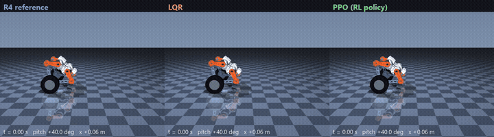
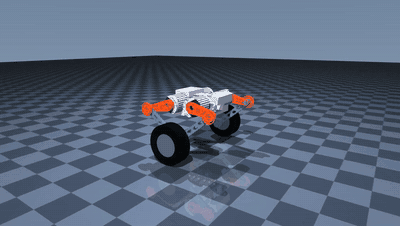
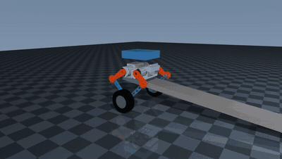
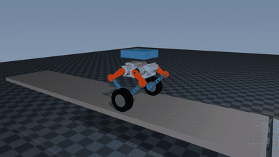
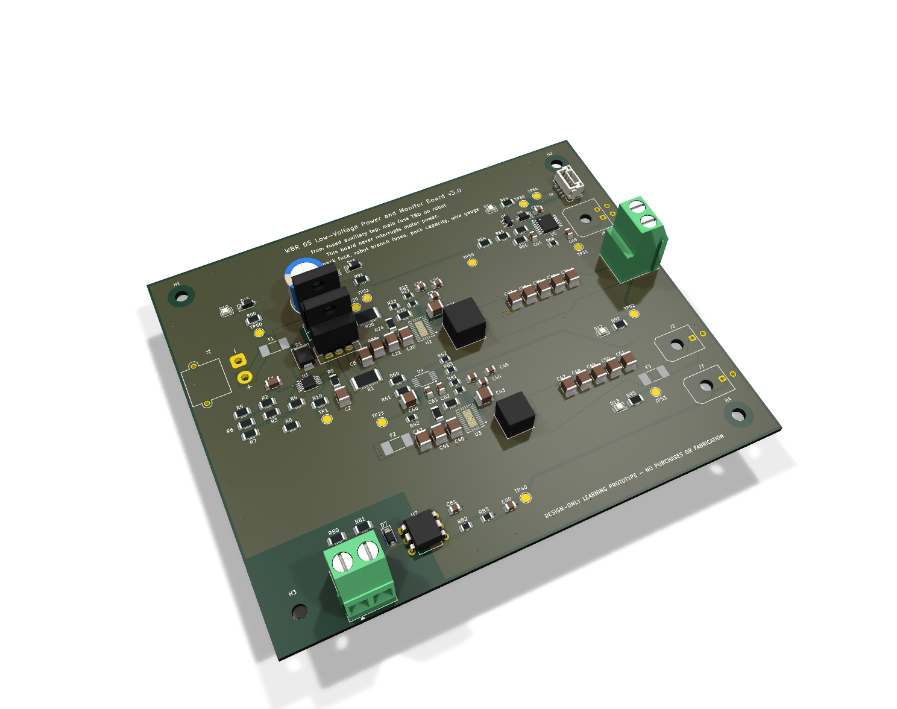
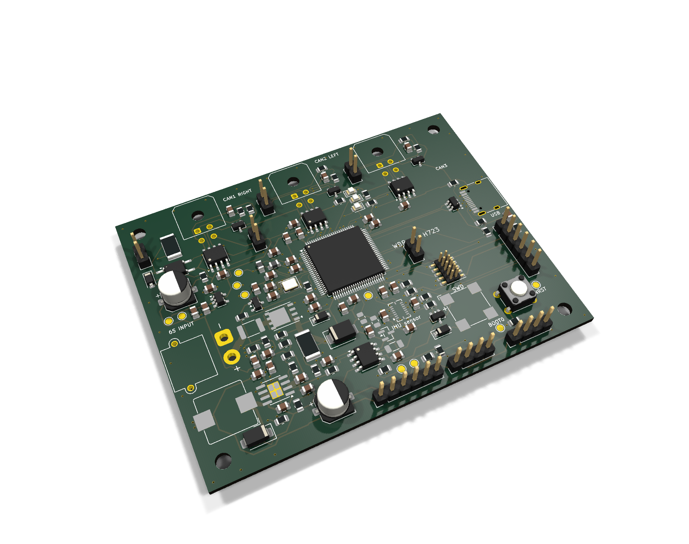
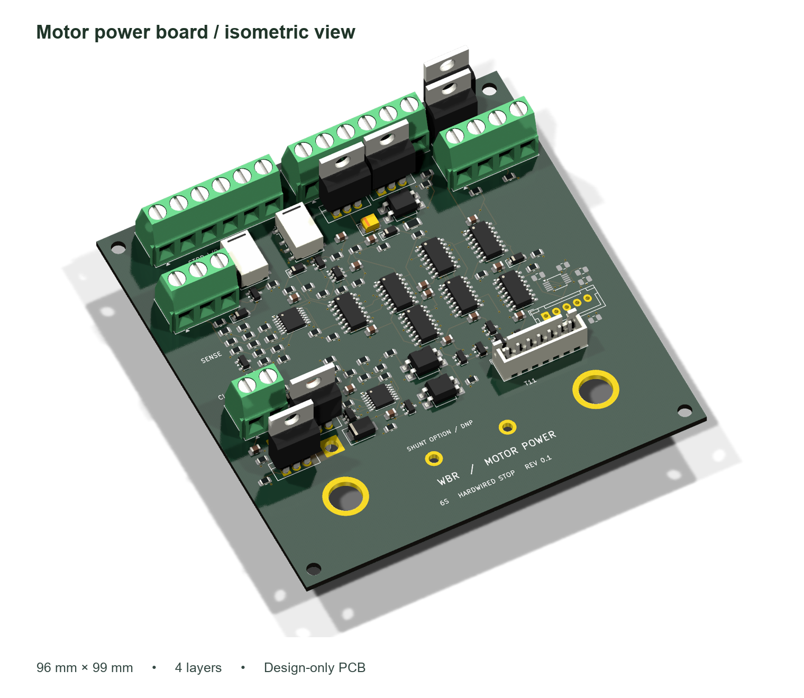
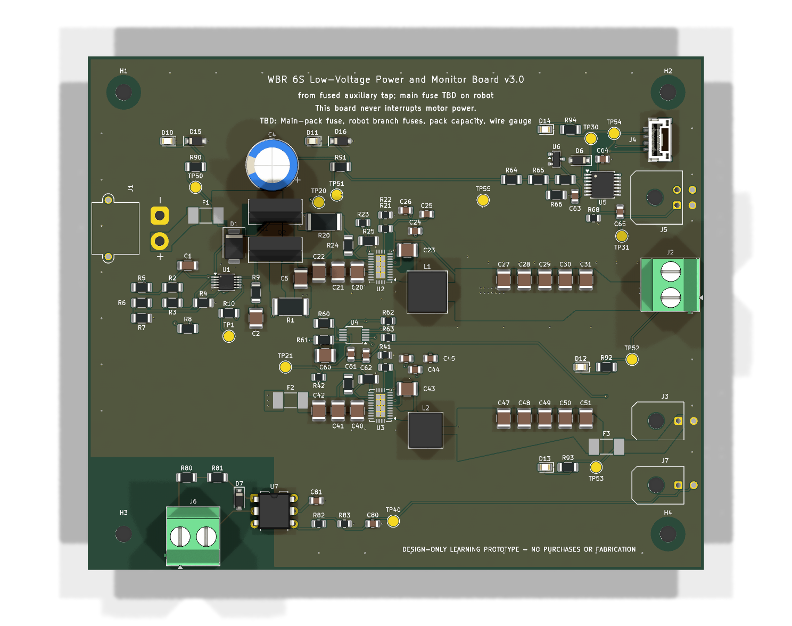
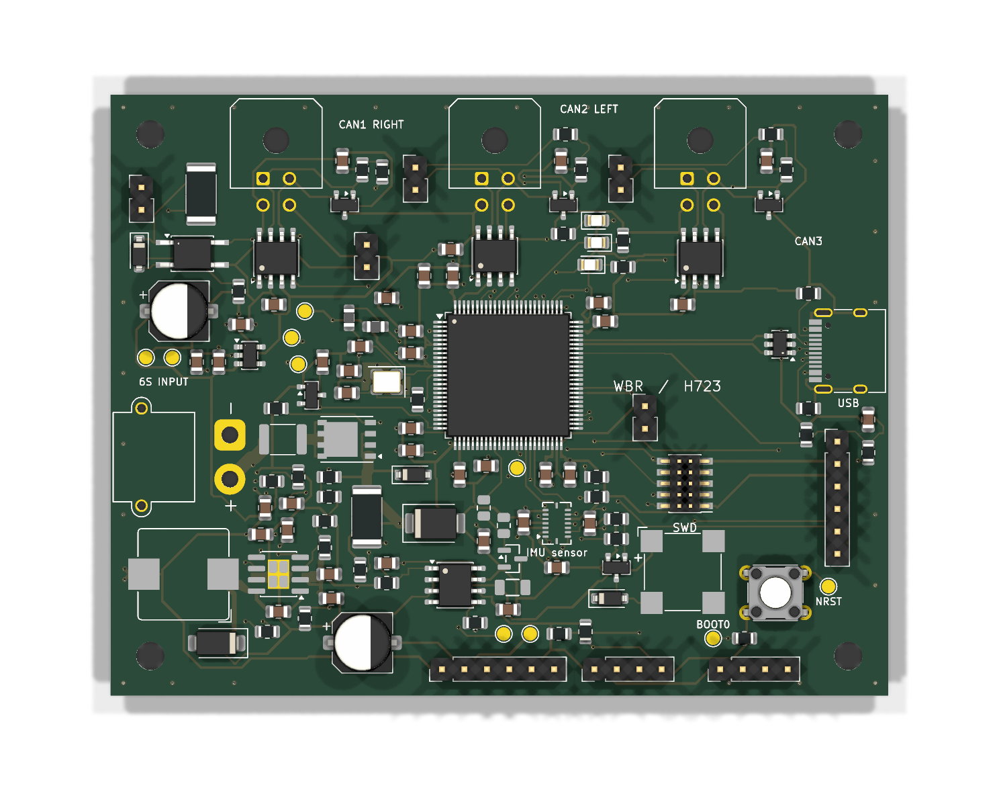
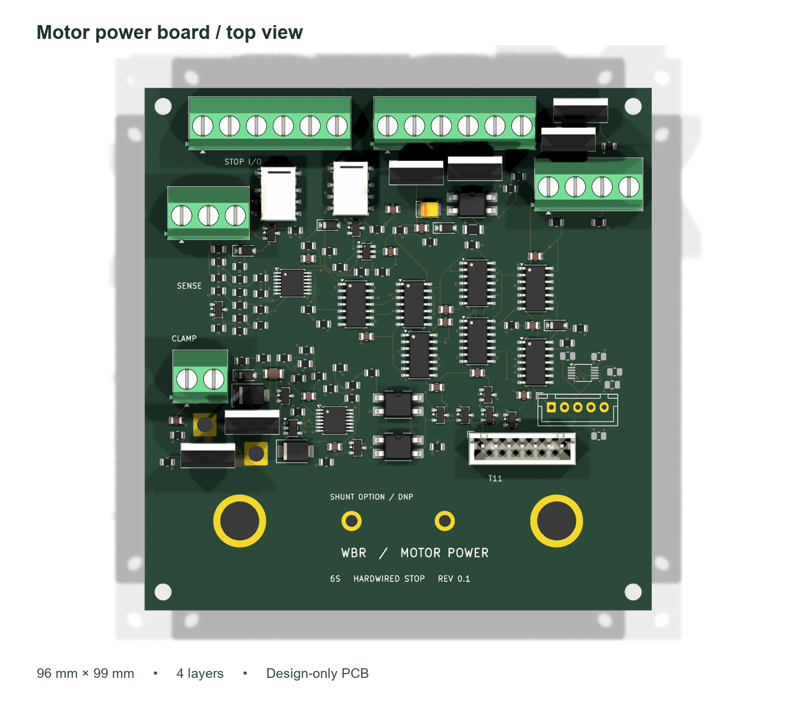

# Wheel-biped simulation

A wheel-legged biped robot built three ways before any motor turns: **MuJoCo** physics, a **MATLAB Simscape Multibody** model, and the robot's own **KiCad 9 electronics**. Two five-bar legs each end in a driven wheel; the robot balances like an inverted pendulum, drives, turns, changes height and jumps.


*Simulation only: the CAD robot at an assumed 8.5 kg clearing an 8 cm obstacle in MuJoCo.*

This project builds on Trần Nguyên Bình's [DM-jump](https://github.com/nguyenbinh-shark/DM-jump) (MIT) and [dmBots/wheel-legged](https://github.com/dmBots/wheel-legged) (MIT). It is a personal refactor and extension: the concept and scenarios come from that work, and the code here was rewritten and reorganized. CAD meshes are not included. AI coding tools were used heavily in building it; the author reviewed and is responsible for all content. See [NOTICE.md](NOTICE.md).

## Simulation

Click any clip for the full MP4. All clips are played back from simulation runs, not footage of a real robot.

<table>
<tr>
<td align="center"><a href="media/m14-simscape-replay.mp4"></a><br>Simscape Multibody: full 16 s mission</td>
<td align="center"><a href="media/ppo-vs-lqr.mp4"></a><br>PPO vs LQR: recovery from a 40° tilt</td>
<td align="center"><a href="media/cad-model-turntable.mp4"></a><br>CAD model in MuJoCo</td>
</tr>
<tr>
<td align="center"><a href="media/cad-stand.mp4"></a><br>Stand and reject a push</td>
<td align="center"><a href="media/cad-drive.mp4"></a><br>Drive</td>
<td align="center"><a href="media/cad-turn.mp4"></a><br>Turn</td>
</tr>
<tr>
<td align="center"><a href="media/cad-leg-height.mp4"></a><br>Change leg height</td>
<td align="center"><a href="media/cad-jump.mp4"></a><br>Jump</td>
<td align="center"><a href="media/cad-obstacle.mp4"></a><br>Clear an 8 cm obstacle</td>
</tr>
<tr>
<td align="center"><a href="media/mass-8.5kg-one-sided-ramp.mp4"></a><br>8.5 kg: one-sided ramp</td>
<td align="center"><a href="media/mass-8.5kg-drop.mp4"></a><br>8.5 kg: 0.245 m drop</td>
<td align="center"><a href="media/cad-obstacle-2ms-falls.mp4"></a><br>2 ms extra delay: the first controller falls</td>
</tr>
</table>

The full clip list, the MATLAB figures and the control story are in [docs/DETAILS.md](docs/DETAILS.md).

## Electronics

Three boards designed in KiCad 9 for a 6S battery (18.0–25.2 V). Design only: not fabricated or powered. Sources, schematic PDFs and check reports: [hardware/](hardware/README.md).

<table>
<tr>
<th>6S power and monitor board</th>
<th>STM32H723 control board</th>
<th>Motor power board</th>
</tr>
<tr>
<td align="center"><a href="media/hardware/power-board-perspective.png"></a></td>
<td align="center"><a href="media/hardware/control-board-perspective.png"></a></td>
<td align="center"><a href="hardware/motor-power-board/motor_power_3d.png"></a></td>
</tr>
<tr>
<td align="center"><a href="media/hardware/power-board-top.png"></a></td>
<td align="center"><a href="media/hardware/control-board-top.png"></a></td>
<td align="center"><a href="hardware/motor-power-board/motor_power_top.png"></a></td>
</tr>
<tr>
<td>Input protection, 5 V buck rails for the Raspberry Pi and auxiliary loads, power monitoring and e-stop status. KiCad 9, ERC/DRC clean.</td>
<td>MCU with three CAN buses to the joint and wheel motors, USB to the Pi and an IMU sensor on SPI. KiCad 9, ERC/DRC clean.</td>
<td>Contactors, precharge, brake chopper and safety latch for the motor bus. KiCad 9, rev 2 schematic ERC clean; views are of the earlier layout.</td>
</tr>
</table>

Renders show archived layouts; the newest power and control revisions are listed in [hardware/README.md](hardware/README.md).

## What's inside

| Area | What it is | Read more |
| --- | --- | --- |
| MuJoCo model | Five-bar kinematics, controller and scenarios with a CPU parity test | [docs/PROJECT.md](docs/PROJECT.md) |
| Simscape model | Multibody robot with contact, six drives on a battery bus and sensor models; 16 s mission, reproducible | [docs/studio/m14-delay-robustness.md](docs/studio/m14-delay-robustness.md) |
| Control and estimation | Delay-aware LQR, gyro-bias estimator, wheel-loss feedforward, safe stop, optional PPO helper | [docs/evidence/README.md](docs/evidence/README.md) |
| Firmware | Portable C firmware with host tests and firmware-in-the-loop runs against MuJoCo | [firmware/README.md](firmware/README.md) |
| Electronics | KiCad 9 sources, schematic PDFs, ERC/DRC reports, BOM | [hardware/README.md](hardware/README.md) |
| Log tools | One telemetry format for simulation and hardware; synthetic log import and identification rehearsal | [docs/studies/log-format.md](docs/studies/log-format.md), [analyses/logsysid](analyses/logsysid/README.md) |
| Perception and SLAM | Dataset-free perception scripts and an RGB-D SLAM launch kit | [perception/README.md](perception/README.md), [slam/README.md](slam/README.md) |
| Studies | Sensitivity, contact, timestep and sim-to-real studies | [docs/studies/](docs/studies/), [sim-to-real checklist](docs/sim-to-real/sim-to-real-checklist.md) |

## Quick start

Use Python with NumPy, SciPy, MuJoCo 3.3.7, and pytest. These commands were run on CPU:

```bash
export PYTHONDONTWRITEBYTECODE=1
python check.py
python -m pytest -q -p no:cacheprovider
python models/generate.py
python scripts/stand.py --seed 0
```

More commands (log tools, log import rehearsal, project layout) are in [docs/DETAILS.md](docs/DETAILS.md).

## Status

Everything here is simulation or design: no board has been built and no motor has been powered. Results and limits, including the failures: [docs/RESULTS.md](docs/RESULTS.md).
