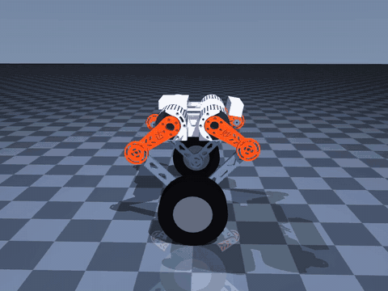
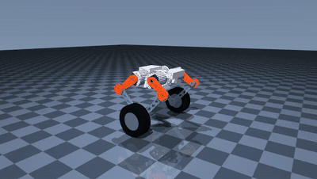
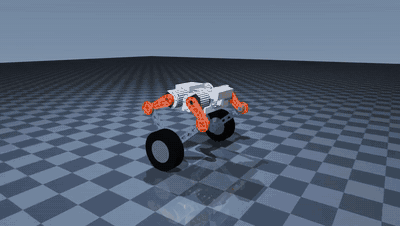
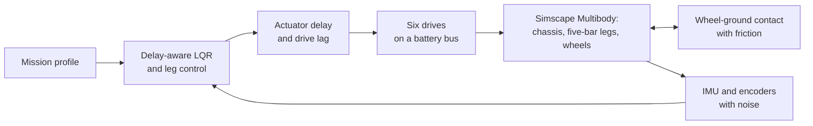
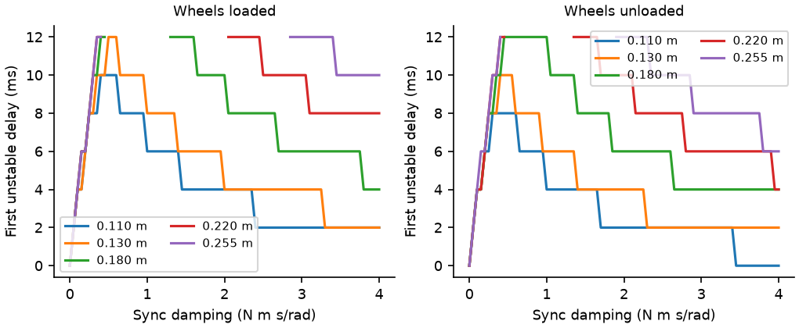
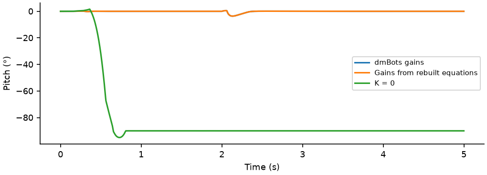
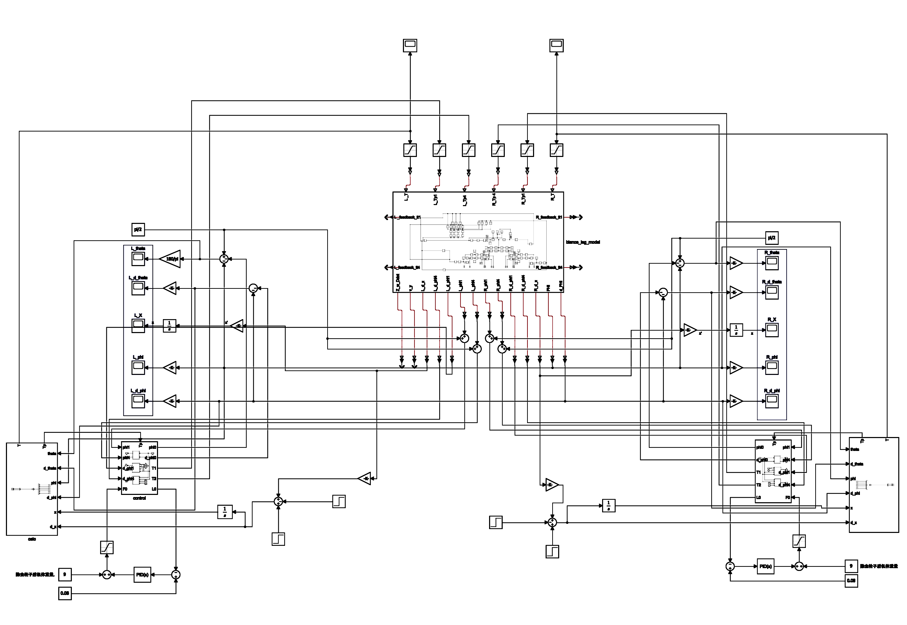
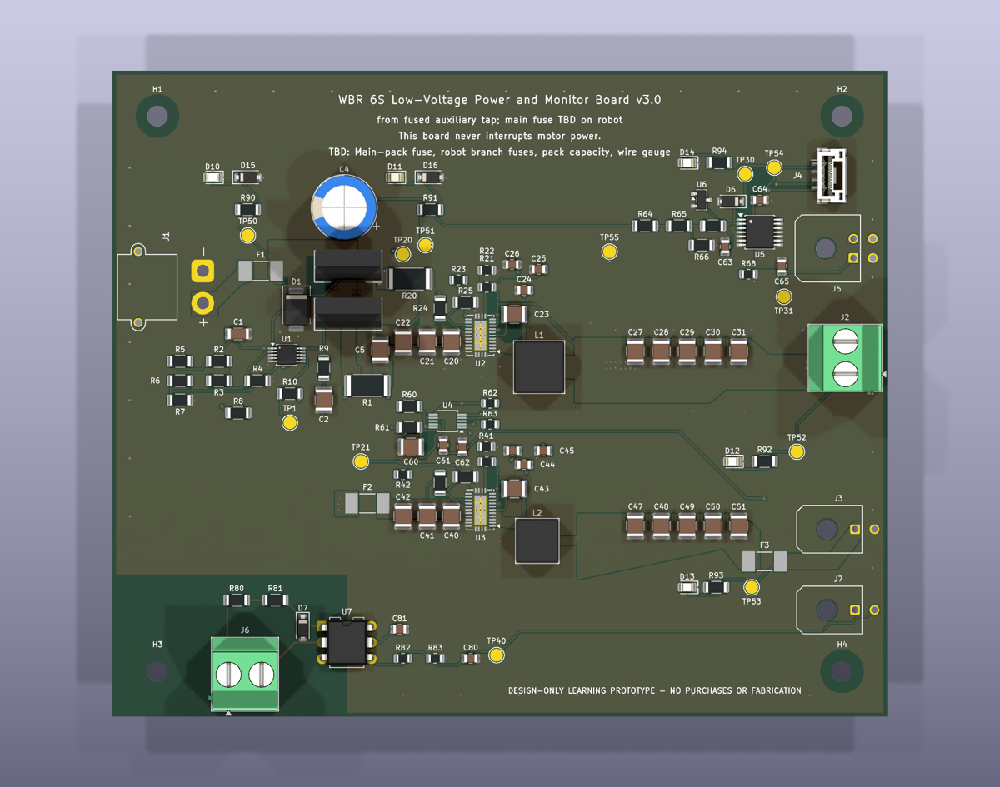
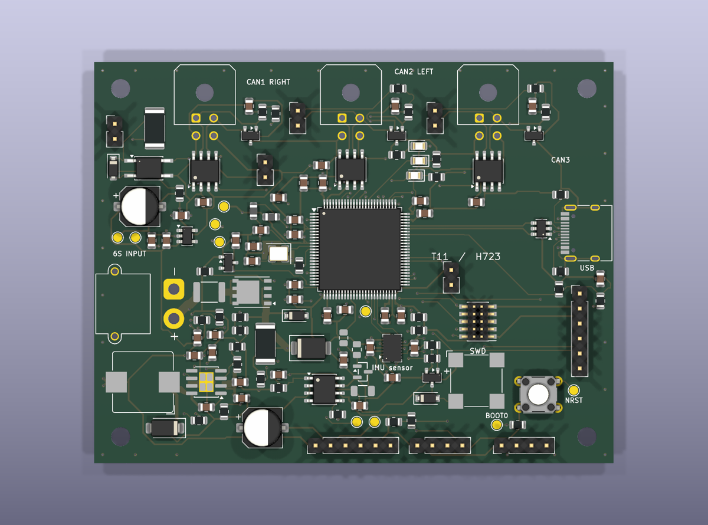
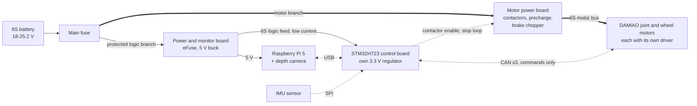

# Wheel-biped simulation

A wheel-legged biped robot built three ways before any motor turns: **MuJoCo** physics, a **MATLAB Simscape Multibody** model, and the robot's own **KiCad 9 electronics**. Two five-bar legs each end in a driven wheel; the robot balances like an inverted pendulum, drives, turns, changes height and jumps.


*Simulation only: the CAD robot at an assumed 8.5 kg clearing an 8 cm obstacle in MuJoCo.*

This project builds on Trần Nguyên Bình's [DM-jump](https://github.com/nguyenbinh-shark/DM-jump) (MIT) and [dmBots/wheel-legged](https://github.com/dmBots/wheel-legged) (MIT). It is a personal refactor and extension: the concept and scenarios come from that work, and the code here was rewritten and reorganized. CAD meshes are not included. AI coding tools were used heavily in building it; the author reviewed and is responsible for all content. See [NOTICE.md](NOTICE.md).

## New in batch 6

- [Study pages](docs/studies/): corrected log units, push-gap controller comparisons, step-climbing and contact sensitivity, plus [published-firmware Monte Carlo results](docs/studies/monte-carlo-published-firmware.md). Results are simulation evidence with their tested assumptions and limits.
- [Firmware-in-the-loop log demo](demo/fil/nominal.jsonl): sample telemetry fixtures store pitch in radians; the [comparison overlay](demo/overlay.png) displays pitch in degrees. The runner and fixture checks are in `demo/fil/` and `tools/log/tests/`.

## New in batch 5

- [Firmware hardware layer for the STM32H723 control board](firmware/README.md#stm32h723-hardware-layer): wired-stop gate, CAN bus mapping for CTRL rev4, watchdog, radio and USB adapters, with host tests. Checked in host tests and simulation only; it has not run on a board ([known issues](docs/known_issues.md)).
- [Log tools](#log-tools): pack firmware-in-the-loop telemetry with the firmware's own C packer, convert framed logs to CSV, and compare two logs.

## New in batch 4

- [Step crossing versus friction and speed](docs/studies/step-crossing-friction-speed.md), [five-bar branch check](docs/studies/five-bar-branch-check.md), and [simulation timestep sensitivity](docs/studies/simulation-timestep-sensitivity.md).
- [30 N push angle definition check](docs/studies/push-angle-definition-check.md) and [traction current sensing design](docs/studies/traction-current-sensing-design.md).

## New in batch 3

- [Sensor noise and Allan variance](docs/studies/imu-noise-and-allan-variance.md) and the [actuator model and identification plan](docs/studies/actuator-model-and-identification.md).
- [AUX buck averaged stability](docs/studies/aux-buck-averaged-stability.md) and [current sensing, ADC settling, and decimation](docs/studies/current-sense-and-decimation.md).
- [Radio link budget](docs/studies/elrs-link-budget.md) and the [sim-to-real checklist](docs/studies/sim-to-real-checklist.md).
- [Motor IDs and commissioning](tools/can/MOTOR_ID_AND_COMMISSIONING.md), [firmware-in-the-loop Monte Carlo](docs/studies/firmware-in-loop-monte-carlo.md), and [published scenario benchmark](docs/studies/published-scenario-benchmark.md).
- [Known issues](docs/known_issues.md).

## Highlights

- **Balances, drives, turns, jumps and clears an 8 cm step** in MuJoCo with the CAD robot, at its CAD mass and at a heavier assumed 8.5 kg ([videos](#videos)).
- **A full Simscape Multibody model** of the robot (legs, wheels, ground contact, six drives on a battery bus, sensors) completes a 16 s mission on every friction and actuator-delay case tested, and reproduces bit for bit in a second clean run ([M14](docs/studio/m14-delay-robustness.md), [M16](docs/studio/m16-reproducibility.md)).
- **A controller built for real delays and real sensors**: delay-aware LQR, an attitude estimator that learns gyro bias, wheel-loss compensation, a learned balance point and a gentle stop when the host computer disconnects ([methods](docs/methods/batch-2.md)).
- **Custom electronics in KiCad 9**: a 6S power and monitor board and an STM32H723 control board, both clean in electrical and design-rule checks ([electronics](#electronics-kicad-9)).

## MuJoCo

The CAD model turning on the spot, then the behaviours it runs. These are MuJoCo renders of meshes exported from SolidWorks.



| | | |
| --- | --- | --- |
| <br>Stand with a push | <br>Drive | <br>Turn |
| <br>Leg height | <br>Jump | <br>8 cm obstacle |
| <br>8.5 kg, one-sided ramp | <br>8.5 kg, 0.245 m drop | <br>2 ms delay: falls |

The last clip is kept on purpose: the first controller fell with just 2 ms of extra delay. Fixing that drove the delay-aware controller below.

## MATLAB and Simscape

The robot rebuilt in Simscape Multibody from the CAD: chassis, five-bar legs and wheels, wheel-ground contact with friction, six drives on a battery bus, IMU and encoder models, and a delay-aware LQR balance controller. It runs a 16 s mission (stand up, drive about 1.5 m, brake, raise and lower the legs, take a push) on every friction and added-delay case tested without falling ([evidence](docs/studio/m14-delay-robustness.md)), and a second clean run in a separate MATLAB process reproduces it exactly ([evidence](docs/studio/m16-reproducibility.md)).

[](media/m14-simscape-replay.mp4)

*Simscape Multibody replay of the full mission, with body pitch, position, bus voltage, pack current and joint torques. [Full-resolution video](media/m14-simscape-replay.mp4).*



<details>
<summary>Earlier MATLAB models</summary>

Before the studio model, the controller was derived and cross-checked on dmBots' Simscape model. Our first Simscape model of the CAD robot did not balance; the studio model above replaces it ([results and limits](docs/RESULTS.md)).


*LQR gains against leg length, from the MATLAB derivation.*


*Closed-loop poles across the gain schedule.*


*Delay and disk margins against leg length.*



*Hip-mode model: first unstable delay against sync damping.*



*dmBots' Simscape model: their gains and the rebuilt gains give overlapping responses.*



*Top level of dmBots' Simulink model (MIT), used for the cross-check.*

</details>

## Control and estimation

The controller grew one real-world problem at a time, each step tested in simulation against the one before ([methods and code](docs/methods/batch-2.md)):

1. **Delay**: the gains are designed on a model that includes the actuator delay, and a predictor makes up the missing samples ([C template](wbr/control/predictor/s5_predictor.h)).
2. **Sensors**: an adaptive complementary filter learns the gyro's pitch bias while the robot stands and while it drives ([C estimator](estimation/s10/s10_estimator.c)).
3. **Wheels**: feedforward for wheel damping and loss ([header](wbr/control/wheel_loss/s7_wheel_loss.h)), and rolling resistance modelled correctly at the contact patch ([model](wbr/sim/rolling.py)).
4. **Losing the host**: if the Raspberry Pi disconnects, the robot latches its position and brakes gently to a stop ([header](wbr/control/stop/s8_stop_position.h)).
5. **Balance point**: a slow trim learns where the centre of mass really is, so the robot settles upright instead of leaning.

Steps 1–4 have C or Python code with tests in this repository. Each study has a short evidence page with its figures and raw CSVs ([evidence index](docs/evidence/README.md)). With every layer switched on, the full stack still falls when two encoder packets are lost in a row ([evidence](docs/evidence/g3-full-stack.md)); a graded packet-loss response is the next step. Paired Monte Carlo trials compare each version with the previous one ([paired-trial scorer](wbr/sim/paired_trials.py)).

## Reinforcement learning (optional helper)


A PPO policy trained in MATLAB and exported to C recovers the 5.1 kg CAD robot from tilts up to ±40° on every case tested, using 13–33% less motor work than LQR. It drifts 10–37 cm before settling, which LQR avoids, so LQR stays the main controller and PPO is an optional helper ([evidence and log](docs/evidence/k1d-ppo.md), [full video](media/ppo-vs-lqr.mp4)).

## Electronics (KiCad 9)

Two learning boards for the robot, designed in KiCad 9 for a 6S battery (18.0–25.2 V). Both are clean in KiCad's electrical (ERC) and design-rule (DRC) checks. They are design-only: not fabricated or powered yet. KiCad sources, schematic PDFs and check reports: [hardware/](hardware/README.md).

| 6S power and monitor board | STM32H723 control board |
| --- | --- |
|  |  |
| Input protection, two 5 V buck rails (Raspberry Pi and auxiliary), an energy monitor and an isolated e-stop status loop. Builds on my earlier **Edge AI Smart Power Module** project (input protection → buck → power monitor → test points). | STM32H723 with three CAN channels for the DAMIAO joint motors, USB to the Raspberry Pi, an IMU sensor on SPI, current sensing for its own supply branch, and its own protected supply. The pin and peripheral map follows DM-jump's `CtrlBoard-H7`. |



*Thick arrows: motor power. Thin arrows: logic power. Dotted arrows: signals. The control board never carries motor current.*

## Results and limits

Everything here is simulation or design. No motors have been powered and no board has been built. Masses, friction, motor limits, sensor noise and delays are assumptions unless a result says otherwise. Each claim links to its evidence; the full table of measured results, including the earlier failures, is in [docs/RESULTS.md](docs/RESULTS.md).

## Videos

Everything below is simulation, played back from saved runs. Nothing here is footage of a real robot.

<details>
<summary>All clips</summary>

### MATLAB studio, Simscape Multibody, 3.62 kg CAD mass

| Clip | What it shows |
| --- | --- |
| [m14-simscape-replay.mp4](media/m14-simscape-replay.mp4) | 16 s mission: stand up, drive about 1.5 m, brake, leg height, push |

### PPO policy against LQR, 5.1 kg CAD model

| Clip | What it shows |
| --- | --- |
| [ppo-vs-lqr.mp4](media/ppo-vs-lqr.mp4) | Recovery from +40°, −40° and +25° tilts by R4, LQR and PPO, with a results card after each |
| [firmware-in-loop-step-and-push.mp4](media/firmware-in-loop-step-and-push.mp4) | The C firmware driving MuJoCo: a 30 N sideways push, a 5 mm step at floor friction 0.38 (falls), the same step with a blocked-drive stop (stops and keeps balancing; not yet in the public firmware), and the step at friction 0.8 (crosses) |

### CAD robot, 3.72 kg model

| Clip | What it shows |
| --- | --- |
| [cad-stand.mp4](media/cad-stand.mp4) | Stand with a push |
| [cad-drive.mp4](media/cad-drive.mp4) | Drive |
| [cad-turn.mp4](media/cad-turn.mp4) | Turn |
| [cad-leg-height.mp4](media/cad-leg-height.mp4) | Leg height |
| [cad-jump.mp4](media/cad-jump.mp4) | Jump |
| [cad-obstacle.mp4](media/cad-obstacle.mp4) | 8 cm obstacle |

### Realistic mass, 8.5 kg model (assumed masses)

| Clip | What it shows |
| --- | --- |
| [mass-8.5kg-obstacle.mp4](media/mass-8.5kg-obstacle.mp4) | 8 cm obstacle |
| [mass-8.5kg-one-sided-ramp.mp4](media/mass-8.5kg-one-sided-ramp.mp4) | One-sided ramp |
| [mass-8.5kg-drop.mp4](media/mass-8.5kg-drop.mp4) | 0.245 m drop |

### Delay

| Clip | What it shows |
| --- | --- |
| [cad-obstacle-2ms-falls.mp4](media/cad-obstacle-2ms-falls.mp4) | 2 ms added delay: falls. Clip stops at the fall |
| [cad-obstacle-2ms-lower-damping.mp4](media/cad-obstacle-2ms-lower-damping.mp4) | One run (seed 5) at 2 ms with lower jump damping: passes. Not yet shown to be a general fix |
| [design-obstacle-6ms-before-after.mp4](media/design-obstacle-6ms-before-after.mp4) | Design model at 6 ms, before and after the fix |
| [design-obstacle-6ms-vs-8ms.mp4](media/design-obstacle-6ms-vs-8ms.mp4) | The same fix at 6 ms and 8 ms: 8 ms still falls |

### Harder scenarios

| Clip | What it shows |
| --- | --- |
| [scenario-one-sided-ramp.mp4](media/scenario-one-sided-ramp.mp4) | One-sided ramp |
| [scenario-ramp-and-drop.mp4](media/scenario-ramp-and-drop.mp4) | Ramp and drop |
| [scenario-opposite-wheel-heights.mp4](media/scenario-opposite-wheel-heights.mp4) | Opposite-phase wheel heights |
| [scenario-yaw-sine.mp4](media/scenario-yaw-sine.mp4) | Yaw sine tracking |

### Simple design model

| Clip | What it shows |
| --- | --- |
| [design-obstacle-rule-before-after.mp4](media/design-obstacle-rule-before-after.mp4) | Obstacle at 1 m/s. Left: before the distance rule, falls. Right: after it, passes |
| [design-jump.mp4](media/design-jump.mp4) | Jump |

</details>

## Quick start

Use Python with NumPy, SciPy, MuJoCo 3.3.7, and pytest. These commands were run on CPU:

```bash
export PYTHONDONTWRITEBYTECODE=1
python check.py
python -m pytest -q -p no:cacheprovider
python models/generate.py
python scripts/stand.py --seed 0
```

These commands were run with Python 3.11, MuJoCo 3.3.7, NumPy, SciPy, and pytest available on CPU. The first command reruns the publish scan and stand and obstacle parity. The scenario command writes CSV and JSON beneath `results/`; it does not create compressed array dumps. To install the package and test runner in a clean environment, use `python -m pip install -e . pytest`.

## Synthetic log import and identification rehearsal

[analyses/logsysid](analyses/logsysid/README.md) contains a standard-library log codec/importer and seeded identification rehearsal. Use Python 3.11+; no MATLAB or additional Python packages are needed for this analysis:

```bash
export PYTHONDONTWRITEBYTECODE=1
(cd analyses/logsysid && python -m unittest discover -s tests -v)
(cd analyses/logsysid && python verify_package.py)
```

The bundled CSV and all recovery results are synthetic/simulation only. They do not show real-robot data import, measured sensor performance, physical motor calibration or hardware acceptance. Hardware applicability is UNKNOWN; contact friction and battery resistance are UNASSESSED. P2 reduced-model screening and its CAD-derived inputs are deferred pending clearance.

## Log tools

[FROM FILE] `tools/log/` reads and writes the firmware's USB telemetry format, so simulation and hardware logs share one schema. Frames are header, payload and CRC-32C, then COBS encoding and a zero delimiter (`firmware/firmware/log_packer.h`, `usb_link.h`); decoding uses the Pi decoder in `pi/link/pi_link/`.

- `sim_writer.py IN.jsonl OUT.bin TRUTH.csv` builds a local shared library from `firmware/firmware/{log_packer,usb_link,cobs,crc32c}.c` and packs per-tick JSONL records into 500 Hz TELEM_FAST and 20 Hz TELEM_HEALTH frames. Simulation truth goes only to the separate CSV, never into the hardware payload. Fields such as `euler_rad` must already be in SI units.
- `convert.py LOG.bin OUT.csv` validates frames, counts CRC rejections and per-message sequence gaps, and writes a CSV.
- `compare_logs.py A.bin B.bin` aligns two logs at their first timestamp, prints per-channel RMSE and peak difference, and writes `demo/overlay.png` (needs NumPy and `ffmpeg`).

```bash
export PYTHONDONTWRITEBYTECODE=1
PYTHONPATH=pi/link:tools/log python -m pytest -q -p no:cacheprovider tools/log/tests
```

`.bin`, generated CSV, `liblogpack.so` and figure outputs are run products; do not commit them. [UNKNOWN] The log rate, loss and throughput on the real USB link have not been measured.

## Project layout

- `wbr/dynamics/`: five-bar kinematics, equations, and model support.
- `wbr/control/`: one controller with configuration options, gain schedule, and jump state machine.
- `wbr/sim/`: MuJoCo scenarios and simulation loop.
- `wbr/analysis/`: saved-trace parity analysis and SVG plotter (`pip install -e '.[plots]'`).
- `models/`: assumed parameter set and primitive MJCF generator. Meshes are intentionally omitted pending license verification.
- `estimation/`: the adaptive attitude estimator in C.
- `matlab/`: derivation, LQR, margins, hip-mode, and Simulink cross-check sources with CSV results. No MATLAB command was run for this refactor. The original Simscape builder depended on the unlicensed CAD mesh set and is not included.
- `perception/`: dataset-free script entry points and notes. No photographs or datasets are included.
- `slam/`: live RGB-D SLAM launch kit and setup notes; hardware execution is unverified.
- `scripts/`: one entry point for each behavior, using a shared result writer.
- `tests/`: CPU parity test and text CSV reference traces.
- `tools/log/`: shared simulation/hardware telemetry log writer, converter and comparator.
- `docs/evidence/`: one page per simulation study, with figures and CSVs.
- `hardware/`: KiCad 9 sources, schematic PDFs and ERC/DRC reports for both boards.
- `media/`: simulation clips (listed under Videos), figures and board renders.
- `docs/`: design notes and CSV summaries of delay and Simscape failures.

Summary CSVs under `docs/` are labeled MEASURED, ASSUMED, or UNKNOWN. Follow the same convention when adding results.


## Hardware, firmware and communication sources

[FROM FILE / COMPUTED] Public copies and verification scope:

- [AUX rev5 and CTRL rev4](docs/evidence/hardware-control-board-revision.md): KiCad sources, regenerated schematic PDFs and ERC/DRC reports.
- [Portable firmware, slices 2–7, and the STM32H723 hardware layer](firmware/README.md): C sources, host tests and FIL fixtures.
- [S11 independent packet-policy fixes](docs/evidence/s11-packet-policy-fix.md).
- [CAN databases and offline tools](tools/can/README.md).
- [Pi USB link](pi/link/README.md).

[FROM FILE / UNKNOWN] Hardware confirmation remains separate from host and simulation results.
