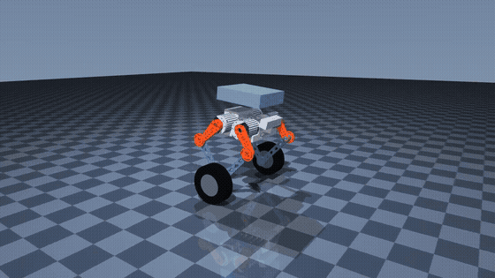

# Wheel-biped simulation

A CPU MuJoCo study of a wheel-biped robot: two driven wheels support a body, and symmetric five-bar legs change body height and absorb impacts.



*Simulation only: the CAD robot at an assumed 8.5 kg clearing an 8 cm obstacle in MuJoCo.*

This project builds on Trần Nguyên Bình's [DM-jump](https://github.com/nguyenbinh-shark/DM-jump) (MIT) and [dmBots/wheel-legged](https://github.com/dmBots/wheel-legged) (MIT). It is a personal refactor: the concept and scenarios come from that work, and the code here was rewritten and reorganized. CAD meshes are not included. AI tools were used heavily in building and refactoring it. See [NOTICE.md](NOTICE.md).

## Results and limits

All results here are simulation results. No motors have been powered. Geometry, inertias, mass distribution, friction, motor limits, sensor noise, and delays are assumptions unless a result says otherwise. The animation above is from a simulation run, not a hardware recording.

| Result | Evidence | Status |
| --- | --- | --- |
| Stand behavior | Pitch RMS `0.000034109°`; drift `0.000061911 m`; no fall | MEASURED by `scripts/stand.py`, saved in `results/stand.json` |
| Stand with a prescribed push | Saved reference trace reproduced with maximum absolute difference `0` across 5,000 samples and 21 columns | MEASURED by `check.py`, saved in `results/parity.json`; reference is `tests/traces/stand_integration.csv` |
| Obstacle run | Integration reference reproduced with maximum absolute difference `0` across 4,000 samples and 21 columns | MEASURED by `check.py`, saved in `results/parity.json`; reference is `tests/traces/obstacle_integration.csv` |
| CAD stand comparison | Largest per-column maximum absolute difference `1.785469515` in `Tp` torque (N·m) | MEASURED by `check.py`, saved in `results/parity.json`; the plant properties differ. |
| CAD obstacle comparison | Largest per-column maximum absolute difference `19.948454409` in rear hip torque `hrR` (N·m) | MEASURED by `check.py`, saved in `results/parity.json`; plant and controller setup differ. Exact cross-model parity is not established. |
| Obstacle with delay | Five of five trials passed at zero added delay; zero of five passed at assumed 2, 4, 6, and 8 ms delays | MEASURED by `scripts/recount_delay.py`, saved in `docs/delay_summary.csv`. |
| Simscape balance | Peak pitch `89.8903707414°`; the balance and firmware-equivalence criteria failed | MEASURED by the archived `check.py` output, summarized in `docs/simscape_balance.csv`. The Simscape run is not part of this CPU test suite. |
| Motors and real robot | No powered-motor or physical robot result | UNKNOWN |

The exact reference traces are checked against the integration build at seed zero. The CAD stand and obstacle traces are also compared at seed zero; the largest per-column differences are reported by the parity script. These mismatches are not treated as parity. Robot physical masses remain ASSUMED. The simple model generator uses primitive geometry because the source of the CAD mesh export does not establish a redistribution license.

## Videos

Everything below is simulation, played back from saved runs. Nothing here is footage of a real robot.

### CAD robot, 3.72 kg model

| Clip | What it shows |
| --- | --- |
| [cad-stand.mp4](media/cad-stand.mp4) | Stand with a push |
| [cad-drive.mp4](media/cad-drive.mp4) | Drive |
| [cad-turn.mp4](media/cad-turn.mp4) | Turn |
| [cad-leg-height.mp4](media/cad-leg-height.mp4) | Leg height |
| [cad-jump.mp4](media/cad-jump.mp4) | Jump |
| [cad-obstacle.mp4](media/cad-obstacle.mp4) | 8 cm obstacle |

### Realistic mass, 8.5 kg model (assumed masses)

| Clip | What it shows |
| --- | --- |
| [mass-8.5kg-obstacle.mp4](media/mass-8.5kg-obstacle.mp4) | 8 cm obstacle |
| [mass-8.5kg-one-sided-ramp.mp4](media/mass-8.5kg-one-sided-ramp.mp4) | One-sided ramp |
| [mass-8.5kg-drop.mp4](media/mass-8.5kg-drop.mp4) | 0.245 m drop |

### Delay

| Clip | What it shows |
| --- | --- |
| [cad-obstacle-2ms-falls.mp4](media/cad-obstacle-2ms-falls.mp4) | 2 ms added delay: falls. Clip stops at the fall |
| [cad-obstacle-2ms-lower-damping.mp4](media/cad-obstacle-2ms-lower-damping.mp4) | One run (seed 5) at 2 ms with lower jump damping: passes. Not yet shown to be a general fix |
| [design-obstacle-6ms-before-after.mp4](media/design-obstacle-6ms-before-after.mp4) | Design model at 6 ms, before and after the fix |
| [design-obstacle-6ms-vs-8ms.mp4](media/design-obstacle-6ms-vs-8ms.mp4) | The same fix at 6 ms and 8 ms: 8 ms still falls |

### Harder scenarios

| Clip | What it shows |
| --- | --- |
| [scenario-one-sided-ramp.mp4](media/scenario-one-sided-ramp.mp4) | One-sided ramp |
| [scenario-ramp-and-drop.mp4](media/scenario-ramp-and-drop.mp4) | Ramp and drop |
| [scenario-opposite-wheel-heights.mp4](media/scenario-opposite-wheel-heights.mp4) | Opposite-phase wheel heights |
| [scenario-yaw-sine.mp4](media/scenario-yaw-sine.mp4) | Yaw sine tracking |

### Simple design model

| Clip | What it shows |
| --- | --- |
| [design-obstacle-rule-before-after.mp4](media/design-obstacle-rule-before-after.mp4) | Obstacle at 1 m/s. Left: before the distance rule, falls. Right: after it, passes |
| [design-jump.mp4](media/design-jump.mp4) | Jump |

## Quick start

Use Python with NumPy, SciPy, MuJoCo 3.3.7, and pytest. These commands were run on CPU:

```bash
python check.py
python -m pytest -q
python models/generate.py
python scripts/stand.py --seed 0
```

These commands were run with Python 3.11, MuJoCo 3.3.7, NumPy, SciPy, and pytest available on CPU. The first command reruns the publish scan and stand and obstacle parity. The scenario command writes CSV and JSON beneath `results/`; it does not create compressed array dumps. To install the package and test runner in a clean environment, use `python -m pip install -e . pytest`.

## Project layout

- `wbr/dynamics/`: five-bar kinematics, equations, and model support.
- `wbr/control/`: one controller with configuration options, gain schedule, and jump state machine.
- `wbr/sim/`: MuJoCo scenarios and simulation loop.
- `wbr/analysis/`: saved-trace parity analysis and SVG plotter (`pip install -e '.[plots]'`).
- `models/`: assumed parameter set and primitive MJCF generator. Meshes are intentionally omitted pending license verification.
- `matlab/`: derivation, LQR, margins, hip-mode, and Simulink cross-check sources with CSV results. No MATLAB command was run for this refactor. The original Simscape builder depended on the unlicensed CAD mesh set and is not included.
- `perception/`: dataset-free script entry points and notes. No photographs or datasets are included.
- `slam/`: live RGB-D SLAM launch kit and setup notes; hardware execution is unverified.
- `scripts/`: one entry point for each behavior, using a shared result writer.
- `tests/`: CPU parity test and text CSV reference traces.
- `media/`: simulation clips, listed under Videos.
- `docs/`: design notes and CSV summaries of delay and Simscape failures.

All CSV measurements are labeled MEASURED, ASSUMED, or UNKNOWN in documentation. Follow the same convention when adding results.
