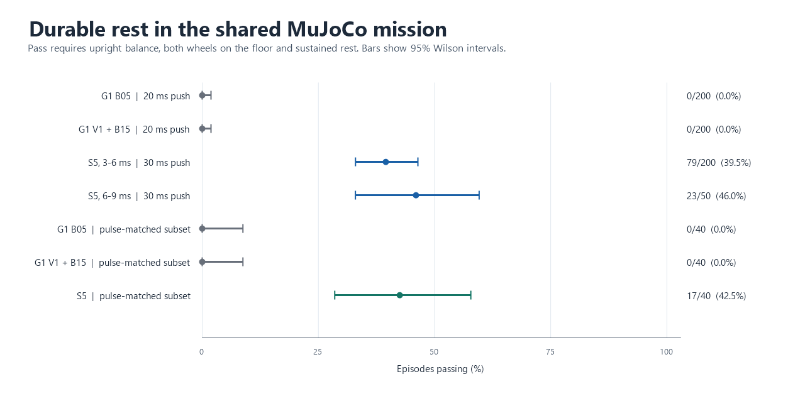
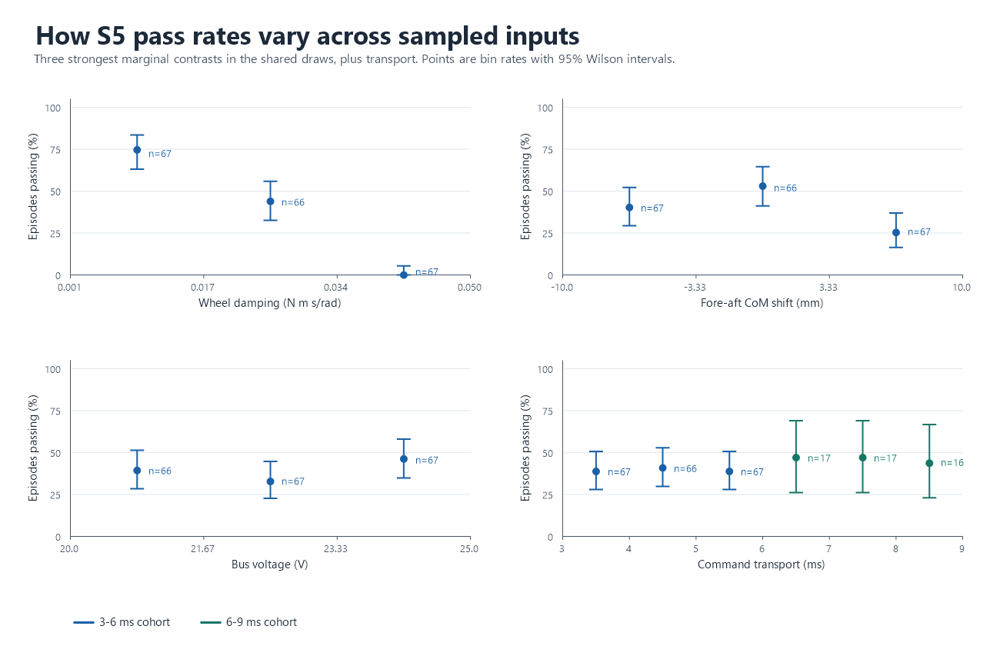

# G2 · Paired mission Monte Carlo

**FROM FILE** · The MuJoCo CAD mission drove, took a brief push and braked after host-command loss. The draws varied modeled mass (3.70–6.40 kg), fore–aft CoM offset (±10 mm), sliding friction (0.3–1.2), wheel damping (0.001–0.050 N·m·s/rad) and bus voltage (20–25 V), among other inputs. Passes required sustained rest at the end of the mission.

**COMPUTED** · S5 passed 79/200 main trials (39.5%, Wilson 95% interval 33.0–46.4%). In the clean 40-draw comparison with the same 20 ms push, S5 passed 17/40 and both earlier controller arms passed 0/40.

*COMPUTED · Durable-rest pass rates and Wilson intervals. The bottom three rows use the same push duration and draws.*

*COMPUTED · Simulated S5 pass rates by sampled wheel damping, CoM offset, supply and transport delay.*

## Results

**COMPUTED** · Saved simulation metrics.

| Cohort | Push | Passes | Falls |
| --- | ---: | ---: | ---: |
| S5 main, 3–6 ms transport | 30 ms | 79/200 | 25 |
| S5 extended, 6–9 ms transport | 30 ms | 23/50 | 5 |
| Matched G1 B05 | 20 ms | 0/40 | 2 |
| Matched G1 V1+B15 | 20 ms | 0/40 | 2 |
| Matched S5 | 20 ms | 17/40 | 6 |

[Download the summary CSV](../../results/evidence/g2-monte-carlo_summary.csv). Blank cells indicate a quantity outside the comparison or a gain edge unavailable at an unstable nominal point.

## What this teaches

**FROM FILE / STANDARD PRACTICE** · This extends the [S5 controller checks](s5-firmware-predictor.md) to a longer mission. Same-draw pairing preserves input composition. The full cohorts used different push durations and the two S5 delay cohorts had different draws, so the matched rows are the controller comparison.

## What the real robot must confirm

**FROM FILE / COMPUTED / UNKNOWN** · Rates describe the declared simulation population. The largest binned contrasts included wheel damping, CoM location and voltage. The [rolling-resistance study](s8-rest-and-rolling.md) revisits the legacy alternate-contact pilot. Measure installed mass and CoM, drive voltage under load, floor grip and wheel losses before using these ranges to design a bench test.

[All evidence studies](README.md)
