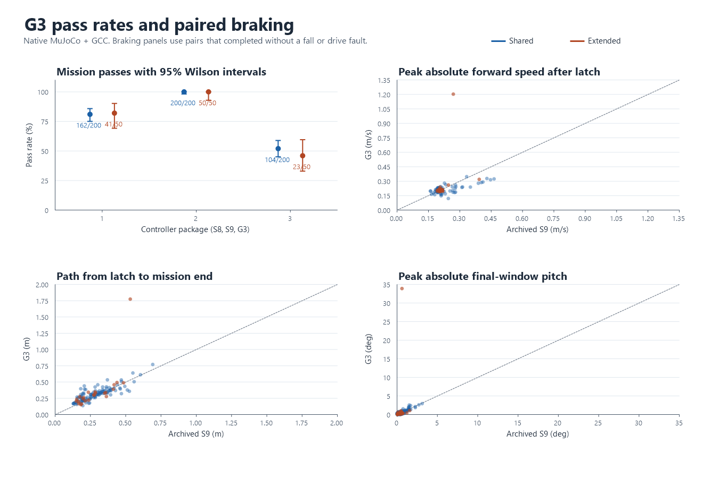
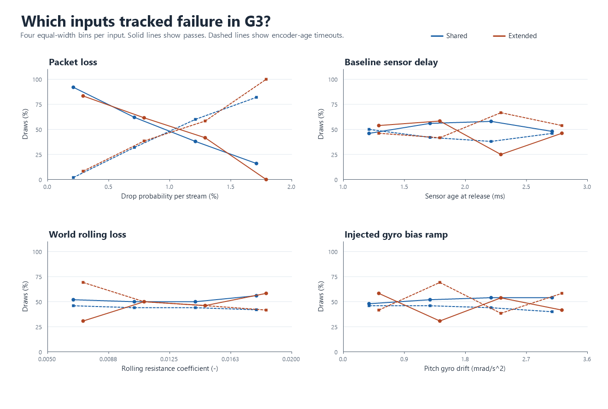

# G3 · Full-stack Monte Carlo

**FROM FILE** · This MuJoCo CAD experiment combined the [S9 controller](s9-balance-point.md), the [S10 adaptive estimator](s10-gyro-bias.md) and the [R5 wheel–ground law](r5-contact-rerun.md). It reused 250 original [G2 draws](g2-monte-carlo.md), with assumed 3.70–6.40 kg plant masses, and added a modeled rolling coefficient of 0.005–0.020, pitch gyro drift up to +0.0036 rad/s² and independent packet drops of 0–2%.

**COMPUTED** · G3 passed 104/200 shared and 23/50 extended cases. Of 112 falls, 111 followed torque disable after a modeled encoder timeout.

*COMPUTED · Pass rates, braking speed and post-latch travel. Braking distributions include only fault-free completions.*

*COMPUTED · Binned pass rates and encoder timeouts across the simulated inputs.*

## Results

**COMPUTED** · The archived S8 and S9 arms used an earlier sensor model and viscous joint loss. Comparing them with G3 captures the combined changes in the stack and its modeled inputs.

| Cohort | S8 passes | S9 passes | G3 passes (95% Wilson interval) | G3 timeouts / falls |
| --- | ---: | ---: | ---: | ---: |
| Shared, 3–6 ms transport | 162/200 | 200/200 | 104/200 (45.1–58.8%) | 88 / 86 |
| Extended, 6–9 ms transport | 41/50 | 50/50 | 23/50 (33.0–59.6%) | 26 / 26 |

[Download the summary CSV](../../results/evidence/g3-full-stack_summary.csv).

## What this teaches

**COMPUTED / STANDARD PRACTICE** · Two consecutive missed 500 Hz encoder packets pushed age above the modeled 6 ms limit in all 114 timeout cases. Six selected timeout draws all passed when repeated with no drops. Consecutive losses and age at control use matter even when the average drop rate is low. The eight fault-free runs that failed durable rest all exceeded the 0.020 m/s final speed gate.

## What the real robot must confirm

**COMPUTED / UNKNOWN** · The grouped encoder packets, independent losses, safety logic and contact-dependent trim inhibit are simulation assumptions. On six fixed draws, reducing modeled motor no-load speed by 15% or raising the hip peak envelope changed no reported trajectory metrics. Changing rolling strength shifted post-latch travel by up to 0.0663 m among the four fault-free replays in a separate sensitivity set. Measure per-axis packet age and burst losses, gyro drift, effective wheel drag and stopping clearance on a supported fixture.

[All evidence studies](README.md)
