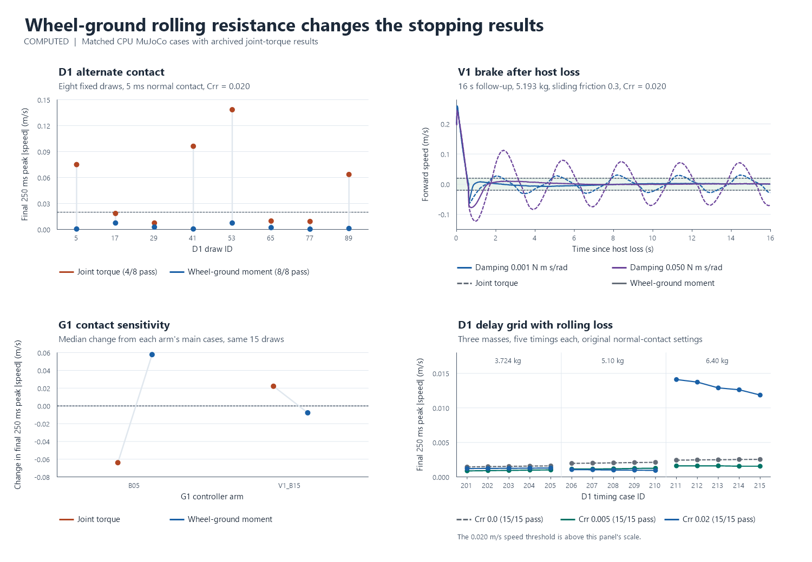

# R5 · Corrected wheel–ground contact reruns

**FROM FILE** · R5 reused earlier MuJoCo CAD conditions and changed the rolling torque from the legacy internal wheel hinge to an external wheel moment that opposes world spin. The D1 alternate-contact comparisons held the modeled normal contact at 5 ms and the rolling coefficient at 0.020.

**COMPUTED** · Matched D1 alternate-contact passes increased from 4/8 to 8/8. Both 5.193 kg V1 runs passed after host loss, reaching durable rest at 0.916 and 1.356 s. Both G1 arms still passed 0/17 under alternate contact, with two falls per arm after correction.

*COMPUTED · Matched D1 and V1 outcomes, corrected G1 contact sensitivity and D1 delay-grid results.*

## Results

**COMPUTED** · Saved simulation metrics.

| Matched run | Legacy hinge | Wheel–ground law |
| --- | ---: | ---: |
| D1 alternate-contact passes | 4/8 | 8/8 |
| V1 16 s follow-up passes | 0/2 | 2/2 |
| G1 B05 alternate-contact passes / falls | 0/17 and 0 falls | 0/17 and 2 falls |
| G1 V1+B15 alternate-contact passes / falls | 0/17 and 0 falls | 0/17 and 2 falls |

[Download the summary CSV](../../results/evidence/r5-contact-rerun_summary.csv).

## What this teaches

**FROM FILE / STANDARD PRACTICE** · This applies the [S8 correction](s8-rest-and-rolling.md) to archived study conditions. The external moment dissipates power relative to the floor. The corrected G1 median speed changes reversed sign on the 15 common completed draws in each arm. V1 still showed transient overspeed at brake onset.

## What the real robot must confirm

**FROM FILE / COMPUTED / UNKNOWN** · Masses, normal compliance and rolling coefficients are assumed. On the original D1 timing grid, rolling coefficients of 0.005 and 0.020 both passed 15/15, but the highest final peak speed was 0.00162 and 0.01411 m/s, respectively. Confirm coast-down in both directions, independent drag estimates, grip and the actual braking response.

[All evidence studies](README.md)
