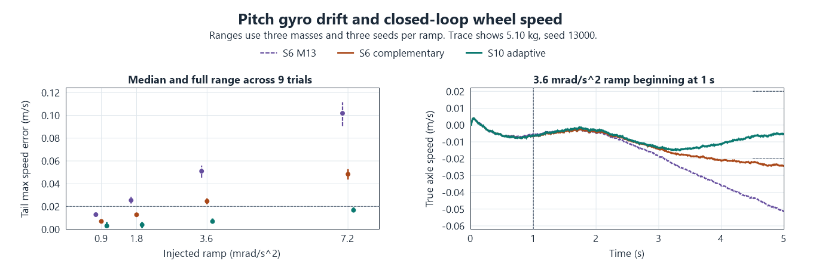
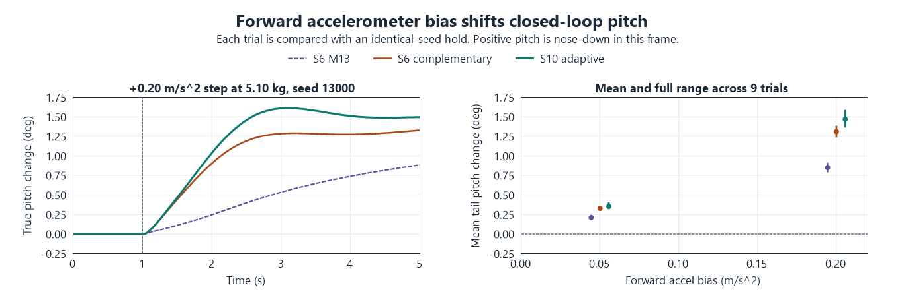

# S10 · Adaptive gyro-bias estimation

**FROM FILE** · The MuJoCo CAD software-in-the-loop experiment replayed the S6 profiles with a complementary filter capable of updating pitch gyro bias from quiet encoder and IMU conditions and a wheel-aided residual.

**COMPUTED** · The adaptive estimator passed all 81 recomputed stress cases and all nine +0.0072 rad/s² gyro ramps. It passed 23/24 motor, contact and encoder cases. The miss used a 5% undersized estimated wheel radius.

*COMPUTED · Closed-loop wheel-axis speed error across imposed pitch gyro-bias ramps.*

*COMPUTED · Closed-loop pitch shifts caused by an imposed forward accelerometer bias.*

## Results

**COMPUTED** · Saved simulation metrics.

| Recomputed case set | S6 complementary | S10 adaptive |
| --- | ---: | ---: |
| Stress | 71/81 | 81/81 |
| +0.0036 rad/s² pitch gyro-bias ramp | 0/9 | 9/9 |
| +0.0072 rad/s² pitch gyro-bias ramp | 0/9 | 9/9 |
| Motor, contact and encoder sensitivity | 24/24 | 23/24 |
| Mean pitch shift, +0.20 m/s² forward acceleration bias | +1.31° | +1.47° |

[Download the summary CSV](../../results/evidence/s10-gyro-bias_summary.csv). Blank cells indicate a quantity outside the comparison or a gain edge unavailable at an unstable nominal point.

## What this teaches

**FROM FILE / STANDARD PRACTICE** · This addresses the bias failure identified by [S6](s6-estimator-in-loop.md). The estimator integrates gyro rate minus the estimated bias. Quiet updates and wheel-aided correction help constrain that bias. The static gravity observation alone cannot distinguish forward accelerometer bias from pitch.

## What the real robot must confirm

**FROM FILE / COMPUTED / UNKNOWN** · The injected ramps, encoder behavior, contact and motor authority are simulation assumptions. At 5.10 kg S10 passed all 15 motor/contact variants with the +0.0036 rad/s² ramp. The low-radius miss reached 0.020225 m/s against a 0.020 m/s speed gate. Measure warm-up bias, encoder scale and effective radius, then check behavior under slip with independently measured pitch and speed.

[All evidence studies](README.md)
