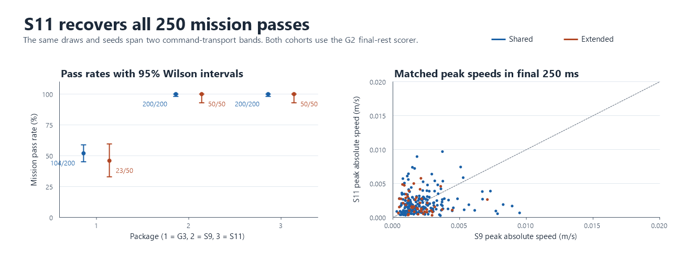
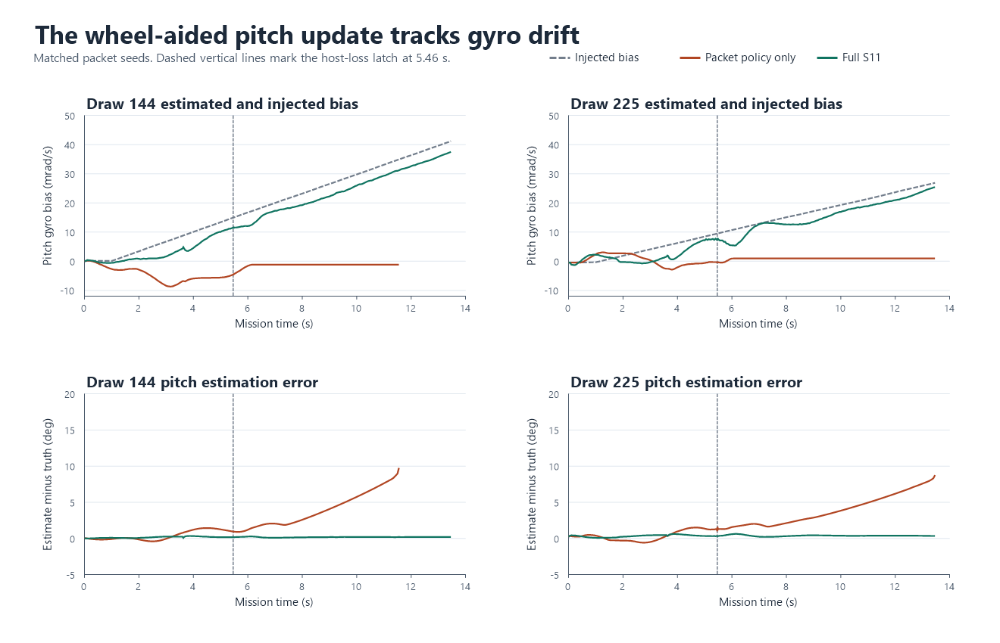
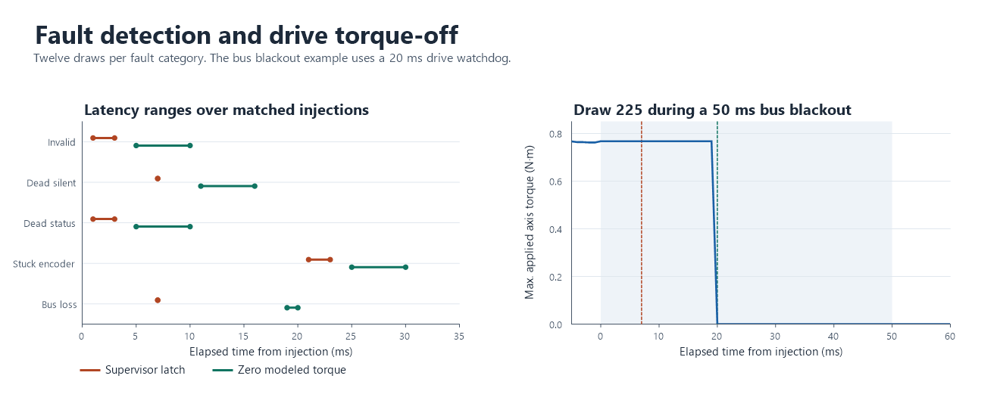
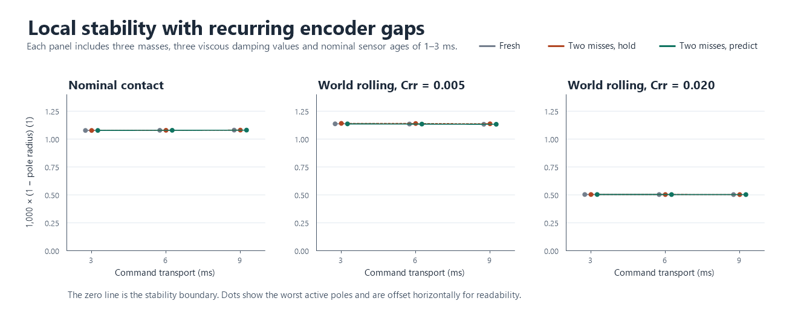

# S11 · Encoder packet tolerance and gyro-drift rejection

**FROM FILE** · The MuJoCo CAD software-in-the-loop experiment replayed all 250 matched [G3](g3-full-stack.md) draws with the [S9](s9-balance-point.md) 500 Hz C balance controller, a six-axis C encoder packet guard, and a revised [S10](s10-gyro-bias.md) adaptive gyro-bias estimator. The campaign added a 243-case loaded linear check, 68 injected-fault trials, 81 recomputed S10 stress trials, and 60 one-factor sensitivity runs.

**COMPUTED** · Passes rose from 104/200 to 200/200 in the shared 3–6 ms command-transport cohort and from 23/50 to 50/50 in the extended 6–9 ms cohort, with zero falls, drive faults or torque clips. All 114 G3 encoder-age trips passed. The two drifting draws (144 and 225) passed with worst final-window pitch of 0.416° and 0.349°, the recomputed S10 stress grid passed 81/81, the linear check passed 243/243, and all 68 injected faults latched as designed.

*COMPUTED · Mission pass rates and matched final-window speeds across G3, S9 and S11.*

*COMPUTED · Paired pitch and gyro-bias traces for draws 144 and 225.*

*COMPUTED · Fault-latch and torque-off latency ranges with a blackout torque trace.*

*COMPUTED · Loaded linear stability margins under repeated two-tick encoder packet gaps.*

## Results

**COMPUTED** · Saved simulation metrics.

| Test or cohort | Baseline or fault condition | S11 result |
| --- | ---: | ---: |
| Shared cohort, 3–6 ms transport | 104/200 (G3) | 200/200 (95% Wilson 98.1–100%) |
| Extended cohort, 6–9 ms transport | 23/50 (G3) | 50/50 (95% Wilson 92.9–100%) |
| Worst final speed, shared / extended | 0.0650 / 1.203 m/s (G3) | 0.00971 / 0.00577 m/s |
| Worst final pitch, shared / extended | 2.96° / 33.91° (G3) | 2.69° / 1.95° |
| Recomputed S10 stress grid | 81/81 (S10) | 81/81 (max speed error 0.00571 m/s) |
| Loaded linear grid, two predicted misses | 243/243 plain hold | 243/243 (max radius 0.999496486) |
| 50 ms CAN blackout (20 ms drive watchdog) | 12 cases | 12/12, latch 7 ms, zero torque 19–20 ms |
| 50 ms CAN blackout (12 / 30 ms watchdog) | 4 cases each | 4/4 each, latch 7 ms, zero torque 11 / 29 ms |
| Stuck moving wheel encoder, fresh frames | 12 cases | 12/12, latch 21–23 ms, zero torque 25–30 ms |
| Dead motor with fault status / invalid frame | 12 cases each | 12/12 each, latch 1–3 ms, zero torque 5–10 ms |
| Dead motor with silent feedback | 12 cases | 12/12, latch 7 ms, zero torque 11–16 ms |

[Download the summary CSV](../../results/evidence/s11-packet-tolerance_summary.csv).

## What this teaches

**FROM FILE / STANDARD PRACTICE** · This addresses the packet-age trip found in [G3](g3-full-stack.md) and a bias-lockout edge case in [S10](s10-gyro-bias.md). The C guard bridges one or two missed 2 ms encoder packets with constant-rate angle extrapolation capped at 4 ms, trims host speed and yaw authority to 75% on a third miss, and latches drive-off on a fourth miss, age above 10 ms, invalid data, fault status or 20 ms of repeated moving codes. Replacing the uncorrected gravity gate with a wheel-compensated residual and a ±0.018 rad/s² bias-rate cap keeps gyro-bias updates active when pitch error grows. Controller latch time and physical torque decay run on separate clocks: across 12–30 ms modeled drive watchdogs, the latch stayed at 7 ms while zero modeled torque moved from 11 to 29 ms.

## What the real robot must confirm

**FROM FILE / COMPUTED / UNKNOWN** · Packet-drop streams, drive watchdogs, contact compliance and harness-supplied push flags are simulation assumptions. All 60 one-factor sensitivity runs passed, with primary peak torque at most 1.551 N·m at the hips and 0.567 N·m at the wheels; rolling endpoints shifted post-latch path by up to 0.0281 m, and a +0.20 m/s² accelerometer step shifted it by up to 0.163 m. On a supported single-axis rig, measure per-axis acquisition and control-use timestamps, verify real drive CAN timeout registers and current decay during TX/RX loss, check frozen-encoder and silent-torque detection, and measure IMU sensor warm-up drift, wheel radius and slip before full powered balance.

[All evidence studies](README.md)
