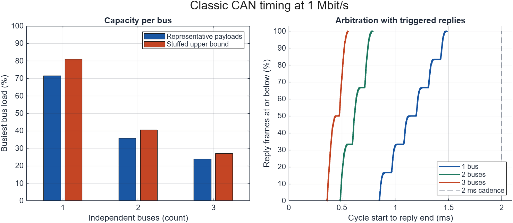
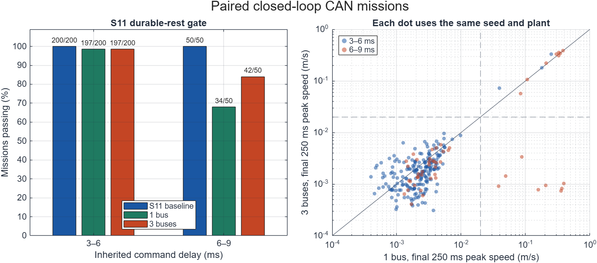
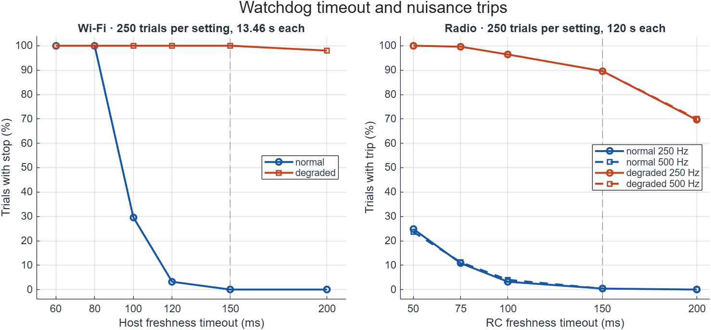
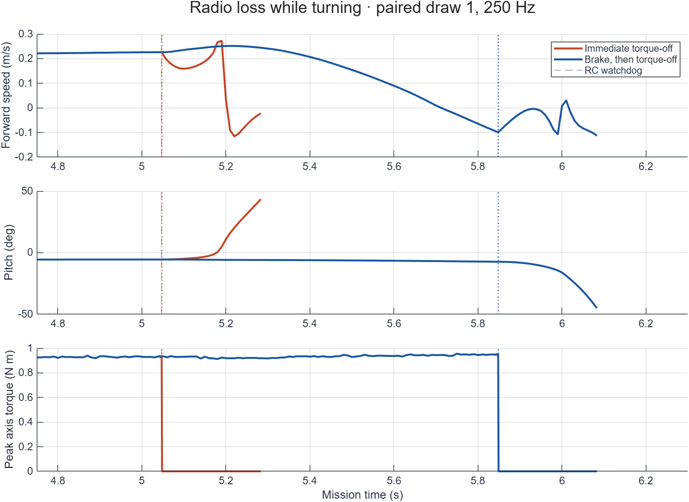

# S12 · CAN, Wi-Fi and e-stop in the control loop

**FROM FILE** · Building on the [S11](s11-packet-tolerance.md) MuJoCo CAD stack and all 250 matched draws, this study added explicit 1 Mbit/s CAN arbitration and wire serialization for one-, two- and three-bus layouts, a 25 Hz Wi-Fi host-command freshness watchdog, 250 and 500 Hz radio-loss cutoffs, and a wired GPIO software e-stop.

**COMPUTED** · Splitting the six motor drives across three CAN buses (two per bus) lowered worst-case stuffed load from 81.0% to 27.0%, cut the latest assumed-schedule reply from 1.700 ms to 0.620 ms, and lifted closed-loop passes from 231/250 on one bus to 239/250 on three buses. A 150 ms Wi-Fi watchdog produced 0/250 normal nuisance stops and 25/25 powered durable rests on both normal and degraded profiles. A 150 ms radio timeout cut normal nuisance gaps from 71 to 1 across 8.33 h, and wired GPIO software disable reached all-axis zero modeled torque in 0.451–0.534 ms on three buses.

**COMPUTED** · Replay video of six S11/S12 communication and fault cases: [s11-s12-comms.mp4](../../media/s11-s12-comms.mp4).

*COMPUTED · CAN bus utilization and reply completion timing across one, two and three buses.*

*COMPUTED · Paired closed-loop mission outcomes for the S11 baseline, one CAN bus and three CAN buses.*

*COMPUTED · Watchdog timeout versus nuisance stops for the modeled Wi-Fi and radio links.*

*COMPUTED · Simulated speed, pitch and torque during radio loss while turning.*

## Results

**COMPUTED** · Saved simulation metrics.

| Subsystem or test | Comparison setting | Modeled result |
| --- | --- | ---: |
| CAN load, unstuffed / max stuffed | 1 × 6 / 2 × 3 / 3 × 2 buses | 66.6–81.0% / 33.3–40.5% / 22.2–27.0% |
| Latest reply, assumed schedule / RTA bound | 1 × 6 / 2 × 3 / 3 × 2 buses | 1.700 (4.230) / 0.890 (1.530) / 0.620 (1.125) ms |
| Closed-loop passes, 3–6 ms / 6–9 ms / total | S11 baseline | 200/200 / 50/50 / 250/250 |
| Closed-loop passes, 3–6 ms / 6–9 ms / total | 1 CAN bus | 197/200 / 34/50 / 231/250 |
| Closed-loop passes, 3–6 ms / 6–9 ms / total | 3 CAN buses | 197/200 / 42/50 / 239/250 |
| Wi-Fi 150 ms timeout (25 Hz, 250 trials) | Normal / degraded link sweep | 0/250 nuisance (69–109 ms detect) / 250/250 degraded stops |
| Wi-Fi 150 ms plant replays (25 draws) | Normal blackout | 25/25 durable rest, 110 ms brake latch, max 0.580 m path |
| Radio 150 ms timeout (250 Hz, 8.33 h) | Normal / degraded link sweep | 1/250 trials (0.12 gaps/h) / 224/250 (63.24 gaps/h) |
| Radio loss at 250 Hz / 150 ms (13 draws) | Immediate off vs 0.80 s brake-then-off | 0.0521 vs 0.1540 m median path; 13/13 fall gate both |
| Radio switch disable (6 fixtures) | Delivered switch frame | 1.351–2.351 ms to all-axis zero torque |
| Wired GPIO software disable (6 phases) | 1 / 2 / 3 CAN buses | 0.951–1.013 / 0.576–0.639 / 0.451–0.534 ms |

[Download the summary CSV](../../results/evidence/s12-comms-in-loop_summary.csv).

## What this teaches

**FROM FILE / STANDARD PRACTICE** · Wire utilization alone hides busy-period queueing and per-axis sample skew at 500 Hz; all eight paired closed-loop flips favored three buses over one, and all occurred in the 6–9 ms delay cohort. For wireless watchdogs under burst loss, timeout duration in milliseconds matters more than raw packet rate: 250 Hz and 500 Hz radio links showed almost identical nuisance-trip rates at 150 ms. On a wheel-biped, motor torque keeps the chassis upright, so cutting torque on radio loss guarantees a fall even after a brief brake—motivating the brake-and-balance radio-loss policy tested in [S14](s14-sensitivity-radio.md), while [S13](s13-power-safety.md) addresses independent power removal.

## What the real robot must confirm

**FROM FILE / COMPUTED / UNKNOWN** · Wire delays were added on top of S11's inherited sensor and actuator delays; reassigning 0.75 ms of command delay and up to 1.00 ms of encoder delay to CAN recovered 11/11 failed three-bus draws and 7/11 on one bus. Published Wi-Fi latency rows and synthetic two-state burst-loss models are placeholders with no measured Wi-Fi/radio coexistence distribution. Bench logs must capture real per-ID CAN arbitration, error counters and current decay, real ROS 2/Wi-Fi tail latencies, receiver fresh-frame versus held-output behavior, and scoped GPIO-to-zero-current and contactor release timing on a supported fixture.

[All evidence studies](README.md)
