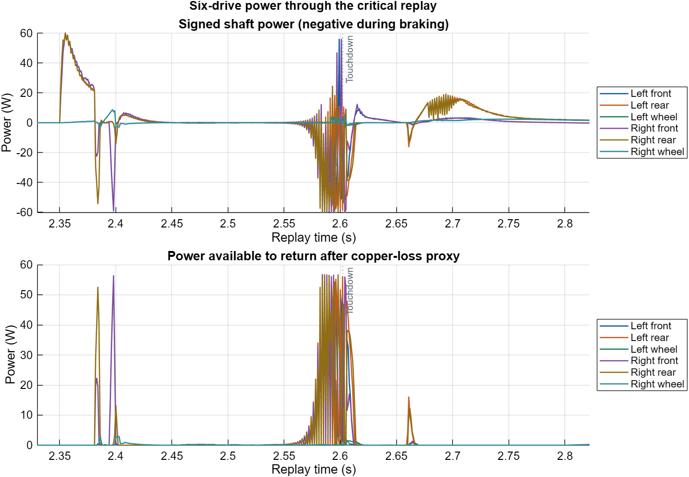
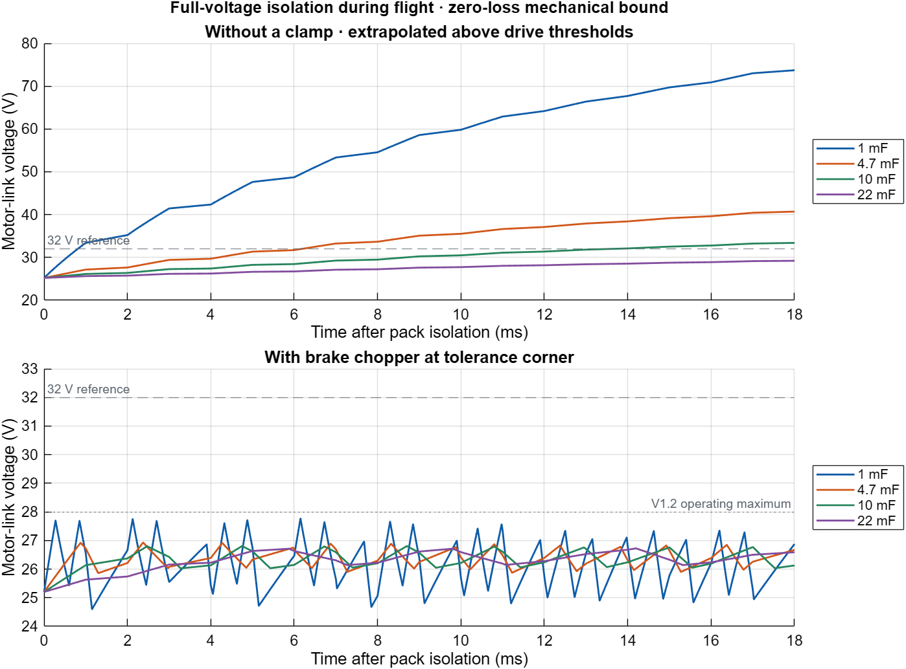
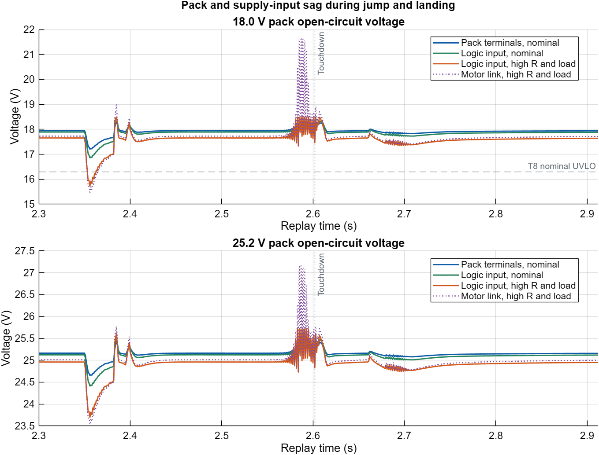

# S13 · Battery sag, regenerative overvoltage and motor-power stop

**FROM FILE** · Thirteen MuJoCo motion replays (six jumps, three host-loss brakes, three driving/braking missions and one CAN blackout) drove a lumped 6S electrical model across 18.0, 22.2 and 25.2 V open-circuit voltage, 25–75 mΩ pack resistance, 10–40 mΩ harness resistance, 1–22 mF link capacitance, 15 or 35 W logic load, and connected versus isolated pack states (6,528 connected and 8,160 open-link sweep rows).

**COMPUTED** · At 18.0 V open-circuit voltage, jump push-off pulled pack voltage to 16.57 V and logic-buck input to 15.73 V at the worst reduced-loss corner, dipping below the power board's 16.30 V cutoff for 9.1 ms. At 25.2 V and 10 mF, a full pack rejecting charge reached 32.93 V, while an isolated motor link crossed 32 V in 0.81 ms at 1 mF or 13.66 ms at 10 mF under the gross zero-loss bound. A downstream 1.5 Ω brake chopper engaging at 26.5 V and releasing at 26.0 V held the worst corner peak to 27.79 V.

*COMPUTED · Shaft power and regenerative return power across all six motors during the critical jump replay.*

*COMPUTED · Isolated motor-link voltage with and without the 1.5 Ω brake chopper.*

*COMPUTED · Battery pack and logic-rail sag through jump push-off and landing.*

## Results

**COMPUTED** · Saved simulation metrics.

| Electrical scenario | Condition | Modeled metric |
| --- | --- | ---: |
| 18.0 V push-off sag (pack / logic / link) | Nominal / worst reduced-loss corner | 17.21 / 16.86 / 16.74 V · 16.57 / 15.73 / 15.47 V |
| 25.2 V push-off sag (pack / logic / link) | Nominal / worst reduced-loss corner | 24.65 / 24.41 / 24.33 V · 24.25 / 23.70 / 23.53 V |
| 18.0 / 25.2 V landing sag (worst proxy) | Pack / logic / link | 17.52 / 17.18 / 17.17 V · 24.86 / 24.63 / 24.63 V |
| 18.0 V winding-sensitivity stress | Push-off (74.7 A pack draw) | 12.39 / 9.33 / 7.95 V (collapse flag) |
| Connected 25.2 V peak link (10 mF) | 5 A uptake / 0 A uptake / no logic | 25.71 / 32.93 / 38.07 V |
| Open motor link at 25.2 V, gross bound | 1.0 / 4.7 / 10 / 22 mF to 32 V | 0.81 / 6.02 / 13.66 / 157.48 ms |
| Open motor link at 25.2 V, unclamped | 1.0 / 4.7 / 10 / 22 mF extrapolation | 154.37 / 74.63 / 54.35 / 41.10 V |
| Brake chopper high corner (1.65 Ω, 26.7/26.2 V) | Peak link, ≥1 / 4.7 / 10 mF | 27.79 / 26.94 / 26.81 V (11.60 J max event) |
| Per-motor maxima (25.2 V, α = 1) | Hip / wheel peak return | 56.74 W (4.41 J) / 5.73 W (0.195 J) |

[Download the summary CSV](../../results/evidence/s13-power-safety_summary.csv).

## What this teaches

**FROM FILE / STANDARD PRACTICE** · Braking torque alone does not set bus voltage; signed shaft power, winding copper loss and simultaneous motoring on other joints determine net link current. Once the battery path opens, local capacitance sets the rise time through ΔE = ½C(V₂² − V₁²), so 2 ms controller telemetry cannot catch a sub-millisecond overvoltage spike and the brake chopper must sit on the motor side of the contactors with at least 4.7 mF effective link capacitance (10 mF initial reference). Upstream input cutoff and buck regulation are distinct: at 18 V push-off the power board's 16.30 V cutoff can drop the Raspberry Pi (needing ~2.94 mF downstream hold-up at 35 W) even while a separate 6S feed keeps the STM32H723 control board within its regulation budget.

## What the real robot must confirm

**FROM FILE / COMPUTED / UNKNOWN** · Pack chemistry, cell resistance across charge and temperature, BMS charge cutoff, motor torque constants, winding losses, drive behavior under Disable or overvoltage, and harness inductance are unmeasured. High unclamped peaks are lumped-model extrapolations past hardware breakdown. Bench tests on a current-limited rig must measure empty-pack load sag, full-pack braking current, remote drive terminal spikes under an open-pack pulse, Raspberry Pi and STM32 rail holdup, and contactor/chopper thermal and single-fault behavior.

[All evidence studies](README.md)
