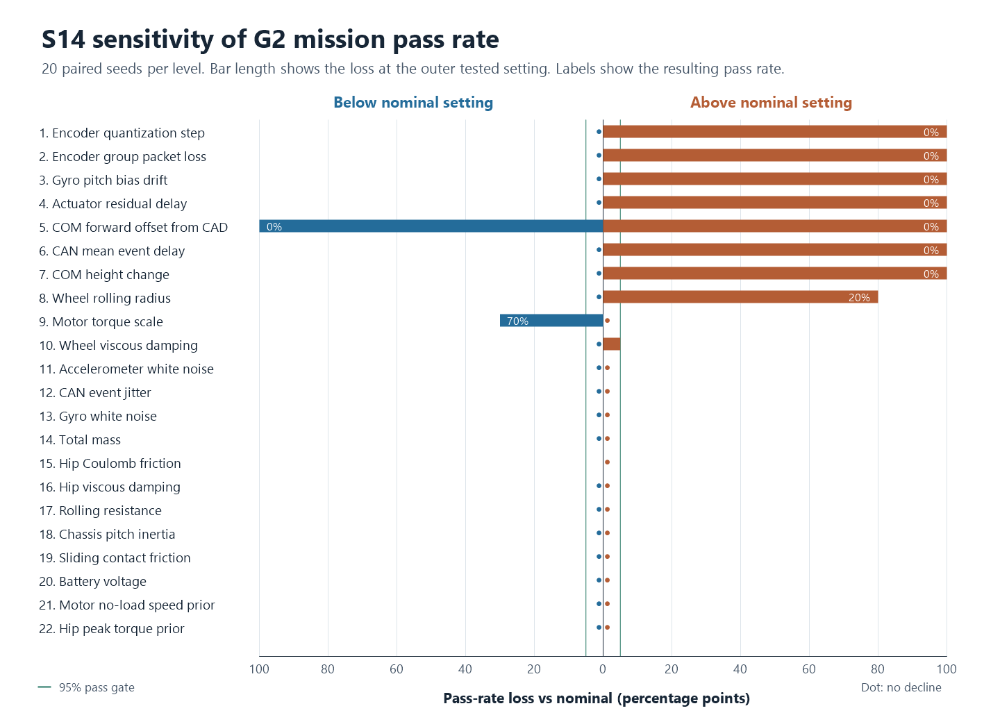
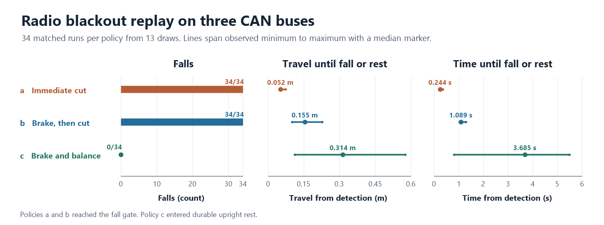
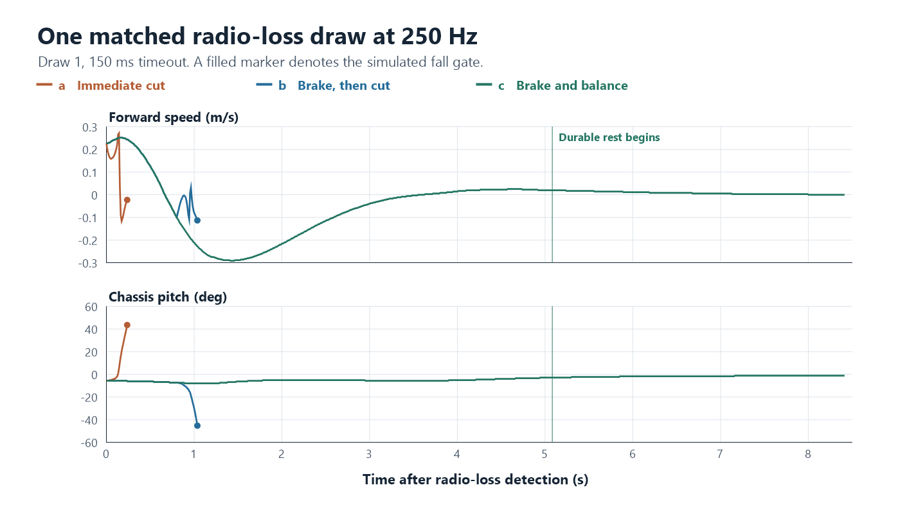

# S14 · Parameter sensitivity and radio-loss policy

**FROM FILE** · This study used the [S12](s12-comms-in-loop.md) three-bus MuJoCo CAD stack with the [S11](s11-packet-tolerance.md) packet guard and estimator to run a 1,000-mission one-factor sweep of 22 parameters (20 seeds per level, 50 levels total), a 102-run matched comparison of three radio-loss policies across all 34 S12 blackout cases, and three override fixtures.

**COMPUTED** · The nominal model passed 20/20 missions, and 9 of 22 swept parameters crossed below the 95% pass gate within their tested spans, led by encoder quantization step, encoder group packet loss and gyro pitch-bias drift. Across all 34 matched radio-loss cases, radio-loss policy c (brake, then keep balancing in place) gave 0/34 falls and 34/34 durable rests vs 34/34 falls for immediate torque-off and 34/34 falls for brake-then-cut. Policy c is now the firmware default; over-tilt, the wired e-stop and drive faults still cut torque at once.

*COMPUTED · Tornado chart of G2 mission pass-rate loss across the 22 swept parameters.*

*COMPUTED · Matched radio-loss replays comparing falls, travel path and elapsed time across the three policies.*

*COMPUTED · Simulated forward speed and body pitch under the three radio-loss policies in draw 1.*

## Results

**COMPUTED** · Saved simulation metrics for the three radio-loss policies (34 matched blackout cases each; brackets show min–max around the median).

| Radio-loss policy | Falls | Durable rest | Rest path (m) | Time to rest (s) | Path to endpoint (m) | Time to fall (s) |
| --- | ---: | ---: | ---: | ---: | ---: | ---: |
| (a) Immediate torque-off | 34/34 | 0/34 | — | — | 0.052 [0.047–0.074] | 0.244 [0.229–0.355] |
| (b) 0.8 s brake, then torque-off | 34/34 | 0/34 | — | — | 0.155 [0.101–0.227] | 1.089 [1.027–1.289] |
| (c) Brake, then keep balancing in place (default) | 0/34 | 34/34 | 0.314 [0.112–0.576] | 3.685 [0.811–5.487] | 0.325 [0.129–0.595] | — |

**COMPUTED** · In the three override fixtures while policy c was active, drive feedback fault (0.351 ms dispatch to all-off), over-tilt (0.351 ms, tested at 0.25°; production limit 12°) and wired GPIO e-stop (0.417 ms dispatch to all-off, 0.517 ms from GPIO edge) all cut torque immediately.

**COMPUTED** · The 9 parameters that crossed below the 95% pass gate (≤18/20 passes); the other 13 parameters—including mass (3.7–6.4 kg), pitch inertia, rolling resistance, sliding friction, battery voltage (18–25.2 V), hip peak torque (3–12.5 N·m) and motor no-load speed (±15%)—passed ≥19/20 at every tested level.

| Rank | Parameter | Nominal | First failing level (passes) | Bench difficulty |
| ---: | --- | --- | --- | --- |
| 1 | Encoder quantization step | 1× code step | +3150% / 32.5× (0/20) | Easy |
| 2 | Encoder group packet loss | 1% | +950% / 10.5% loss (9/20) | Easy |
| 3 | Gyro pitch-bias drift | 0.0018 rad/s² | +950% / 0.0189 rad/s² (0/20) | Medium |
| 4 | Actuator residual delay | 4.5 ms | +166.7% / 12.0 ms (0/20) | Hard |
| 5 | CoM forward offset from CAD | 0 mm | −30 mm and +30 mm (0/20 each) | Medium |
| 6 | CAN mean event delay | 1× S12 schedule | +500% / 6.0× (0/20) | Easy |
| 7 | CoM height change | 158.5 mm | +37.9% / +60 mm (0/20) | Medium |
| 8 | Wheel rolling radius | 0.0603 m | +17.7% / 0.071 m (4/20) | Easy |
| 9 | Motor torque scale | 1.0 ratio | −50% / 0.50 ratio (14/20) | Hard |

[Download the summary CSV](../../results/evidence/s14-sensitivity-radio_summary.csv).

## What this teaches

**FROM FILE / STANDARD PRACTICE** · On a wheel-biped, removing torque on radio loss causes a fall even after a brief brake. Policy c revokes host commands, runs the 0.60 s local brake and holds powered balance—avoiding falls from transient radio gaps while keeping immediate torque-off for over-tilt, the wired e-stop and drive faults. These software actions mirror IEC 60204-1 Category 2 versus Category 0/1 behavior, with no claimed hardware safety rating. Across the plant, encoder resolution, packet loss, gyro drift, delay and CoM offset govern failure sooner than single-factor mass, friction or voltage shifts.

## What the real robot must confirm

**FROM FILE / COMPUTED / UNKNOWN** · One-factor sweeps on 20 seeds do not test combined worst-case errors or unsampled interior points. Real motor gain and latency, CoM position, inertia, wheel radius, rolling drag and radio outage tails are unmeasured. Hardware bring-up must measure the top-ranked parameters first, verify guarded rearm and override cutoffs on a supported fixture, confirm stopping distance against the 0.576 m modeled maximum in a restrained lane, and confirm the independent [S13](s13-power-safety.md) power disconnect.

[All evidence studies](README.md)
