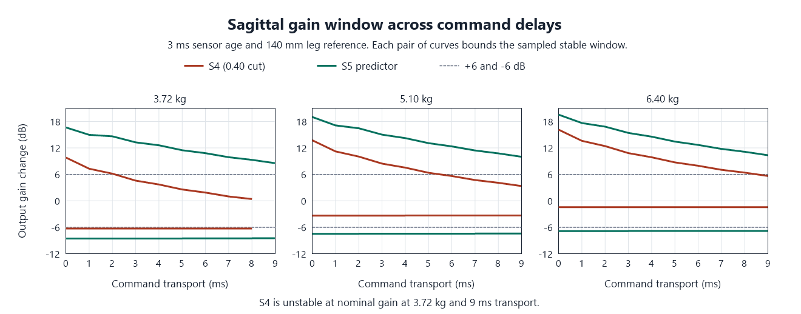
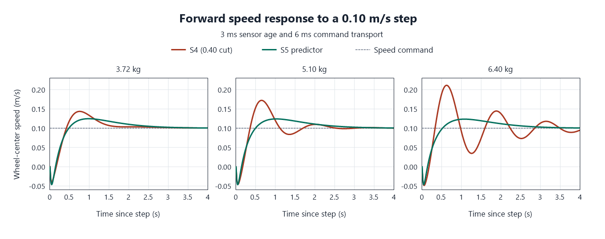

# S5 · Delay-aware balance in C

**FROM FILE** · The C software-in-the-loop test compared the S4 controller with a delay-augmented LQR on a CAD-derived MuJoCo plant at assumed masses of 3.72, 5.10 and 6.40 kg. The linear gain checks used 140 mm leg length and 3 ms sensing age.

**COMPUTED** · At 9 ms command transport, the nominal 3.72 kg S4 linear model was unstable and S5 had a stable gain window of −8.48 to +8.55 dB. The nonlinear hold, push and speed-step battery at 3 ms sensing age and 9 ms transport improved from 6/9 to 9/9 passes.

*COMPUTED · Stable linear gain windows by mass and command transport delay.*

*COMPUTED · Simulated wheel-center speed following a 0.10 m/s command step.*

## Results

**COMPUTED** · Saved simulation metrics.

| Test | S4 | S5 |
| --- | ---: | ---: |
| Linear gain window, 3.72 kg and 6 ms | −6.27 to +1.88 dB | −8.51 to +10.82 dB |
| Linear gain window, 3.72 kg and 9 ms | Nominal gain unstable | −8.48 to +8.55 dB |
| Linear gain window, 5.10 kg and 9 ms | −3.34 to +3.36 dB | −7.41 to +10.00 dB |
| Nonlinear passes, 9 ms transport | 6/9 | 9/9 |

[Download the summary CSV](../../results/evidence/s5-firmware-predictor_summary.csv). Blank cells indicate a quantity outside the comparison or a gain edge unavailable at an unstable nominal point.

## What this teaches

**FROM FILE / STANDARD PRACTICE** · S5 extends S4 by appending three recent effort pairs to the state. The delayed plant update uses the oldest queued effort, so the feedback gain accounts for the actuation already in flight. The local gain window and the nonlinear pass count describe different checks.

## What the real robot must confirm

**FROM FILE / COMPUTED / UNKNOWN** · Passes are simulation results with assumed masses, contact and motor envelopes. All 30 nonlinear sensitivity cases passed with S5 under the sampled friction, contact, voltage and lag changes at nominal gain. Physical sensing age, CAN transport jitter and the installed torque–speed curves still need measurement.

[All evidence studies](README.md)
