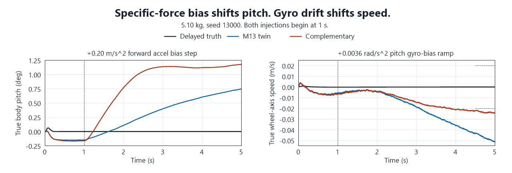

# S6 · Estimated feedback in the balance loop

**FROM FILE** · The MuJoCo CAD experiment put IMU and wheel/leg encoder estimates in the S5 loop. It compared delayed simulation truth, the M13 estimator and a complementary filter over assumed masses of 3.72, 5.10 and 6.40 kg.

**COMPUTED** · The complementary filter passed 70/81 original stress cases versus 63/81 for M13. Both passed all 27 nominal cases and both missed all nine cases with the isolated +0.0036 rad/s² pitch gyro-bias ramp.

*COMPUTED · An acceleration offset shifts pitch and a gyro-bias ramp shifts wheel-axis speed in one simulated 5.10 kg case.*

## Results

**COMPUTED** · Saved simulation metrics.

| Case set | Delayed truth | M13 | Complementary |
| --- | ---: | ---: | ---: |
| Nominal | 27/27 | 27/27 | 27/27 |
| Stress | 81/81 | 63/81 | 70/81 |
| Isolated +0.0036 rad/s² gyro-bias ramp | 9/9 | 0/9 | 0/9 |
| Combined disturbance | 9/9 | 0/9 | 7/9 |

[Download the summary CSV](../../results/evidence/s6-estimator-in-loop_summary.csv).

## What this teaches

**FROM FILE / STANDARD PRACTICE** · This extends [S5](s5-firmware-predictor.md) by replacing truth feedback with estimates. Acceleration along the chassis can be confused with gravity tilt, and integrating a biased gyro creates drift. The [S10 rerun](s10-gyro-bias.md) reports 71/81 for a recomputed complementary-filter baseline in its own comparison.

## What the real robot must confirm

**FROM FILE / COMPUTED / UNKNOWN** · The original stress counts apply to the synthetic sensor, transport and contact profiles tested. At 5.10 kg, the complementary filter passed 3/3 at +0.0018 rad/s² and 0/3 at either sign of 0.0036 rad/s². Check estimated pitch and speed against independent references and measure sensor biases and timing on the real robot.

[All evidence studies](README.md)
