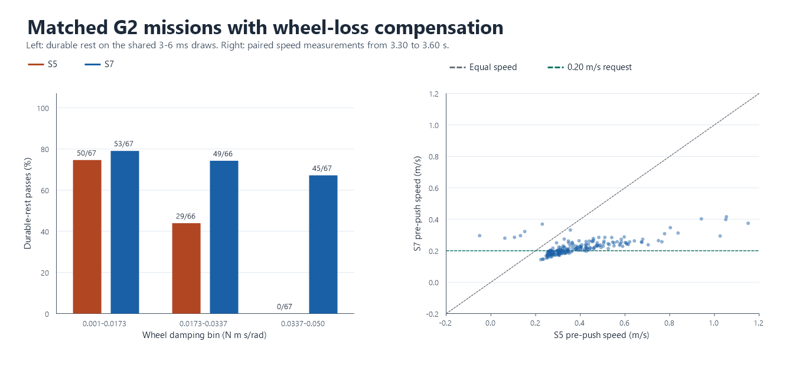

# S7 · Wheel-loss feedforward

**FROM FILE** · S7 extended the S5 controller with viscous and rolling feedforward, gains designed at a mid-range damping value, and acceleration feedforward. The shared MuJoCo CAD comparison reused the G2 draws and their assumed mass, contact, torque and voltage ranges.

**COMPUTED** · In the shared 200-draw cohort, passes increased from 79 to 147 and falls fell from 25 to zero. Median absolute pre-push speed error decreased from 0.145 to 0.025 m/s.

*COMPUTED · Shared-draw pass rates by damping bin and paired pre-push speeds.*

## Results

**COMPUTED** · Saved simulation metrics.

| Same-draw cohort | Passes, S5 → S7 | Falls, S5 → S7 | Median absolute speed error, S5 → S7 |
| --- | ---: | ---: | ---: |
| Shared, 3–6 ms transport | 79/200 → 147/200 | 25 → 0 | 0.145 → 0.025 m/s |
| Extended, 6–9 ms transport | 22/48 → 35/48 | 4 → 0 | 0.136 → 0.018 m/s |

[Download the summary CSV](../../results/evidence/s7-wheel-loss-comp_summary.csv). Blank cells indicate a quantity outside the comparison or a gain edge unavailable at an unstable nominal point.

## What this teaches

**FROM FILE / STANDARD PRACTICE** · The [G2 mission](g2-monte-carlo.md) exposed pre-push overspeed as a failure pathway. Feedforward adds modeled effort at the commanded speed. The selected changes were tested together, and changes in pass counts belong to that combined controller.

## What the real robot must confirm

**FROM FILE / COMPUTED / UNKNOWN** · The shared and extended results used viscous joint damping as the plant wheel-loss input. [S8](s8-rest-and-rolling.md) found that the separate alternate-contact branch used an internal hinge surrogate that changed the results. Measure unloaded drive losses and loaded coast-down separately, and check the available torque when the pack sags.

[All evidence studies](README.md)
