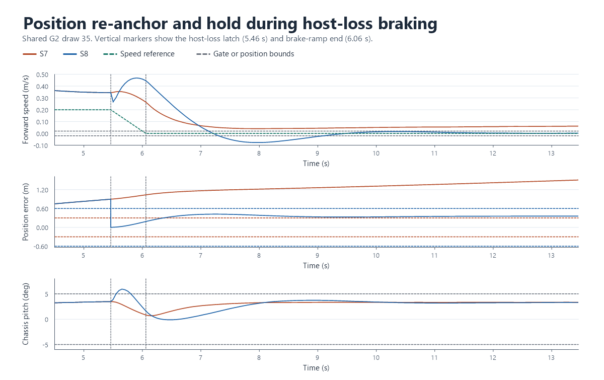
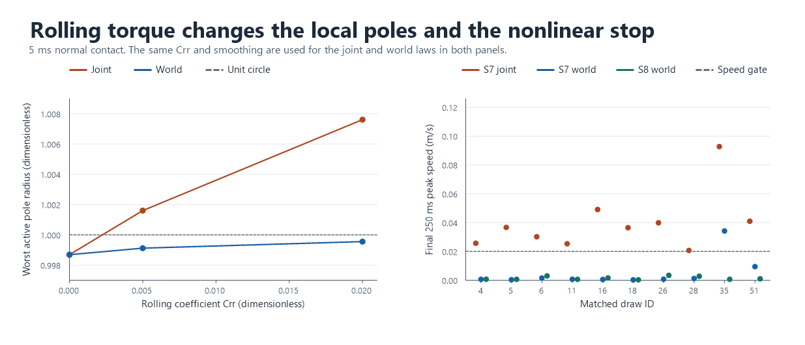

# S8 · Durable rest and world-referenced rolling loss

**FROM FILE** · S8 zeroed accumulated position error at host-command loss and then integrated speed error within a bound. A second experiment changed where the plant applied rolling torque and compared both formulations on a spring-mounted wheel fixture and the MuJoCo CAD model.

**COMPUTED** · S8 improved the shared cohort from 147/200 to 162/200 passes. At the assumed 5 ms contact time constant and rolling coefficient 0.020, the replaced hinge surrogate gave 270/270 unstable linear points, while the corrected world-referenced law gave 0/270.

*COMPUTED · The re-anchored position error in a simulated host-loss case.*

*COMPUTED · Local poles and nonlinear stop metrics for the legacy hinge and corrected world laws.*

## Results

**COMPUTED** · Saved simulation metrics.

| Test | Earlier variant | Revised variant |
| --- | ---: | ---: |
| Shared cohort, S7 → S8 | 147/200 | 162/200 |
| Extended cohort, S7 → S8 | 36/50 | 41/50 |
| Unstable points at rolling coefficient 0.020 | 270/270, legacy explicit hinge torque | 0/270, world law |

[Download the summary CSV](../../results/evidence/s8-rest-and-rolling_summary.csv).

## What this teaches

**FROM FILE / STANDARD PRACTICE** · This follows [S7](s7-wheel-loss-comp.md). The revised torque is proportional to normal load and opposes wheel spin relative to the floor. The wheel carrier can rotate, so a torque between wheel and carrier is a different physical input. [R5](r5-contact-rerun.md) applies that correction to the older contact claims.

## What the real robot must confirm

**FROM FILE / COMPUTED / UNKNOWN** · The gain grid is local and the rolling coefficient, smoothing and contact stiffness are assumed. Varying rolling coefficient between 0.005 and 0.020 preserved stability on the tested world-law grid. Measure loaded rolling loss and independently assess braking distance and creep after command loss.

[All evidence studies](README.md)
