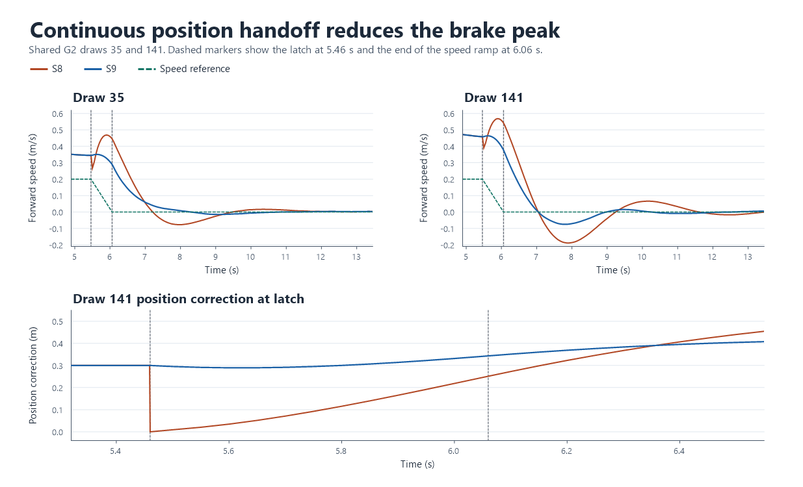
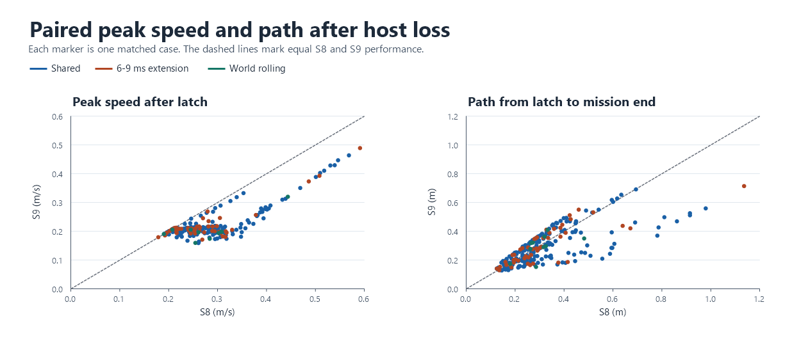

# S9 · Learned balance point and smoother braking

**FROM FILE** · The controller slowly adjusted its pitch reference in quiet conditions and blended the existing position correction across host-command loss. The same assumed mass and CoM draws were replayed against S8 in MuJoCo, including a separate world-rolling subset.

**COMPUTED** · The shared pass count rose from 162/200 to 200/200, with a median post-latch peak speed reduction from 0.261 to 0.206 m/s. Median travel changed from 0.280 to 0.272 m, and several individual stops traveled farther.

*COMPUTED · Continuous position correction at host-command loss and the simulated braking response.*

*COMPUTED · Paired post-latch peak speed and travel. The diagonal marks equal results.*

## Results

**COMPUTED** · Saved simulation metrics.

| Cohort | Passes, S8 → S9 | Median peak speed, S8 → S9 | Median travel, S8 → S9 |
| --- | ---: | ---: | ---: |
| Shared | 162/200 → 200/200 | 0.261 → 0.206 m/s | 0.280 → 0.272 m |
| Extended | 41/50 → 50/50 | 0.260 → 0.206 m/s | 0.281 → 0.276 m |
| World rolling | 8/10 → 10/10 | 0.272 → 0.198 m/s | 0.301 → 0.308 m |

[Download the summary CSV](../../results/evidence/s9-balance-point_summary.csv).

## What this teaches

**FROM FILE / STANDARD PRACTICE** · This follows the [S8 stop change](s8-rest-and-rolling.md). The gravity moment about the axle scales as mass × gravity × fore–aft CoM offset. A tilted chassis can settle with its CoM near the axle. The exploratory 2 mm CoM criterion passed all 49 replayed S8 primary misses as well as all S9 trials.

## What the real robot must confirm

**FROM FILE / COMPUTED / UNKNOWN** · The original pitch gate was kept for the primary comparison. The simulated quiet-mode inhibit used information supplied by the test harness. On four replays, reducing assumed no-load speeds by 15% or raising the hip torque envelope left the results identical. On three world-rolling draws, tested changes to rolling strength and smoothing kept the verdicts. Confirm real quiet-gate inputs, stopping clearance, actuator limits and the desired rest attitude.

[All evidence studies](README.md)
