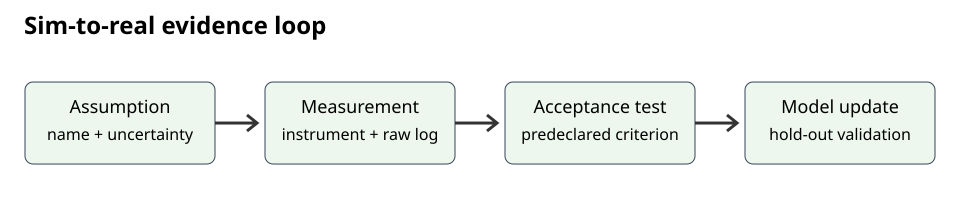

# Sim-to-real measurement checklist

**Tóm tắt tiếng Việt.** **[FROM FILE: v2 checklist and S2R_V3 source reports]** Danh sách này liên kết giả định mô phỏng với phép đo, thiết bị, tiêu chí đánh giá và tham số cần cập nhật. V3 thêm các phát hiện push, mép bậc, tiếp xúc, encoder đóng băng, nguồn tái sinh và vòng buck; các điều kiện chưa đo trên robot được ghi rõ là chưa xác nhận.

**Summary.** This checklist turns simulation assumptions into instrumented measurements, acceptance criteria, and model updates. Start with axis signs, kinematics, and timing; treat simulation results as hypotheses until synchronized robot logs are available. [FROM FILE]

## Question and method

Which physical quantities should be measured before trusting a simulation-to-hardware comparison? The checklist groups model assumptions into observable bench or supported-robot tests, with instruments, acceptance criteria, and the model parameter each result should update. [FROM FILE; provenance is recorded in the CSV fields and the V3 update notes below]

## Results

The deliverable is the checklist itself rather than a new simulation. It covers geometry and encoder signs, sensor bias, motor and bus timing, packet loss, contact, power, and safety behavior. [FROM FILE]

[Download the checklist CSV](sim_to_real_checklist.csv)

| Use | Evidence to collect | Output |
|---|---|---|
| Establish frames and signs | Matched joint poses and signed single-axis motions | Update zeros, signs, and kinematic model |
| Identify timing | Synchronized acquisition, control, CAN, and response timestamps | Replace fixed delay with measured timing distribution |
| Check drive response | Command, torque/current, voltage, and encoder capture | Fit drive-specific lag and operating envelope |
| Validate safe stopping | Radio-loss, wired stop, and fault behavior on a supported fixture | Update stop and rearm model |

## What this teaches

A checklist makes validation falsifiable: each assumed parameter needs a measured quantity, a reference instrument, a pass criterion, and a model update. Collect synchronized evidence so latency, estimator error, and actuator lag can be distinguished. [STANDARD PRACTICE]

## Limits

Checklist entries are proposed measurements and thresholds, not completed hardware tests or permission to run them. Thresholds tagged as assumed in the CSV require review against the actual instrumentation and safe fixture. [FROM FILE / GUESS]

## Reproduce

Use the downloadable CSV in this repository as the machine-readable checklist. Record measured values with units, timestamps, test conditions, instrument details, and deviations from each criterion. [FROM FILE / STANDARD PRACTICE]

## What the real robot must confirm

Complete relevant entries only on a supervised, mechanically supported setup and record actual as-built configuration, instruments, raw logs, and deviations from the stated acceptance criteria. [UNKNOWN / STANDARD PRACTICE]

## S2R_V3 update (24 Nov 2026)

**Cập nhật V3.** **[FROM FILE: `PUSHGAP_root_cause/PUSHGAP_REPORT.md` §§2,4; `STEP3RC/STEP3RC_REPORT.md` §§A2,A5,A6,B4; `CONTACT1FIX/CONTACT1FIX_REPORT.md` §§Calibrated classification, Sensitivity and model caveats, What the real robot must confirm; `HW2REV/HW2REV_REPORT.md` §§Chopper / dump sizing, TVS, What the real robot must confirm; `HW3FIX/HW3FIX_REPORT.md` §§2–3; `BUCK2_phase_margin/BUCK2_REPORT.md` §§What the real robot must confirm]** V3 bổ sung phép đo định nghĩa xung đẩy và xác nhận dấu/đáp ứng gain hông; kiểm tra ma sát mép, run-up và phản ứng dừng có thay bánh khi encoder đóng băng; hiệu chuẩn slip trên ramp, coast-down và rebound khi thả bánh; kiểm tra xung tái sinh, giới hạn điện áp drive và vòng điều khiển buck. TVS vẫn BLOCKED đến khi có giới hạn điện áp tuyệt đối của đúng drive và dạng sóng surge đo được. Đây là kế hoạch đo; chưa có phép đo phần cứng mới trong đợt cập nhật này.

Các dòng V3 được gắn provenance trong CSV. Dòng có ngưỡng từ mô phỏng được đánh dấu là ngưỡng đối chiếu, không phải kết quả đã xác nhận trên robot. [FROM FILE]

- **Định nghĩa push và hip gains:** chuẩn hóa impulse, điểm đặt lực và kênh góc trước khi so sánh; kiểm tra dấu gain/đáp ứng torque và common-delay margin trước khi dùng gain ứng viên. [FROM FILE: `PUSHGAP_root_cause/PUSHGAP_REPORT.md` §§2,4]
- **Mép bậc và encoder đóng băng:** đo hệ số ma sát và khoảng dừng trước thử curb; thử phản ứng controlled-stop/partner-wheel trên fixture có hỗ trợ, vì mô phỏng cho thấy torque-cut là phản ứng gây ngã. [FROM FILE: `STEP3RC/STEP3RC_REPORT.md` §§A2,A6,B4]
- **Tiếp xúc:** tách ma sát trượt trên ramp, rolling/bearing drag trong coast-down, và độ cứng/giảm chấn qua drop-rebound; hiệu chỉnh theo lực, độ lún và hồi nảy đo được thay vì ánh xạ trực tiếp tên tham số solver. [FROM FILE: `CONTACT1FIX/CONTACT1FIX_REPORT.md` §§Sensitivity and model caveats, What the real robot must confirm; STANDARD PRACTICE]
- **Điện công suất:** ghi giới hạn tuyệt đối drive từ tài liệu chính thức; đo regen surge gần và xa trên bus, thời gian phản ứng chopper và nhiệt; chưa chọn TVS nếu không có vùng làm việc liên tục/surge/abs-max tương thích. [FROM FILE: `HW2REV/HW2REV_REPORT.md` §§Chopper / dump sizing, TVS; `HW3FIX/HW3FIX_REPORT.md` §§2–3]
- **Buck:** đo loop gain, PM/GM tại các góc điện áp/tải CCM; xác nhận riêng chế độ nhẹ tải thay vì áp dụng PM CCM cho DCM/PFM. [FROM FILE: `BUCK2_phase_margin/BUCK2_REPORT.md` §What the real robot must confirm]

## Figure

**[FROM FILE]** Existing conceptual diagram copied from the v2 checklist source. No new simulation plot was created for this checklist update.

## S2R_V3FIX traceability correction (24 Nov 2026)

**[COMPUTED]** The CSV now has one row-specific source status in every provenance cell. The 11 rows independently verified in `VERIFY_B6/checklist_number_audit.csv` link to their originating reports above; the remaining 65 inherited rows are explicitly marked `SOURCE NOT FOUND` pending discovery of their originating report/CSV. Generic provenance labels are not treated as numeric verification. See [traceability notes](source-notes.md) for row numbers and scope. No checklist threshold was recalculated or silently changed. Development source IDs below identify supplied reports; they are not files distributed in this repository. See the [public source map](source-notes.md).
