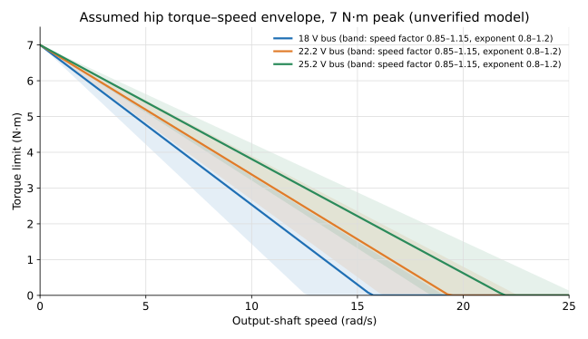
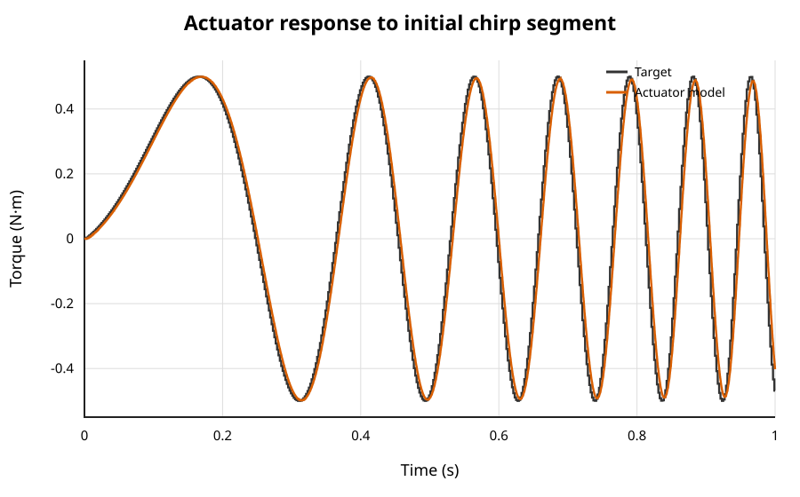

# Actuator model and identification plan

**Summary.** The reduced model ran with delay, torque dynamics, friction, and speed limits. Its response depends on assumed parameters; the next step is to measure torque, speed, and drive delay on a restrained fixture before fitting the model. [COMPUTED / GUESS]

## Question and method

What actuator dynamics should a wheel-biped simulation expose to its controller, and how can the unknowns be measured? A reduced discrete-time model combined a command delay, first-order current-loop equivalent, voltage/speed torque envelope, friction, placeholder backlash, and reply delay. It does not model switching electronics or calibrated motor internals. [FROM FILE; provenance is listed in `NUMBERS.md`]

## Results

| Result | Value | Provenance |
|---|---:|---|
| Assumed current-loop time constant / command age | 3 ms / 1 ms | [GUESS] |
| 2 N·m step 10–90% rise time | 6.6 ms | [COMPUTED, conditional on assumptions] |
| Gain / phase at 20 Hz | 0.936 / −28.22° | [COMPUTED, discrete model] |
| 24 V hip no-load speed prior | 20.9 rad/s | [FROM DATASHEET, unverified on installed unit] |

## What this teaches

A useful actuator block needs both dynamics and limits: a delay and lag shape phase, while torque-speed saturation clips commands as speed rises. For a first-order lag, τ[k+1] = aτ[k] + (1−a)u[k−d], where a = exp(−Ts/Tlag), d is command delay in samples, and the speed envelope clips τ. Identification should separate command-to-CAN delay, motor response rise time, static torque calibration, and speed-dependent limit. [STANDARD PRACTICE]

## Limits

The lag, delays, friction, supply voltage, backlash placeholder, and much of the torque envelope are assumed. The replay is an open-loop trace playback, not a closed-loop robot comparison. Motor revision, temperature, peak duration, and torque constant remain unknown. [GUESS / UNKNOWN]

## Reproduce

The source Simulink model and raw response traces are not included in this public tree. Reproduce the analytic step and frequency checks using the stated lag and delay assumptions, then replace them with measured values from the identification procedure described above. Regenerating the original block model requires the source model and MATLAB/Simulink. [FROM FILE / UNKNOWN]

## What the real robot must confirm

On a restrained fixture, capture synchronized command, CAN, encoder, voltage, current, and independent reaction-torque measurements. Identify rise time and delay separately for each drive type, then validate held-out low-amplitude responses before updating simulation limits. [UNKNOWN / STANDARD PRACTICE]
