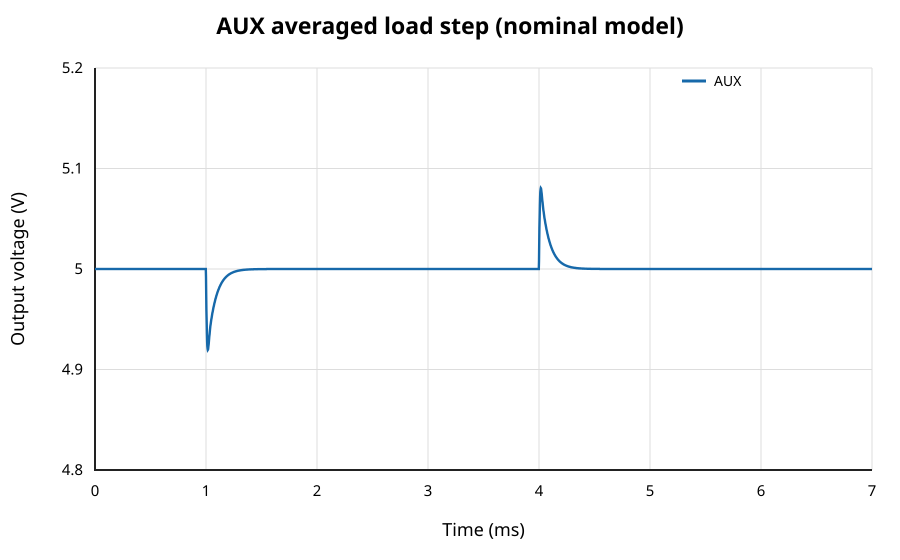

# AUX buck stability with an averaged model

**Summary.** The averaged model shows AUX load-step sag depends strongly on compensation and capacitance assumptions. It does not replace SPICE or board measurements; retain the current bypass configuration and choose an input filter only after measuring source impedance and load response. [COMPUTED / STANDARD PRACTICE]

## Question and method

How do the AUX rail and its input filter respond to load changes and source interaction? A physical LC stage was paired with a simplified inner-current loop and outer PI controller, then swept across assumed compensation and capacitance cases. No SPICE switching model was used. [FROM FILE; provenance is listed in `NUMBERS.md`]

## Results

| Result | Value | Provenance |
|---|---:|---|
| Nominal-model input / effective output capacitance | 18 V / 180 µF | [GUESS] |
| AUX voltage dip for 10%→90% load step | about 81 mV | [COMPUTED, conditional on the model] |
| AUX dip when capacitance is reduced to 94 µF | 106 mV | [COMPUTED, nominal compensation] |
| Recommended modeled configuration | Keep bypass links; optional LC remains unpopulated | [COMPUTED / STANDARD PRACTICE] |

## What this teaches

The immediate load-step change includes an ESR term, while capacitor voltage changes as the time integral of current deficit: ΔV_ESR = ΔI·ESR and ΔV_C = (1/C)∫(Iload−iL)dt. Input filters can interact with a regulated converter's negative incremental input impedance; a damped RC branch can reduce resonance, but its values must be validated against the actual source and hardware. [STANDARD PRACTICE]

## Limits

Compensation constants, biased capacitance, ESR, harness impedance, actual load slew, and silicon loop behavior are unknown. The selected phase-stress cases can oscillate or clamp; small excursion in those cases is not a pass result. No measured board response is claimed. [UNKNOWN / GUESS]

## Reproduce

For a fresh study, use the rail LC values from the public schematic, implement the averaged inductor-current and capacitor-voltage equations, and apply the stated 18 V, 180 µF, 10%-to-90% load step. The exact compensation gains and raw time series are not included in this public tree, so the original numeric traces cannot be regenerated from this repository alone. [FROM FILE / UNKNOWN]

## What the real robot must confirm

Measure load steps at the regulator and remote load, input impedance and harness drops, power-good behavior, and cold/hot response before selecting an input filter or claiming stability margin. [UNKNOWN / STANDARD PRACTICE]
