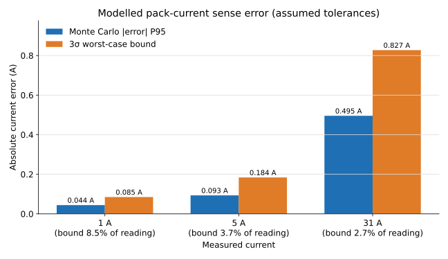
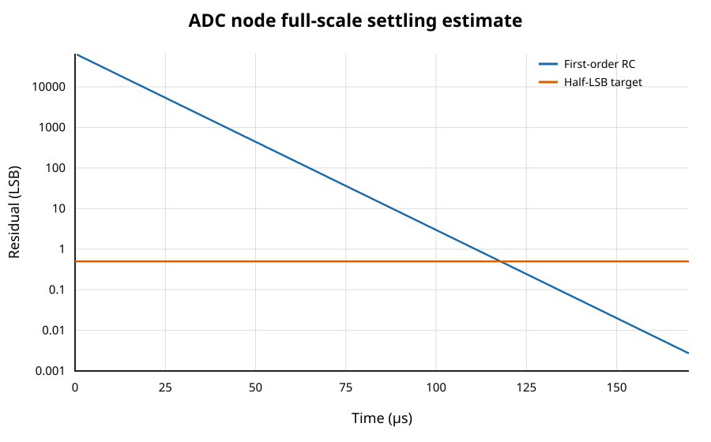
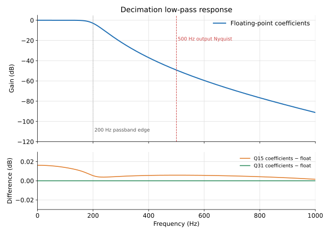

# Current-sense error, ADC settling, and decimation

**Summary.** The error budget models a unidirectional current channel; it neither certifies hardware nor measures motor phase current. The ADC model settles within its calculated window, but aliased PWM can appear as a DC offset before digital filtering. Board flag: the 5 mΩ, 3 W shunt dissipates 4.8 W at 31 A. [COMPUTED / FROM FILE]

## Question and method

What accuracy and settling can the CTRL board's analog current channel support, and what can the digital decimator remove? A Monte Carlo model combined assumed component tolerances and ADC errors; first-order RC settling and a sixth-order digital low-pass followed by decimation were calculated. [FROM FILE; provenance is listed in `NUMBERS.md`]

## Results

| Result | Value | Provenance |
|---|---:|---|
| Modelled absolute error P95 at 1 A / 5 A / 31 A | 0.044 / 0.093 / 0.495 A | [COMPUTED, 200,000 draws] |
| Shunt dissipation at 31 A | 4.81 W vs 3 W marking | [COMPUTED / FROM FILE] |
| ADC input RC time constant / cutoff | 10 µs / 15.9 kHz | [COMPUTED] |
| Modelled settling to half LSB / sample window | 117.8 µs / 162.1 µs | [COMPUTED] |
| Filter passband / output Nyquist attenuation | 0–200 Hz / 49.2 dB at 500 Hz | [COMPUTED] |
| Average group delay in passband | 3.75 ms | [COMPUTED] |

## What this teaches

Settling time is distinct from sampling period: a source may have settled before conversion while still containing switching ripple. If PWM components alias to DC at the ADC rate, a later digital low-pass cannot identify and remove them. Decimation therefore needs adequate analog attenuation or synchronized sampling before its digital response can help. [STANDARD PRACTICE]

## Limits

The modeled tolerances include unverified shunt, temperature coefficient, reference, and datasheet-typical ADC terms. The one-direction channel cannot represent negative regenerative current. The shunt thermal flag is a calculation, not evidence that 31 A is an allowable operating point. [GUESS / UNKNOWN]

## Reproduce

The board values and calculated results are summarized above; the raw Monte Carlo draw set and coefficient file are not included in this public tree. Recreate the analytical RC estimate from τ=RC and the filter response from the stated sample rate, order, and cutoff; use measured tolerances to rerun the error budget. [FROM FILE / STANDARD PRACTICE]

## What the real robot must confirm

Measure zero offset, both current polarities if needed, shunt temperature, reference voltage, switching-edge pickup, real ADC acquisition timing, and compiled filter execution time. Confirm shunt pulse and continuous ratings before any high-current test. [UNKNOWN / STANDARD PRACTICE]
