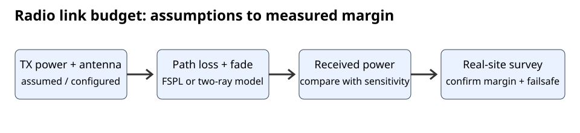

# ELRS link budget and radio-loss behavior

**Summary.** The RF budget predicts comfortable link margin in the assumed scenarios, but does not replace antenna and interference measurements on the robot. Radio loss should trigger braking while balance control continues; the receiver failsafe timer is not the robot watchdog. [COMPUTED / FROM FILE]

## Question and method

What link margin is plausible for a 2.4 GHz control link, and what should the robot do when packets stop? A free-space and two-ray budget was calculated with stated antenna, cable, polarization, and shadowing assumptions; the recovery policy was aligned with the saved controller safety decision. [FROM FILE; provenance is listed in `NUMBERS.md`]

## Results

| Result | Value | Provenance |
|---|---:|---|
| Illustrative radio sensitivity | −108 dBm | [FROM WEB, as cited by source] |
| Baseline TX power | 100 mW / +20 dBm | [ASSUMED / COMPUTED] |
| Calculated fade margin at 200 m | 42.8 dB FSPL; 29.4 dB two-ray | [COMPUTED] |
| Robot radio freshness watchdog | 150 ms | [FROM FILE] |
| Link-loss response | Brake and keep balancing; powered rest after controlled stop | [FROM FILE] |

## What this teaches

A link budget is a conditional received-power estimate, not a range guarantee: antenna orientation, body shadowing, ground reflection, interference, and receiver telemetry can dominate. Safety behavior is a separate control problem. A stale-radio timeout should trigger a controlled stop that preserves balance; an immediate torque cut is reserved for the separately defined hardware/fault stops. [STANDARD PRACTICE / FROM FILE]

## Limits

Antenna gain, feed loss, shadowing, two-ray geometry, and indoor fading margins are assumptions or literature priors. The margin does not establish performance in the robot's actual environment. [ASSUMED / UNKNOWN]

## Reproduce

Recalculate free-space path loss as 20 log10(4πd/λ), then compute received power from transmit power, antenna gains, cable and polarization losses, and path loss. Subtract receiver sensitivity to obtain margin; compare the free-space and two-ray results using the same assumptions. [STANDARD PRACTICE]

## What the real robot must confirm

Measure packet age and loss behavior end to end, receiver no-pulse behavior, antenna placement/orientation, telemetry asymmetry, and stop distance with a supported robot. [UNKNOWN / STANDARD PRACTICE]

## Figure

