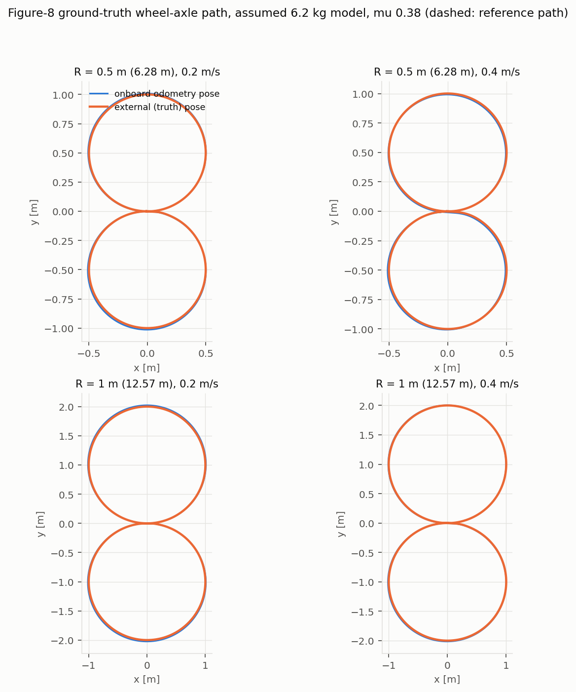
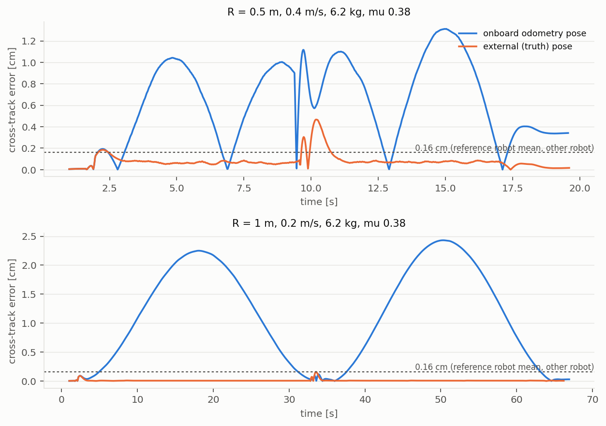

# Figure-8 path tracking: pose source and crossing error

How accurately can a heading loop and path follower track a figure-8, and how much
does the pose source matter? All numerical results below come from simulation runs,
except the explicitly identified reference value and model assumptions. All 32/32
runs completed without a fall or wheel torque saturation. Ideal external pose gave
smaller errors than onboard odometry; the largest external-pose deviations occurred
at the crossing, where the direction of curvature changes.

The paths shown use the assumed 6.2 kg model at μ 0.38. External pose is the
noise-free simulation truth, standing in for motion capture.

Video: [figure-8 run at 0.4 m/s with onboard odometry](../../media/figure-8-path-tracking.mp4)
(simulation, firmware in the loop).

## Method and result

- Run a flat-floor plant at 1 kHz with the current firmware at 500 Hz.
  Use a heading-error and cross-track controller with curvature preview and yaw-rate limits.
- Test two-circle paths at R 0.5 m and R 1.0 m, speeds 0.2 and 0.4 m/s,
  the nominal 5.06 kg and assumed 6.2 kg models, and μ 0.8 and 0.38.
  Compare onboard dead reckoning with external pose across the 32 runs.
- Measure wheel-axle midpoint distance to the nearest reference circle from ground
  truth at 500 Hz, from t = 1 s until the stop completes. Report mean and maximum error.
- Count a fall on body–ground contact, |pitch| > 30°, or FAULT/ESTOP.
  Count saturation when |wheel torque command| ≥ 2.0 N·m − 1e-4 on either wheel.

| Path and pose source | Falls | Completed | Wheel saturation time | Max absolute pitch | Mean error | Max error |
|---|---|---|---|---|---|---|
| R 0.5 m, external pose | 0 | 8/8 | 0.000 s | 3.01° | 0.021–0.090 cm | 0.156–0.769 cm |
| R 0.5 m, onboard odometry | 0 | 8/8 | 0.000 s | 2.97° | 0.269–0.666 cm | 0.796–1.541 cm |
| R 1.0 m, external pose | 0 | 8/8 | 0.000 s | 3.01° | 0.008–0.046 cm | 0.131–0.649 cm |
| R 1.0 m, onboard odometry | 0 | 8/8 | 0.000 s | 2.99° | 0.333–1.164 cm | 1.007–2.544 cm |

The reference robot's reported mean error of 0.16 cm is
**reference only, different robot and unknown method**: its path shape, speed,
pose source and error definition are unknown. The R 1.0 m two-circle geometry is
an assumption based on its reported 12.57 m path length.

The 0.16 cm line is the same reference-only value, not an equivalent test target.

## What this teaches

Curvature preview helps a rate-limited yaw loop negotiate the crossing. With onboard
odometry, a smooth error bulge also appears around each circle: the speed estimate
read about 0.6–1.2 % low in the three runs checked. Effective rolling radius or the
speed definition are possible causes, not isolated findings.

## What the real robot must confirm

**Simulation only, firmware in the loop; not run on a robot.** The mode stays off by
default and has no host message to enable it on hardware. Forward driving alone was
tested. Gains were tuned in-sample on the R 0.5 m, 0.4 m/s, μ 0.38 external-pose
setting with both models; the other 30 runs were not used for tuning.

The nearest-circle metric can under-count error near the crossing. Real localisation
noise, IMU sensor gyro bias and noise, encoder quantisation, and rolling radius must
be checked before treating these errors as physical performance.

## Reproduce

With the study harness and model files, use Python 3.11.18 and MuJoCo 3.3.7; run `bash run_build.sh`, then `bash run_gates.sh` to rebuild and repeat the matrix.
For a single case, run `fig8_sim.py` at radius 0.5 m, speed 0.4 m/s, μ 0.38 and the assumed 6.2 kg model; compare `--pose ext` with `--pose odom`.
