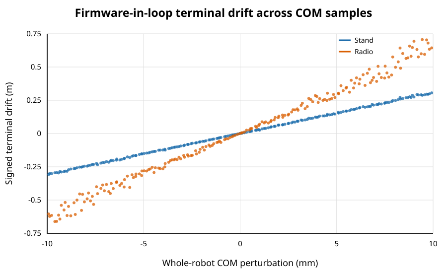
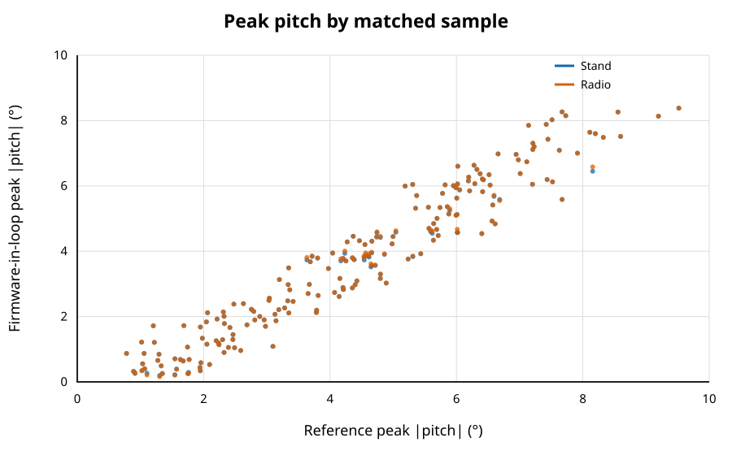
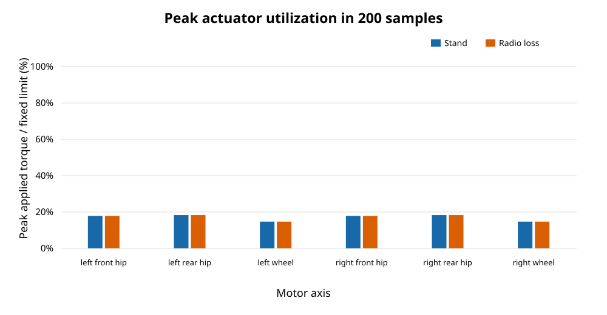
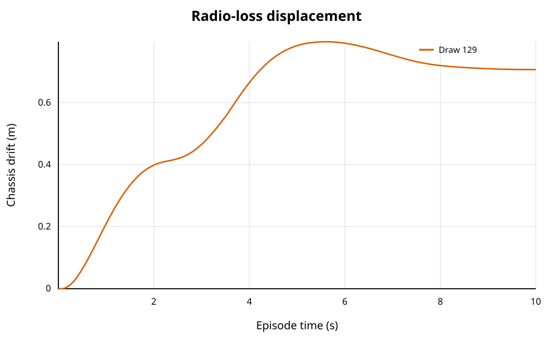
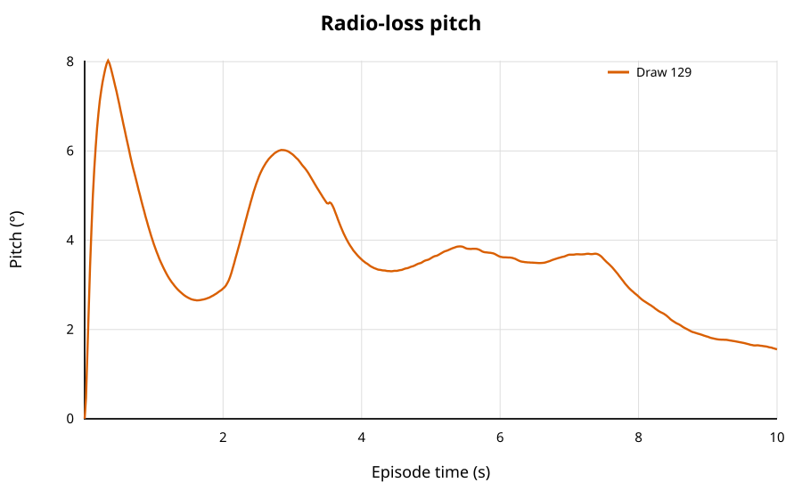
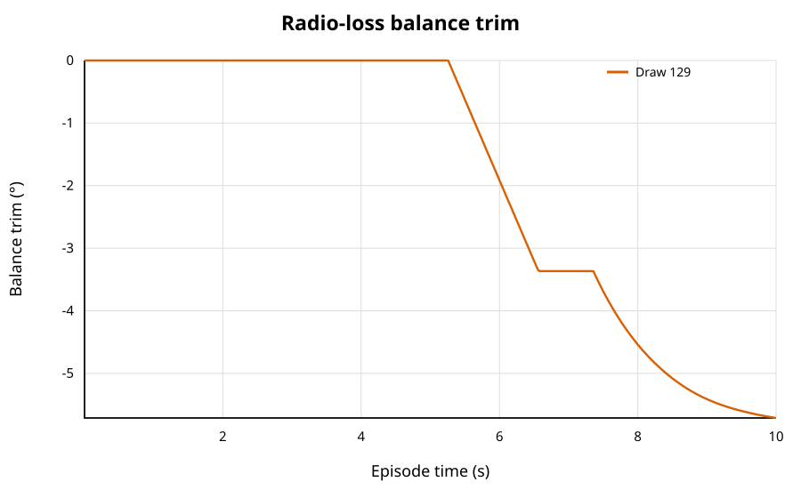

# Firmware-in-the-loop Monte Carlo results

**Summary.** Host firmware-in-the-loop runs survived the stand and radio-loss cases across all 200 samples in both cohorts. In the newer 30 N push case, 199 of 200 avoided a fall; the single fall combined low friction and long delay. These results do not establish target timing or hardware reliability. [COMPUTED / FROM FILE]

## Question and method

How do firmware-in-the-loop outcomes change across sampled robot parameters and a harder push? Result tables record 200 draws per cohort. The earlier campaign included standing with a push and radio-loss stop; the later campaign added a 30 N push case. Survival below means no body-contact fall in a result row. [FROM FILE; provenance is listed in `NUMBERS.md`]

## Results

| Firmware scenario | Robots | Survived / total | Key observation |
|---|---:|---:|---|
| Earlier cohort: stand and radio loss | 200 each | 200/200 each | No body-contact falls in either CSV case [COMPUTED] |
| Later cohort: stand and radio loss | 200 each | 200/200 each | No body-contact falls in either CSV case [COMPUTED] |
| Later cohort: 30 N push | 200 | 199/200 | One body-contact fall; μ=0.343 and transport delay=4.479 ms in that row [COMPUTED] |

The later cohort's worst push peak pitch was 96.79°; this is the fall case, not a stable-response metric. [COMPUTED]

## What this teaches

Monte Carlo counts describe the declared sample and gate. A high pass count does not prove safety outside the sampled distribution; report failures and their parameter combinations. Terminal drift and maximum transient excursion answer different questions. Firmware-in-the-loop exercises C logic and command mapping, while host simulation does not establish microcontroller scheduling, physical CAN timing, or hardware motor response. [STANDARD PRACTICE / FROM FILE]

## Limits

The cohorts are synthetic and inherit their model, controller, friction, motor, and timing assumptions. The later push fall demonstrates a counterexample within that cohort; no probability-of-failure claim follows from 200 samples. The result CSVs and traces are the evidence summarized here. [FROM FILE / UNKNOWN]

## Reproduce

The summary table and figures in this page are the released outputs. Exact reruns require the original sample-generation ranges, firmware-in-loop harness, and execution environment; those inputs are not bundled here. A new study should freeze those inputs and the fall/scoring rule before sampling, then report both the complete count and each failure row. [FROM FILE / STANDARD PRACTICE]

## What the real robot must confirm

Measure as-built mass and center of mass, tire-floor friction, motor torque versus speed and voltage, CAN age and jitter, transient workspace, and independently measured stop distance. Validate radio-loss behavior on a supported fixture before any free balancing test. [UNKNOWN / STANDARD PRACTICE]
