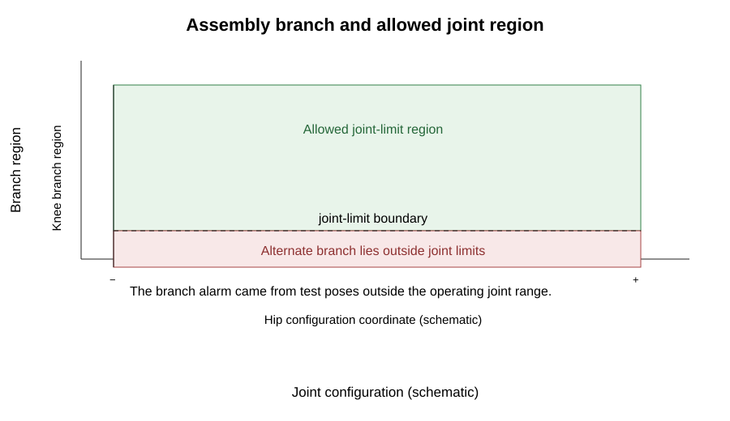

# Five-bar branch check

[COMPUTED] The reported “wrong branch” alarm was a test artifact: the alternate circle-intersection branch lies outside the joint-limit region used for operation. The revised regression checks preserve the assembly branch explicitly, and the host suite passes 26/26 checks.

## Method and result

[FROM FILE] The check replayed known assembly streams through both left and right leg entry points, including a negative-assembly case, while retaining the virtual-work and controller checks. The problematic test poses belonged to an alternate geometric branch outside the allowable joint range. The result explains the alarm for the tested fixture; it does not claim automatic branch identification from arbitrary cold starts.

## What this teaches

[STANDARD PRACTICE] A closed-chain mechanism can have multiple geometric solutions. A solver should preserve a known assembly branch and enforce physical joint limits. Tests should distinguish mathematically valid roots from mechanically reachable poses.

## What the real robot must confirm

[UNKNOWN] Confirm encoder zero, assembly branch, mechanical joint stops, and link geometry on the built leg. The simulation checks do not measure compliance or establish a dynamic workspace.
