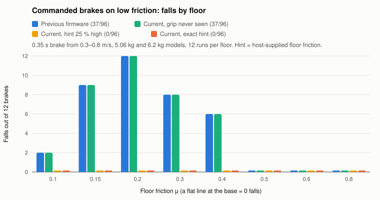

# Grip-aware braking: keep the stop inside the floor's friction

## Tóm tắt tiếng Việt

[COMPUTED: FW11 integration run] Firmware ước lượng độ bám của sàn (từ các lần trượt bánh hoặc từ gợi ý ma sát do máy chủ gửi) và kéo giãn lệnh phanh để gia tốc hãm không vượt 0.48·μ·g. Khi biết trước độ bám, số lần ngã khi phanh trong 96 ca giảm từ 37 xuống 0, kể cả khi gợi ý cao hơn thực tế 25 %. Nếu firmware chưa từng thấy sàn trơn, kết quả giữ nguyên như trước (37/96). Trên sàn bình thường, quãng phanh không đổi. Chỉ là mô phỏng.

**Result in one line.** [COMPUTED: FW11 integration run] When the floor's grip is known before the stop, commanded-brake falls go from **37/96 to 0/96**, with no new falls and an unchanged normal-friction stopping distance (ratio 1.000000 over 76 comparisons).

## The problem

[STANDARD THEORY] A wheeled pendulum cannot slow its centre of mass faster than μ·g. [FROM FILE: wheel-slip study] The balance controller brakes lean-first and commits the lean before any slip is visible, so on a slippery floor a normal 0.35 s brake falls. The [slip study](slip-estimator-and-traction-governor.md) showed that reacting to the first slip is too late: the firmware has to know the grip before it brakes.

## What the firmware does

[FROM FILE: `firmware/control/grip_limit.c`, `balance_ctrl.c`]

- **Grip estimate.** `mu_used = min(mu_slip, host hint)`; 1.0 means "no low grip known". A slip alarm drops `mu_slip` to the recent no-slip use of grip, clamped to [ASSUMED] 0.08–0.30, held 5 s, then relaxed at 0.05/s. Driving that demonstrably carries more grip raises it again. An optional host `floor_mu_hint` can set it before the robot ever slips. Evidence is ignored while any encoder is frozen or suspect.
- **Brake limiter.** [ASSUMED: development values] While `mu_used` ≤ 0.50 and a command exceeds the limits, a jerk-limited tracker stretches the brake: peak deceleration ≤ 0.48·mu_used·g, jerk ≤ that over 0.30 s. The 0.48 margin keeps a 0.6·μ·g budget even if the hint is 25 % too high. Commands within the limits, floors with no low grip known and every host-loss stop pass through bit for bit.
- **One owner for the speed reference.** [COMPUTED: diagnosis run] In an earlier version, a wheel slip too small to arm the slip alarm dragged the speed estimate below the true speed. When the alarm then fired, the slip governor restarted its reference from that wrong estimate and stepped the reference from 0.519 to 0.014 m/s in one tick, and the robot fell. The governor may now not *start* while the limiter already owns the reference. In that case the largest reference step drops to 0.0012 m/s per tick and the robot stays up (peak back-pitch −5.2°).

## Results

Brake sweep [ASSUMED scenario]: friction 0.1–0.8 × 0.3–0.8 m/s × 5.06 kg and 6.2 kg models; 96 commanded brakes and 96 host-loss stops per condition.

| Condition | Previous firmware | Current firmware (FW11) |
|---|---|---|
| Commanded brakes, exact floor hint | 37/96 falls | **0/96** (37 rescued, 0 new) |
| Commanded brakes, hint 25 % too high | 37/96 | **0/96** (37 rescued, 0 new) |
| Commanded brakes, grip never seen | 37/96 | 37/96 (0 new) |
| Host-loss stops, all three conditions | 0/96 | 0/96 |
| Slip matrix, 16 cases, no hint / with hint | 2/16 | 2/16 / **1/16** (the remaining fall is a 5 mm step, not a brake) |
| Normal friction (μ 0.8) stopping distance | reference | ratio 1.000000 over 76 comparisons |

[COMPUTED: FW11 integration run] Firmware in the loop 6/6 identical, 108 frozen-encoder runs identical with 0 falls, figure-8 32/32 identical. Host build 0 warnings and CTest 73/73 on the published tree, including `test_grip_limit`.

**Cost.** [COMPUTED] A stretched stop is longer: 0.232 m for 6.2 kg on μ 0.15 from 0.5 m/s (physical minimum 0.085 m), 0.653 m for 5.06 kg on μ 0.10 from 0.8 m/s (minimum 0.326 m).

## Limits

- [COMPUTED] **Grip never seen, no protection.** Without a slip or a hint the floor gives no upper bound on friction, so the 37 falls remain. On a floor not known to have μ ≥ 0.5 the host must send a conservative hint or plan brakes within 0.6·μ_min·g.
- [FROM FILE] `floor_mu_hint` is a tick input only; it is not yet in the USB host protocol. Hints do not expire in firmware.
- [COMPUTED] With a fast 0.8 s acceleration ramp on low friction, 25 runs fall *before* the stop: 20 because the ramp itself asks for 0.84–1.91 × μ·g, and 5 (6.2 kg at 0.8 m/s) because the motors saturate on every floor. These falls happen with the previous firmware too. They are planner requirements, not braking faults.
- [FROM FILE] The speed estimator still follows wheels that slip below the 0.15 m/s alarm threshold; the ownership rule only stops the governor from acting on it.
- [ASSUMED] All constants are simulation values; tyre compliance and real friction are unmeasured.
