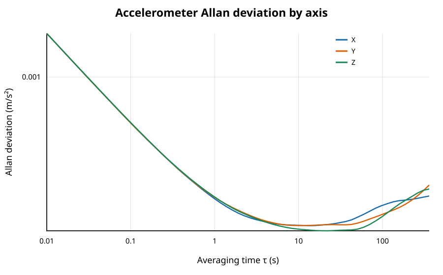

# IMU sensor noise and Allan variance

**Summary.** The synthetic noise model recovered most injected components, while the long-term random-walk fit differed more. Estimator replay remained stable in the tested cases, but yaw cannot self-correct without an absolute heading reference. This is not an installed-sensor calibration. [COMPUTED]

## Question and method

Can a stationary sensor log recover a useful noise model, and how does that noise affect the existing pitch estimator? A synthetic stationary record was generated and its Allan deviation fitted; synthetic streams were then replayed through the C estimator at nominal and enlarged noise levels. [FROM FILE; provenance is listed in `NUMBERS.md`]

## Results

| Result | Value | Evidence |
|---|---:|---|
| Synthetic stationary record | 2 h at 1 kHz | [COMPUTED] |
| Maximum fit error, full mixture | 24.84% | [COMPUTED] |
| Maximum component-isolation cross-check error | 10.36% | [COMPUTED] |
| Pitch RMS, nominal / 3× noise | 0.0531° / 0.1629° | [COMPUTED] |
| Yaw excursion without absolute heading reference | 574.6° / 1723.8° | [COMPUTED] |

## What this teaches

Allan deviation versus averaging time separates white noise, bias-instability-like behavior, and random walk by slope. A fitted curve can validate that a synthetic generator is internally consistent, but only a stationary log from the installed sensor estimates that unit's parameters. Gyro bias integrates into attitude; without an external heading observation, yaw drift is unobservable. [STANDARD PRACTICE; COMPUTED]

## Limits

All values are generated-model results, not measured sensor specifications. The long-time random-walk fit is the weakest part of the closure check; no temperature sweep or installed-sensor calibration is included. [FROM FILE / UNKNOWN]

## Reproduce

The raw synthetic log and MATLAB generator are not included in this public tree. To reproduce the analysis with a new log, calculate overlapping Allan deviation for each body axis using the sample rate and signal units, then fit the white-noise, bias-instability, and random-walk terms. The figure shows the saved fit; source provenance is in `NUMBERS.md`. [FROM FILE / STANDARD PRACTICE]

## What the real robot must confirm

Record a stationary, time-stamped sensor log at operating temperature, estimate Allan coefficients by axis, and compare yaw and pitch drift against an independent reference. [UNKNOWN / STANDARD PRACTICE]
