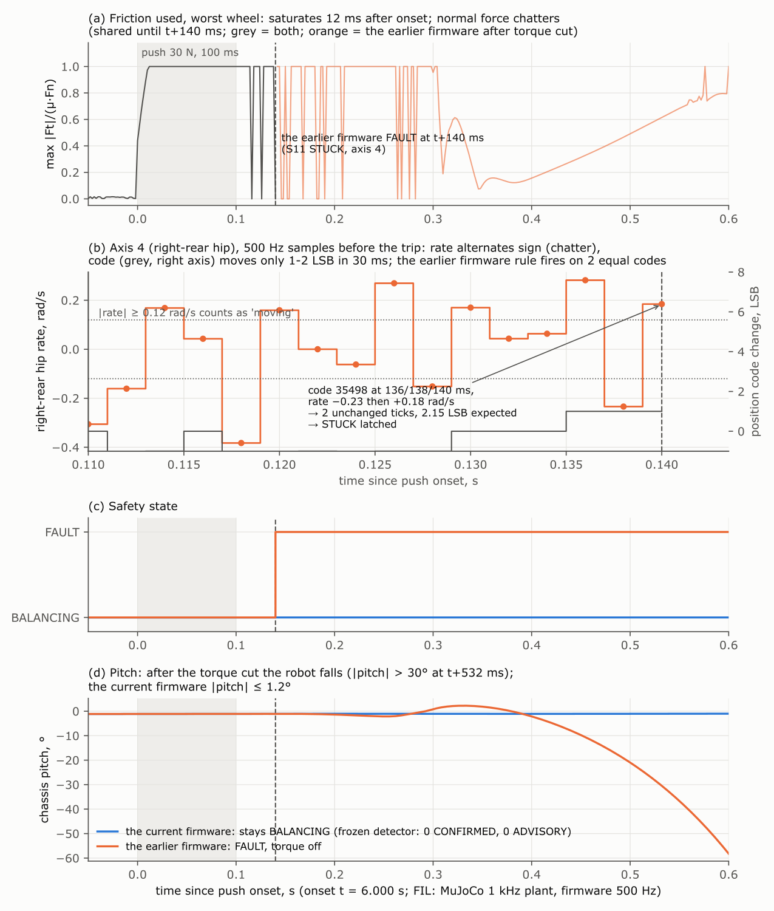

# Lateral push on low friction: why did the robot fall?

Does a lateral push on low friction overwhelm balance control, or trigger a safety fault?
The earlier firmware mistook slip-induced hip-encoder chatter for a stuck encoder,
cut torque, and then fell forward. The current firmware had 0/16 falls on the same
comparison grid. Unless marked otherwise, numerical results below are from simulation runs.

## Method and result

- Run MuJoCo physics at 1 kHz and the C firmware at 500 Hz, with the robot standing still.
- Apply a +Y push of 30 N for 100 ms at the chassis center of mass, starting at
  t = 2 s; run for 14 s. Set floor and wheel friction to μ 0.25 / 0.38 / 0.5 / 0.8.
- Test two 5.06 kg models and assumed 6.2 kg and 7.5 kg models. The latter adds
  a 1.3 kg battery lump to the 6.2 kg model, with inertia scaled with mass.
- For the firmware comparison, push at t = 6 s at the combined center of mass of
  the chassis and welded children, use radio-loss policy 0, and omit torque feedback.
- Declare a fall at |pitch| or |roll| > 30°, or any non-wheel ground contact;
  inspect contact forces, encoders, IMU sensor signals, torque commands, and safety states.

The comparison below uses identical rig settings for both firmware versions.

| Firmware | Falls / 16 | Falling cases | First abnormal event |
|---|---|---|---|
| The earlier firmware | 2 | One 5.06 kg model at μ 0.25; the nominal 5.06 kg model at μ 0.38 | False stuck-encoder fault at 140 / 114 ms after push onset |
| The current firmware | 0 | None | BALANCING throughout; 0 CONFIRMED, 0 ADVISORY |

At μ 0.25, the earlier firmware saw wheel slip at +12 ms and encoder chatter
from about +30 ms. Its detector latched at +140 ms, switching to FAULT and
zeroing all torque. |Pitch| exceeded 30° at +532 ms. The current firmware received
a byte-identical encoder stream up to +140 ms and stayed balanced.

Comparison traces for the 5.06 kg model that fell at μ 0.25; push onset is t = 6 s.

Video: [the same push, both firmware versions side by side](../../media/lateral-push-low-friction.mp4)
(simulation, firmware in the loop).

In the chassis-center-of-mass push grid, the current firmware also had 0/16 falls
and no safety-state change. Every case slipped. Peak roll was 1.68–3.90° and
wheel torque was ≤ 0.031 N·m, with no saturation. For the nominal 5.06 kg model,
final lateral drift was 4.01 cm at μ 0.25 and 0.04 cm at μ 0.8.

## What this teaches

A fall after slip can originate in fault detection. Here, the first abnormal
decision was the stuck-encoder latch; the subsequent loss of balance followed torque removal.
The current firmware already uses an evidence-integrating detector with a rate
deadband and an IMU transient gate. This study added a regression replay of the
16 push streams, with no firmware behavior change. It passed with 0 CONFIRMED
and 0 ADVISORY; CTest passed 47/47 and the firmware in the loop checks passed 6/6.

## What the real robot must confirm

**Simulation only, firmware in the loop; not run on a robot.** Tire compliance,
tread, friction, and contact chatter remain unmeasured. The μ 0.25 / 0.8 inputs
bracket conditions rather than fit measured friction; the 7.5 kg model is an
assumed mass lump rather than CAD. The contact-chatter explanation depends on
the simulated rigid wheel and contact model.

Stronger 45, 60, 75 and 90 N pushes gave 0/64 falls, but the assumed 6.2 kg model
at μ 0.25 and 90 N falsely confirmed a frozen encoder at +308 ms, leading to a
controlled stop and REST at 5.556 s. This does not establish physical stopping safety.
Measure the real encoder response during slip and preserve frozen-encoder fault
detection when assessing any threshold change.

## Reproduce

With the simulation source and both firmware versions, run `python make_models.py`, `bash run_baseline.sh`, and `bash run_traces.sh`.
Use `bash run_corpus.sh` and `bash run_gates.sh` for replay and checks; render the trace figure with `python plot_root_cause.py`.
