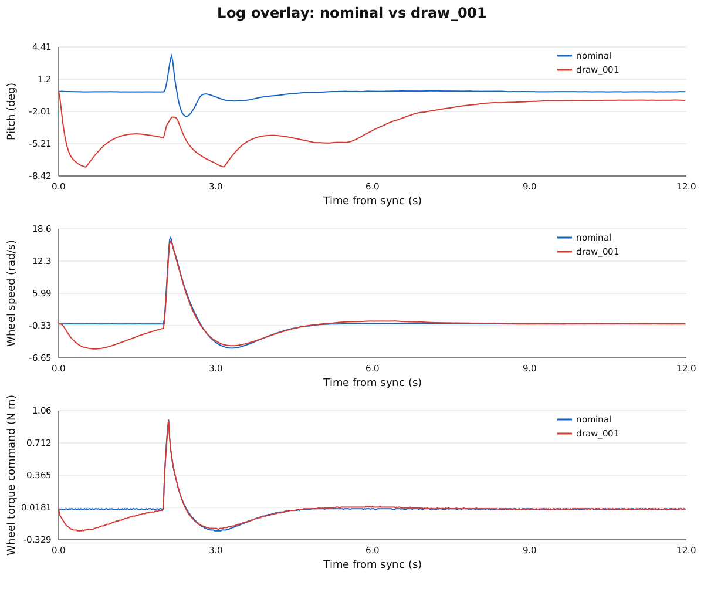

# One log format for simulation and hardware

## Tóm tắt tiếng Việt

[FROM FILE: `../LOG1FIX2/LOG1FIX2_REPORT.md`, “Change and results”] Bộ ghi demo đã sửa để lưu pitch mô phỏng và pitch ước lượng bằng radian đúng với tên trường. [COMPUTED: LOG1FIX2 report] Hai log mô phỏng MuJoCo, mỗi log 12 s, được đóng gói và giải mã thành 6.240 frame, không lỗi CRC hoặc mất frame. Hình overlay đổi radian sang độ chỉ để hiển thị; file log vẫn dùng radian.

## Frame layout

[FROM FILE: `../LOG1_sim_hw_log/LOG1_REPORT.md`, “Fields and conversion”] Simulation and hardware use the same versioned frame builder and decoder. A frame contains an 18-byte header, payload, 4-byte CRC-32C, COBS encoding, and a zero delimiter.

[FROM FILE: LOG1 firmware definitions] `TELEM_FAST` (type `0x81`) has a 176-byte payload. `TELEM_HEALTH` (type `0x82`) has a 56-byte payload. The fast payload carries estimates, leg state, six-axis motor data, trim, gyro bias, and bus measurements. The health payload carries CAN, motor, radio, power, reset, CPU, and stack health.

[FROM FILE: `../LOG1FIX2/LOG1FIX2_REPORT.md`, “Units of fixture fields”] The corrected demo stores `euler_rad[0]` and `true_pitch_rad` in radians (rad). Gyro rate and motor velocity are in rad/s; time is in seconds (s). The plot converts pitch from rad to degrees for readability. Simulation truth is kept separate from hardware telemetry.

## Bandwidth

[COMPUTED: `../LOG1_sim_hw_log/LOG1_REPORT.md`, “Bandwidth”] At 500 Hz fast and 20 Hz health, the conservative encoded stream bound is 102.6 kB/s. The measured two-log stream was 101.6 kB/s. The bound allows up to 202 bytes per fast frame and 82 bytes per health frame, including framing overhead.

[COMPUTED: LOG1 report] A nominal USB CDC rate of about 1 MB/s is roughly 9.7 times the bound. UART 8N1 at 921.6 kbaud carries at most 92,160 B/s, below the bound; 3 Mbaud carries 300,000 B/s, about 2.9 times the bound. [UNKNOWN] These nominal rates do not establish sustained throughput on the real robot.

## Fixed simulation demo

[COMPUTED: `../LOG1FIX2/LOG1FIX2_REPORT.md`, “Change and results”] The corrected firmware-in-the-loop simulation generated nominal and `draw_001` logs. Each ran for 12 s with 6,000 samples at 500 Hz; the controller ran at 500 Hz and MuJoCo at 1 kHz. The push was 30 N from 2.0 to 2.1 s. Each packed log decoded to 6,240 frames with zero CRC errors and zero missing frames.

[COMPUTED: LOG1FIX2 report] Between these simulation traces, pitch RMSE was 0.06417 rad and peak absolute difference was 0.13048 rad. The plot expresses pitch in degrees, but the fixture values remain radians. These are differences between two simulations, not errors against hardware.

[COMPUTED] The saved overlay was visually inspected. The white background, titles, pitch axis in degrees, wheel-speed axis in rad/s, torque axis in N·m, time axes in seconds, tick numbers, and legend are visible. [COMPUTED: LOG1FIX2 report] SHA-256 of this copied `overlay.png`: `4bde18346fe6b80c0eb482b1087720c8b1a78142e79d3d863fc6efedd50670cb`.

## What this teaches

[STANDARD PRACTICE] A unit suffix is a data contract. Convert at the serialization boundary so `euler_rad` always contains radians, even if a user interface displays degrees.

[COMPUTED: LOG1FIX2 report] The corrected writer converts degrees to radians when it creates the fixture; the plot converts radians to degrees only for display. This separation prevents a readable plot from silently changing stored units.

[STANDARD PRACTICE] Check both field names and value ranges. A schema test can catch degree values accidentally written into a field named `*_rad`.

## What the real robot must confirm

[UNKNOWN] Confirm the firmware and host use rad for `euler_rad`, rad/s for `gyro_rad_s` and motor velocity, and seconds for timestamps. Confirm axis order and signs, encoder direction, timestamp synchronization, and torque-command meaning against an independent bench measurement.

[UNKNOWN] Measure actual logging cadence, sequence gaps, CRC errors, USB/UART throughput under controller load, and whether sensor fields represent measured or estimated hardware signals. Simulation-only `true_*` fields have no hardware equivalent.
