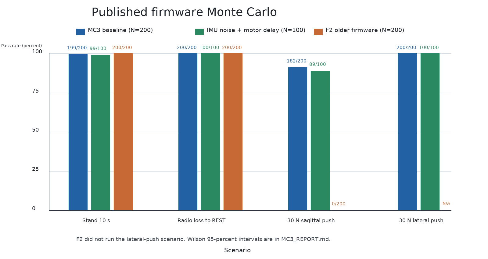

# Monte Carlo robustness of the published firmware

## Tóm tắt tiếng Việt

[COMPUTED: `../MC3_published_fw/MC3_REPORT.md`, “Monte Carlo results”] Mô phỏng firmware đã xuất bản đạt 199/200 mẫu khi đứng, 200/200 khi mất radio và đi về REST, 182/200 khi bị đẩy dọc 30 N, và 200/200 khi bị đẩy ngang 30 N. [COMPUTED: cùng nguồn, “IMU noise + motor-command delay cohort”] Cohort bổ sung gồm 100 mẫu có nhiễu IMU sensor và trễ lệnh motor đạt lần lượt 99/100, 100/100, 89/100 và 100/100. Cú đẩy dọc là tình huống yếu nhất ở cả hai cohort. [UNKNOWN: phạm vi nghiên cứu] Đây là kết quả mô phỏng cho các phân bố giả định; không phải tỷ lệ an toàn của reference robot ngoài đời.

## Scope and randomized inputs

[FROM FILE: `../MC3_published_fw/MC3_REPORT.md`, “Scope and method”; `../R2_methods/METHODS.md`, row 19] This study sampled synthetic robot models and scored four episodes: stand for 10 s, radio loss to REST, a 30 N sagittal push, and a 30 N lateral push. The two main cohorts were 200 baseline models and 100 models with IMU sensor noise plus motor-command delay.

[COMPUTED: `../MC3_published_fw/model_manifest.csv`, rows 1–200] Across the 200 generated models, realized ranges were mass 3.701–6.393 kg, chassis shift −16.088 to +16.406 mm, ground friction coefficient μ 0.304–1.196, and wheel damping 0.00103–0.04998 N·m·s/rad. These are observed sample extrema, not guaranteed population bounds. [COMPUTED: `../MC3_published_fw/results_baseline.csv`, rows 1–200] Sensor age ranged 1.003–2.992 ms and transport delay 3.008–5.986 ms. [FROM FILE: `../MC3_published_fw/MC3_REPORT.md`, “Scope and method”] These timing values were stored per sample; baseline did not apply them as noise or command delay.

[COMPUTED: `../MC3_published_fw/results_imu_delay.csv`, rows 1–100; `run_mc3_injected.py`, `imu_delay` mode] In the 100-sample stress cohort, IMU white noise was applied independently each tick with gyro standard deviation 0.005 rad/s and accelerometer standard deviation 0.05 m/s². Motor-command delay used each sample’s transport-delay value (realized 3.008–5.986 ms). Encoder noise was disabled in this main stress cohort. [UNKNOWN: `MC3_REPORT.md`, “Scope and method”] Sensor sample age itself was not injected as a stale measurement.

## Pass rates

[COMPUTED: `../MC3_published_fw/MC3_REPORT.md`, “Monte Carlo results” and “IMU noise + motor-command delay cohort”] Wilson 95% intervals use the number of independent robot samples as *n*.

| Scenario | Baseline, n=200 | IMU noise + motor delay, n=100 |
|---|---:|---:|
| Stand, 10 s | 199/200 (99.5%; 97.2–99.9%) | 99/100 (99%; 94.55–99.82%) |
| Radio loss to REST | 200/200 (100%; 98.1–100%) | 100/100 (100%; 96.30–100%) |
| 30 N sagittal push | 182/200 (91%; 86.2–94.2%) | 89/100 (89%; 81.37–93.75%) |
| 30 N lateral push | 200/200 (100%; 98.1–100%) | 100/100 (100%; 96.30–100%) |

[COMPUTED: `../MC3_published_fw/MC3_figure.png`] The source PNG was inspected: its white background, title, axis labels, tick numbers, scenario labels, legend, and sample counts are visible. The study copy has the same SHA-256 as that inspected source: `f98bec9e8dada1910ece2d29a64ca39dd9c8aa006f74186fac216f4224791ab8`.

## Forward push: weakest case

[COMPUTED: `../MC3_published_fw/MC3_REPORT.md`, “Monte Carlo results”] The sagittal (forward) push had the lowest pass rate in both cohorts: 182/200 baseline and 89/100 with IMU noise plus motor delay. Baseline had 18 failing samples: 8 failed the peak-pitch gate and 10 failed the drift gate. Sample 170 contacted the body and failed peak pitch (95.94°), final pitch versus S11, and final-state gates; it did not fail the drift gate.

| Cohort and sample | Worst result | Randomized model parameters |
|---|---|---|
| [COMPUTED] Baseline 170 | Peak pitch 95.94°; body contact | Mass 4.038 kg; CoM shift −2.924 mm; μ 0.343; wheel damping 0.00490 N·m·s/rad |
| [COMPUTED] Baseline 127 | Final drift 0.540 m | Mass 3.789 kg; CoM shift +8.288 mm; μ 0.968; wheel damping 0.04915 N·m·s/rad |
| [COMPUTED] IMU + delay 73 | Peak pitch 22.25° | Mass 3.756 kg; CoM shift +6.842 mm; μ 0.664; wheel damping 0.00849 N·m·s/rad; sensor age 2.293 ms; applied motor delay 5.089 ms |
| [COMPUTED] IMU + delay 35 | Final drift 0.529 m | Mass 3.740 kg; CoM shift +8.926 mm; μ 0.616; wheel damping 0.03920 N·m·s/rad; sensor age 2.016 ms; applied motor delay 5.493 ms |

[COMPUTED: `../MC3_published_fw/MC3_REPORT.md`, “What this teaches”] The sampled forward-push failures show that the scored outcome depends on disturbance direction and the chosen pass gates. They do not identify one physical cause: the worst examples combine different sampled mass, CoM, friction, and damping values.

## What this teaches

[STANDARD PRACTICE] The sample pass fraction is p̂ = k/n, where k is the number of passing robot samples. A Wilson 95% interval communicates finite-sample uncertainty; it does not account for model error or an incorrect assumed distribution. [FROM FILE: `../MC3_published_fw/MC3_REPORT.md`, “What this teaches”] A 30 N push lasting 0.1 s has impulse J = FΔt = 3 N·s. This makes push duration part of the disturbance definition: the reference robot response depends on the force-time input, not force alone.

[COMPUTED: `../MC3_published_fw/MC3_REPORT.md`, “Monte Carlo results”] In this sample set, standing and radio-loss-to-REST passed more often than either forward-push cohort. The forward disturbance exposed cases that the other tests did not. That is why scenario-specific gates and failure examples matter alongside an aggregate pass count.

[FROM FILE: `../MC3_published_fw/MC3_REPORT.md`, “Scope and method”] The delay model interpolated between historical motor commands for a fractional number of 1 ms ticks. It represents a fixed transport delay approximation, not measured actuator latency, jitter, dropped commands, or motor bandwidth.

## What this does not show

[UNKNOWN] These are simulation results only. The assumed parameter distributions have not been calibrated against a measured population of reference robots. The intervals do not turn the simulated pass fractions into real-robot reliability or safety probabilities.

[UNKNOWN] The study does not validate the assumed friction, wheel damping, mass distribution, IMU sensor noise, or command delay against hardware. The injected cohort does not include sensor-age effects, encoder noise, delay jitter, packet loss, or a distribution of real motor response dynamics.

[FROM FILE: `../MC3_published_fw/MC3_REPORT.md`, “Scope and method”] The baseline cohort did not apply its stored transport-delay and sensor-age values. Do not interpret its rates as a zero-delay-vs-delayed comparison. The 100-sample cohort adds IMU noise and motor delay together, so its difference from baseline cannot isolate either effect.

## What the real robot must confirm

[UNKNOWN] Measure assembled mass and CoM, wheel–floor traction and rolling loss, IMU sensor noise over relevant bandwidth and temperature, packet age, command-to-torque delay, and actuator response. Confirm the push force, duration, direction, application point, and scoring signals before comparing tests.

[STANDARD PRACTICE] Begin any physical disturbance check at low force with appropriate restraint and supervision. [UNKNOWN] The 30 N simulated push does not establish that the reference robot can safely withstand that push.
