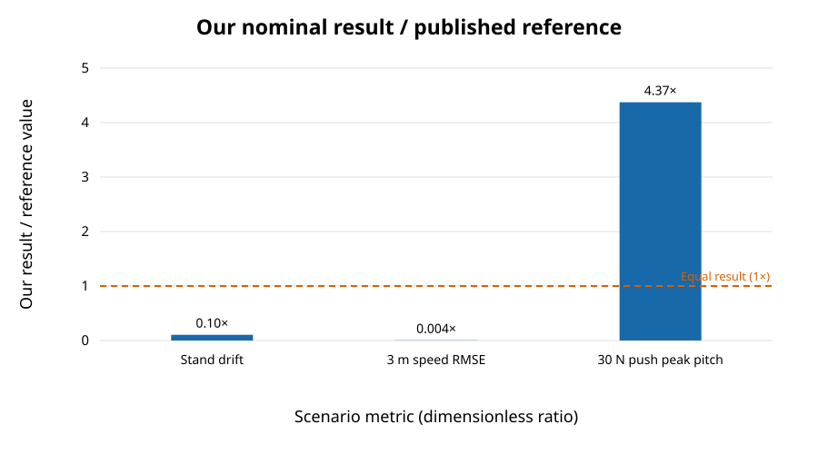

# Benchmark against published reference scenarios

**Summary.** In these fixtures, our stand drift and speed error are lower than the published reference values, while peak pitch under the 30 N push is about four times higher. All six 5 mm and 10 mm step cases entered FAULT at nominal friction near 0.38. The test conditions are not fully matched. [COMPUTED / FROM FILE]

## Question and method

How does the current firmware-in-the-loop model compare with the DM-jump reference robot's published stand, push, and straight-run results? The reference's published figures were aligned with our 5.06 kg nominal MuJoCo firmware model; an assumed 6.2 kg variant was also run. The comparison separates event-corrected push pitch from initial pitch and measures drift from a declared time origin. [FROM FILE; provenance is listed in `NUMBERS.md`]

## Results

| Scenario | Published reference | Our model | Interpretation |
|---|---:|---:|---|
| Stand drift | 0.22 cm | 0.023 cm, nominal | Lower in this fixture [FROM FILE / COMPUTED] |
| 3 m steady-speed RMSE | 6.22 cm/s | 0.023 cm/s, nominal | Lower in this fixture [FROM FILE / COMPUTED] |
| 30 N / 100 ms push peak pitch | 0.818° | 3.577°, nominal | About 4.4× higher [FROM FILE / COMPUTED] |
| Uniform 5 mm and 10 mm step fields | Reference RMS pitch 0.164° on its 4.36 m step field | Six tested step cases ended in FAULT at μ=0.379 | Not a like-for-like terrain fixture [FROM FILE / COMPUTED] |

## What this teaches

Benchmark comparisons depend on matching initial state, mass distribution, center of mass, push point and axis, terrain layout, friction, controller, and metric window. Event-corrected peak pitch avoids counting startup transients as push response. A mismatch is still useful: it identifies which assumptions or physical measurements could explain a result. [STANDARD PRACTICE]

## Limits

The reference publishes its own simulation setup; the reproduced scenarios do not share identical initial conditions or terrain geometry. The 6.2 kg case is an assumed lumped model. The 5 mm and 10 mm failures apply only to these simulated step fixtures, not every real step. [FROM FILE / ASSUMED]

## Reproduce

The ratio chart in this repository is derived from the values in the results table and the cited published values. Exact scenario reruns require the original firmware-in-loop harness and scenario definitions; these are not included in this public tree. For a comparable new benchmark, match mass, center of mass, push point and axis, terrain geometry, friction, controller, and metric window first. [FROM FILE / STANDARD PRACTICE]

## What the real robot must confirm

Measure actual mass and center of mass, wheel-floor friction, applied push force and location, speed reference, and obstacle geometry. Repeat only on a supported, supervised setup with matched metrics and logged contact state. [UNKNOWN / STANDARD PRACTICE]
