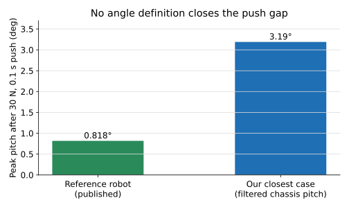

# 30 N push: angle definition check

[COMPUTED] The experiment ran 72 trajectories across three model variants, three physics timesteps, four push locations, and two push directions, then scored each trajectory using three angle definitions. No definition approaches the published 0.818° reference peak; the closest result is 3.19°. The gap therefore remains in the controller or plant model, not in the angle definition alone.

## Method and result

[COMPUTED] The closest value was the filtered chassis pitch in the assumed 6.2 kg model with the push applied at chassis center of mass, in the backward direction at 0.25 ms. It was still well above the reference. Changing the measurement point or filtering the angle did not reconcile the results.

## What this teaches

[STANDARD PRACTICE] A comparison needs the same physical input and measured state. Chassis pitch and a virtual leg angle are different quantities; filtering can change a peak, but cannot establish that two controllers or plants are equivalent. A residual discrepancy after checking the measurement definition points to control or model assumptions.

## What the real robot must confirm

[UNKNOWN] Verify push force and duration, force application point, chassis pitch sensing, controller gains, mass properties, and actuator response on the physical system before comparing peak angles.
