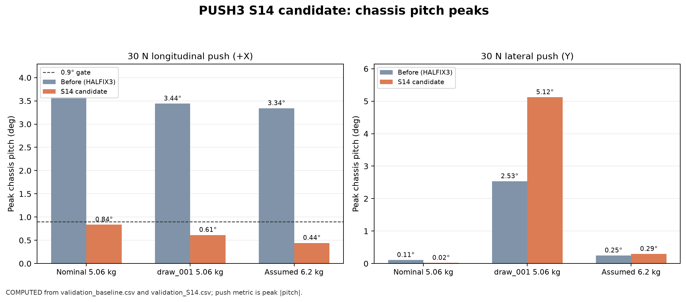

# Why the simulated chassis pitch differs from the reference robot

## Tóm tắt tiếng Việt

[COMPUTED: `../PUSH3_hip_pitch/PUSH3_REPORT.md`, “Bảng trước / sau”] Bảng gain S14 làm giảm pitch đỉnh khi đẩy dọc trong ba mô hình từ 3.34–3.58° xuống 0.44–0.84°. Tuy nhiên, mô hình `draw_001` hồi quy khi đứng và đẩy ngang; các thử nghiệm trễ và nhiễu cũng thất bại. [COMPUTED: `../PUSH3B/PUSH3B_REPORT.md`, “Tìm kiếm và gates”] PUSH3B không tìm được bảng gain dùng chung vượt các gate. Giữ bảng baseline; S14 không được chấp nhận. [COMPUTED: `../PUSH4_trim/PUSH4_REPORT.md`, “Before / after results”; `../PUSH5_blend/PUSH5_REPORT.md`, “Kết quả theo α”] PUSH4 cải thiện một fixture FIL nhưng vẫn không qua các cổng đẩy âm, lateral và trễ/nhiễu. PUSH5 thử chín blend gain; không blend nào đồng thời đạt mục tiêu push và các cổng hồi quy: ở α=1.0, pitch −X vẫn là 1.112° so với mục tiêu ≤1.0°, còn các blend đạt FIL đều vượt cổng lateral trên `draw_001`; α cao hơn cũng mất ổn định với trễ. Trong miền gain đã thử, chỉ chỉnh gain không đủ để đạt mục tiêu push mà không tạo hồi quy về trễ/nhiễu hoặc lateral. Cần nghiên cứu thay đổi cấu trúc điều khiển/cơ cấu và đánh giá lại; đây là kết luận của các mô phỏng được nêu, không phải khẳng định phổ quát.

## What is being compared

[COMPUTED: `../PUSH3_hip_pitch/PUSH3_REPORT.md`, “Bảng trước / sau”] PUSH3 compares simulated peak chassis pitch after a 30 N longitudinal push. The three models are nominal 5.06 kg, `draw_001` 5.06 kg, and an assumed 6.2 kg model. The 6.2 kg model uses an assumed added mass lump.

| Model | Baseline peak pitch | S14 peak pitch | S14 outcome |
|---|---:|---:|---|
| Nominal 5.06 kg | 3.577° | 0.838° | [COMPUTED] Below the 0.9° target for +X |
| `draw_001` 5.06 kg | 3.440° | 0.615° | [COMPUTED] Below the 0.9° target for +X |
| Assumed 6.2 kg | 3.341° | 0.443° | [COMPUTED] Below the 0.9° target for +X |

[FROM FILE: `../PUSH3_hip_pitch/PUSH3_REPORT.md`, test setup] The nominal push is applied in simulation at +X for 100 ms, with zero added delay and zero sensor noise. A separate reference figure reports 0.818°, but its push location, mass distribution, pitch definition, and controller are not fully specified. It is not a fully matched benchmark.

## Why S14 was rejected

[COMPUTED: `../PUSH3_hip_pitch/PUSH3_REPORT.md`, “Bảng trước / sau”] In `draw_001`, standing peak pitch rose from 2.662° to 5.164°. Under lateral push it rose from 2.532° to 5.121°. Its S14 -X push was 1.112°, above the 0.9° target.

[COMPUTED: PUSH3 report, “Delay, noise, torque, and step results”] With added delay, 5 of 6 directional push cases faulted at 5 ms; all 6 faulted at 10 ms before finishing the push. In the sampled sensor-noise cases, 15 of 18 trials faulted. These are test results for the copied simulation harness, not failure rates for hardware.

[COMPUTED: `../PUSH3B/PUSH3B_REPORT.md`, “Tìm kiếm và gates”] PUSH3B searched 48 shared gain tables using combined 5 ms delay and sampled IMU sensor noise. No candidate passed all cases, so the exported firmware kept the baseline table. Its report records 41/41 C tests, 2/6 FIL cases, and F3 counts of 219 PASS, 31 FAIL, and 2 INCOMPLETE. The S14 improvement on a single push metric was not enough to adopt it.

[COMPUTED] The copied PNG was inspected. Panel titles, axes in degrees, tick numbers, values, target line, and white background are visible. The chart shows longitudinal improvement and the `draw_001` lateral regression.

## PUSH4/PUSH5: gain tuning reached a limit in the tested family

[COMPUTED: `../PUSH4_trim/PUSH4_REPORT.md`, “Before / after results”] PUSH4 held the stiff hip gain table and changed how pitch reference and S9 trim were used. Its copied firmware improved the offset-stand FIL case from 2/6 to 6/6, but the candidate still failed the negative push gate (1.112° against a 1.0° limit), lateral regression (+15.9%), and delay/noise robustness checks. The reported 3.8 mm drift margin in its passing offset stand is narrow.

[COMPUTED: `../PUSH5_blend/PUSH5_REPORT.md`, “Kết quả theo α”] PUSH5 tested nine gain blends. No blend passed all non-push gates and the push target together. At α=1.0 the worst clean push pitch was still 1.112°; blends that passed FIL had a lateral regression on `draw_001`, and higher blends lost stability under delay. The report also distinguishes IMU-only noise trials from combined IMU and encoder noise; do not merge those outcomes.

[COMPUTED: PUSH4 and PUSH5 reports] Within these tested gain families, gain tuning alone did not meet the push target without delay/noise or lateral regressions. This supports testing a structural change to the controller or mechanism, then repeating the paired push, lateral, delay, noise, and standing checks. It does not prove every possible gain schedule will fail.

## What this teaches

[STANDARD PRACTICE] A controller change must pass a paired regression set across standing, both push axes, delay, sensor noise, driving, and safety transitions. A favorable single disturbance result does not establish robust control.

[COMPUTED: PUSH3 and PUSH3B reports] A stiffer hip pitch response reduced longitudinal pitch in the selected simulations, but the shared candidate did not pass the broader regression and disturbance tests. Added transport delay and sensor noise can expose failures hidden by a clean nominal run.

[STANDARD PRACTICE] Define push force, duration, application point, measured angle, filtering, mass and center of mass before comparing a simulation with a reference robot.

## What the real robot must confirm

[UNKNOWN] Measure assembled mass and center of mass, force-time profile and application point, sensor noise, and sensor-to-torque delay. Confirm motor limits and standing/lateral response before changing gains. [FROM FILE: PUSH3 and PUSH3B reports] S14 was rejected; PUSH3B retained baseline gains. Neither result is a real-robot performance claim.

## Firmware status

[FROM FILE: `../PUSH3_hip_pitch/PUSH3_REPORT.md`, rejection status] PUSH3's S14 gain candidate is rejected. [FROM FILE: `../PUSH3B/PUSH3B_REPORT.md`, final output] The shared-gain search did not select a replacement; its output retains baseline gains.
