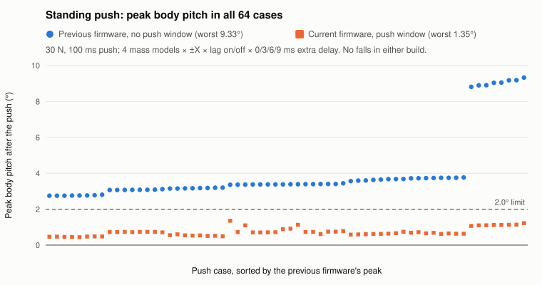

# Push window: a standing-push reflex that stays out of the way

## Tóm tắt tiếng Việt

[COMPUTED: FW11 integration run] Phản xạ chống đẩy (vòng góc thân có bộ dự báo Smith và "nhường" vị trí) chỉ chạy trong một cửa sổ ngắn, mở khi cảm biến IMU phát hiện cú đẩy lúc robot đứng yên. Với cú đẩy 30 N trong 100 ms, góc nghiêng lớn nhất trong 64 ca giảm từ 9.328° xuống 1.355°, không ca nào ngã. Ngoài cửa sổ, đầu ra giống hệt firmware trước từng bit; không có cửa sổ nào mở nhầm trong 778 lần chạy không có đẩy. Chỉ là mô phỏng.

**Result in one line.** [COMPUTED: FW11 integration run] Worst peak pitch after a 30 N, 100 ms standing push drops from **9.328° to 1.355°** over 64 cases, with **0 falls** and **0 false windows in 778 runs without a push**.

## The problem

[FROM FILE: push-yield study] A robot whose centre of mass sits off the axle holds its stance with a standing position error. A push in the wrong direction drives that error into the position clamp, swings the legs out and gives a large pitch excursion: 9.328° worst case on the 64-case push matrix with the previous firmware.

A stiff, delay-compensated body-pitch loop plus a short "yield" reflex fixes the push (0.927° worst case), but it hurts everything else when left on:

- [FROM FILE] Always on, it fights the commanded lean while driving. Nominal drive speed in the firmware-in-the-loop suite fell from 0.1746 to 0.1648 m/s, outside the 0.20 ± 0.03 m/s target, and one acceleration case in the slip matrix gained a new fall.
- [FROM FILE] Gated to standstill only, it still made standing hip-encoder freezes that the fault detector never flags worse: up to 4.22° → 5.51° pitch.

## The window

[FROM FILE: `firmware/control/h5_balance.c`, `balance_ctrl.c`] One weight, `push_weight` in [0, 1], gates every push term: the body-pitch hip torque, the predictor states and the yield. While the window is closed none of those terms is computed into the output, so the controller is exactly the previous one.

- **Arming.** [ASSUMED: development values] Grounded and BALANCING, host link fine, no frozen or suspect encoder, and commanded standstill (|v| ≤ 0.015 m/s, |a| < 0.06 m/s², |jerk| < 0.1 m/s³, |yaw rate| < 0.02 rad/s) held for 1.5 s. Any violation closes the window at once.
- **Detector, IMU sensor only.** At standstill the commanded pitch acceleration is zero, so the measured pitch rate itself is the disturbance: |rate| > 0.04 rad/s with a growing rate faster than 8 rad/s², held 4 ms.
- **Quiet gate.** A 0.5 s low-pass of |rate| must be below 0.04 rad/s before the onset. This keeps out the rocking of an unflagged encoder freeze, which grows to 0.088–0.18 rad/s.
- **Envelope.** Smooth 4 ms fade-in, 3.0 s hold, 2.0 s fade-out (step < 0.002 per tick), then re-arm after 1.5 s. At opening the predictor history is zeroed and the washout seeded, so the added hip torque starts at about 0.02 N·m.

## Results

| Check | Previous firmware | Current firmware (FW11) |
|---|---|---|
| Standing push, 64 cases: 30 N / 100 ms, 4 mass models × ±X × lag on/off × 0/3/6/9 ms delay | 0/64 falls, worst **9.328°** | 0/64 falls, worst **1.355°**; window opened in 64/64, 4–20 ms after the push starts |
| Firmware in the loop, 6 cases | 6/6 | 6/6, output lines identical |
| Frozen-encoder set, 108 runs | 0 falls | 0 falls, 108/108 identical |
| Figure-8 tracking, 32 runs | 32/32 | 32/32 identical |
| Slip matrix, 16 cases | 2/16 falls | 2/16, same fall times |
| Windows opened without a push | — | **0 in 778 runs** |
| 20 000-tick stimulus with the window closed | reference output | identical SHA-256 |

[COMPUTED: FW11 integration run] Host build 0 warnings and CTest 73/73 on the published tree.

## Limits

- [COMPUTED] Standing pushes only. A push while driving or turning gets the previous behaviour.
- [COMPUTED] Small taps (the 6 N / 30 ms pushes in the firmware-in-the-loop suite) stay under the detector threshold, by design.
- [COMPUTED] The quiet gate has a small margin on the CoM-offset model, which is still settling when pushed (0.027–0.030 rad/s against 0.04). A push during stronger settling would get the previous behaviour.
- [COMPUTED: stress run, outside the gates] On friction 0.1 the same push fails in 28/64 cases, with or without the grip-aware braking code. That is a floor limit, not a window fault.
- [ASSUMED] One push profile and one IMU sensor noise model. Thresholds and predictor values are simulation values; real compliance, sensor vibration and bus latency are unmeasured.
