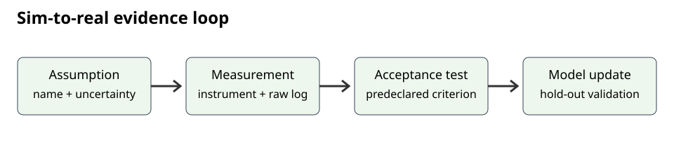

# Sim-to-real measurement checklist

**Summary.** This checklist turns simulation assumptions into instrumented measurements, acceptance criteria, and model updates. Start with axis signs, kinematics, and timing; treat simulation results as hypotheses until synchronized robot logs are available. [FROM FILE]

## Question and method

Which physical quantities should be measured before trusting a simulation-to-hardware comparison? The checklist groups model assumptions into observable bench or supported-robot tests, with instruments, acceptance criteria, and the model parameter each result should update. [FROM FILE; provenance is listed in `NUMBERS.md`]

## Results

The deliverable is the checklist itself rather than a new simulation. It covers geometry and encoder signs, sensor bias, motor and bus timing, packet loss, contact, power, and safety behavior. [FROM FILE]

[Download the checklist CSV](sim_to_real_checklist.csv)

| Use | Evidence to collect | Output |
|---|---|---|
| Establish frames and signs | Matched joint poses and signed single-axis motions | Update zeros, signs, and kinematic model |
| Identify timing | Synchronized acquisition, control, CAN, and response timestamps | Replace fixed delay with measured timing distribution |
| Check drive response | Command, torque/current, voltage, and encoder capture | Fit drive-specific lag and operating envelope |
| Validate safe stopping | Radio-loss, wired stop, and fault behavior on a supported fixture | Update stop and rearm model |

## What this teaches

A checklist makes validation falsifiable: each assumed parameter needs a measured quantity, a reference instrument, a pass criterion, and a model update. Collect synchronized evidence so latency, estimator error, and actuator lag can be distinguished. [STANDARD PRACTICE]

## Limits

Checklist entries are proposed measurements and thresholds, not completed hardware tests or permission to run them. Thresholds tagged as assumed in the CSV require review against the actual instrumentation and safe fixture. [FROM FILE / GUESS]

## Reproduce

Use the downloadable CSV in this repository as the machine-readable checklist. Record measured values with units, timestamps, test conditions, instrument details, and deviations from each criterion. [FROM FILE / STANDARD PRACTICE]

## What the real robot must confirm

Complete relevant entries only on a supervised, mechanically supported setup and record actual as-built configuration, instruments, raw logs, and deviations from the stated acceptance criteria. [UNKNOWN / STANDARD PRACTICE]

## Figure

