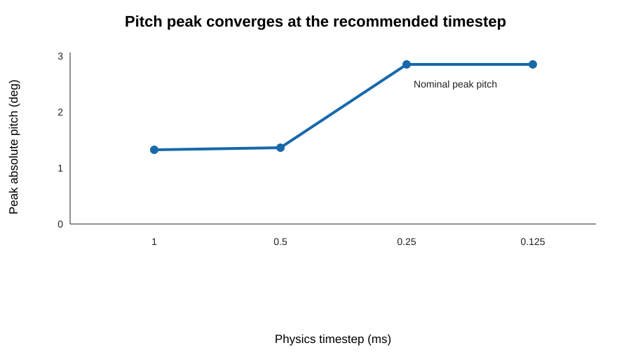

# Simulation timestep sensitivity

[COMPUTED] The earlier 52% and 17% changes came from the test rig’s own sampled PD controller, which held commands across physics steps. With `implicitfast` and a 0.25 ms timestep, refining to 0.125 ms changed peak pitch by 0.083%, 0.156%, and 0.119% in the three tested models. Recommended fixture setting: **0.25 ms, `implicitfast`**, with the documented Newton solver settings.

## Method and result

[COMPUTED] The study compared timestep and integrator choices, then checked controller timing and selected contact and constraint settings. At 0.25 ms, the three peak pitches were 2.847°, 2.029°, and 3.184°; the next timestep refinement changed each by less than 0.16%. The large coarse-step changes coincide with saturated, rapidly oscillating test-rig commands. This is a numerical recommendation for these fixtures, not proof that the simulated robot or controller is physically accurate.

## What this teaches

[STANDARD PRACTICE] Integration error depends on both the plant and how the controller samples and holds its command. Changing integrator alone cannot fix a feedback loop whose update timing is inconsistent with the simulated dynamics. Refinement should compare the quantity of interest while keeping controller timing and model assumptions explicit.

## What the real robot must confirm

[UNKNOWN] Measure controller execution period, actuator delay, contact response, and joint damping. Compare measured traces before using this timestep study as a physical accuracy claim.
