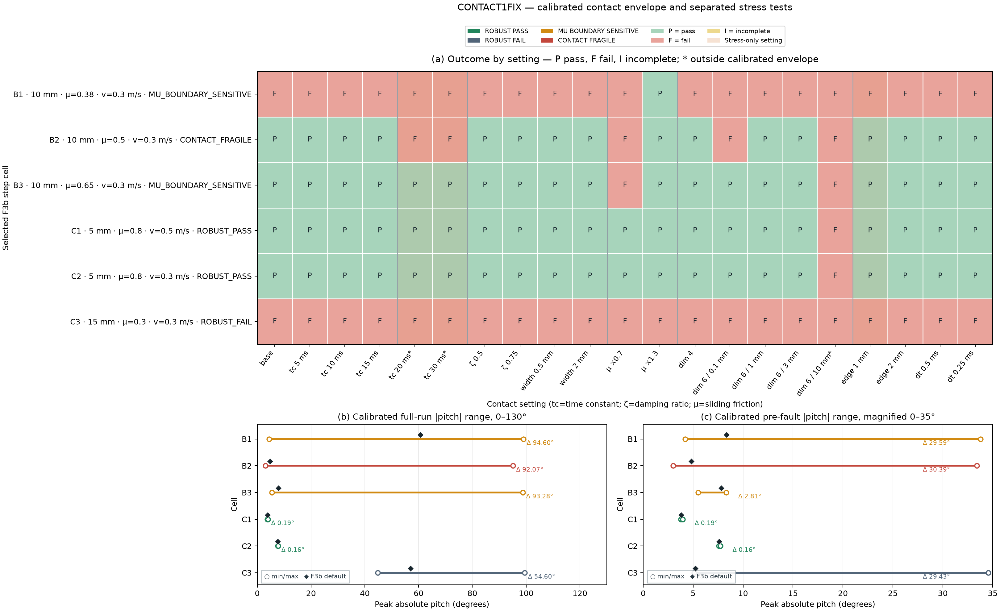

# Step results and contact sensitivity

## Tóm tắt tiếng Việt

[COMPUTED: `../CONTACT1FIX/CONTACT1FIX_REPORT.md`, “Calibrated classification”] Phân tích hiệu chuẩn mới chia kết quả thành bốn lớp: `ROBUST_PASS`, `ROBUST_FAIL`, `CONTACT_FRAGILE`, và `MU_BOUNDARY_SENSITIVE`. Trong sáu ô, có hai ô qua ổn định, một ô trượt ổn định, hai ô nhạy với μ, và một ô nhạy với biến thể tiếp xúc khác. [FROM FILE: report, “Flat-ground stalls and stress variants”] Các giá trị `tc` ngoài miền hiệu chuẩn và rolling lớn được hiển thị riêng là stress test, không gộp vào phân loại chính.

## Scope and calibrated envelope

[COMPUTED: `../CONTACT1FIX/CONTACT1FIX_REPORT.md`, “Question and method”] The study reuses 120 frozen contact runs and adds six MuJoCo runs at `tc=0.015 s`. The classification below uses 18 calibrated contact settings per cell. Motor-reference runs are separate from this contact classification.

| Cell | Scenario | Class | Baseline | Pass / fail in calibrated set | Flip setting |
|---|---|---|---|---:|---|
| B1 | 10 mm, μ=0.38, 0.3 m/s | `MU_BOUNDARY_SENSITIVE` | FAIL | 1 / 17 | friction 1.3 |
| B2 | 10 mm, μ=0.5, 0.3 m/s | `CONTACT_FRAGILE` | PASS | 16 / 2 | friction 0.7; condim6 rolling 0.0001 m |
| B3 | 10 mm, μ=0.65, 0.3 m/s | `MU_BOUNDARY_SENSITIVE` | PASS | 17 / 1 | friction 0.7 |
| C1 | 5 mm, μ=0.8, 0.5 m/s | `ROBUST_PASS` | PASS | 18 / 0 | None |
| C2 | 5 mm, μ=0.8, 0.3 m/s | `ROBUST_PASS` | PASS | 18 / 0 | None |
| C3 | 15 mm, μ=0.3, 0.3 m/s | `ROBUST_FAIL` | FAIL | 0 / 18 | None |

[COMPUTED: CONTACT1FIX report] A non-friction flip is classified `CONTACT_FRAGILE`; if outcomes only flip under a ±30% sliding-friction variant, the class is `MU_BOUNDARY_SENSITIVE`. Invariant pass and invariant fail are `ROBUST_PASS` and `ROBUST_FAIL`. “Robust” means invariant over this finite calibrated set only.

[COMPUTED] The saved figure was inspected. Its 4-way class legend, setting labels, pass/fail marks, pitch panels, axis units, tick numbers, and title are visible. It marks stress-only variants outside the calibrated envelope separately from the calibrated outcome matrix.

## Stress variants and interpretation

[COMPUTED: `../CONTACT1FIX/CONTACT1FIX_REPORT.md`, “Flat-ground stalls and stress variants”] Settings `tc=0.020/0.030 s` and rolling `0.010 m` are stress variants outside the calibrated envelope. Three rolling-stress cases stopped on flat ground before step contact: B3 at 7.872 s, C1 at 3.150 s, and C2 at 4.286 s. These are not scored as step-climbing failures.

[FROM FILE: CONTACT1FIX report, “Sensitivity and model caveats”] MuJoCo rolling friction is a length parameter. At wheel radius 0.0603 m, rolling value 0.010 m maps approximately to Crr 0.166 using Crr≈ρ/R, above the cited 0.005–0.02 prior. The sweep also notes that long contact time constants can allow penetration comparable to the tested step heights.

[COMPUTED: CONTACT1FIX report] The sweep did not independently rerun all 120 frozen runs. The six new `tc=0.015 s` runs completed in the latest run. Contact/material priors remain unverified on the real robot.

## What this teaches

[STANDARD PRACTICE] State the credible parameter envelope before calling a result robust. Keep calibrated variations separate from deliberate stress tests.

[COMPUTED: CONTACT1FIX report] Friction-only flips and other contact-parameter flips indicate different sensitivities. Separating them prevents friction-boundary behavior from being mistaken for solver/contact sensitivity.

[FROM FILE: CONTACT1FIX report] Contact solver settings can change effective compliance, penetration, rolling drag, and contact topology. Compare those physical responses with measured tyres and obstacles rather than interpreting parameter names alone.

## What the real robot must confirm

[UNKNOWN] Measure loaded wheel radius, tyre compression and rebound, rolling loss separately from bearing drag, traction onset and repeatability on representative surfaces, actual masses and centers of mass, and real step-edge geometry. Revisit these classes if measured values fall outside the tested envelope.
