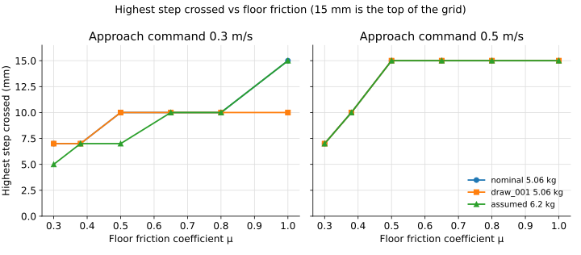

# Step crossing versus floor friction and speed

[COMPUTED] A deterministic firmware in the loop sweep completed 252 cases: 219 passes, 30 failures, and 3 incomplete runs. At 0.5 m/s, the highest sampled passing step was 10 mm at μ=0.38; it reached at least 15 mm at μ≥0.50. At lower approach speeds, some cases failed even at higher friction. The map is for the tested model and repeated square-edged field, not a universal hardware limit.

## Method and result

[FROM FILE] The sweep varied step height, floor friction, model variant, and commanded approach speed. A pass required crossing the full field and maintaining balance afterward. [COMPUTED] Across the 33 non-passing cases, the first recorded adverse mechanism was wheel slip in 25, blocked progress in 7, and wheel torque saturation in 1. The observed chain was edge contact → slip, blocked progress, or wheel torque saturation → tilt-limit or packet-policy fault → possible body contact. This ordering describes the tested traces; it does not prove one single cause for every fall.

[COMPUTED] The first blocked-drive detector stopped 13 previously passing crossings. Restricting it to reference speeds at or below 0.15 m/s restored all crossings in the 0.3 and 0.5 m/s grid: no pass was lost. In the separate slow trials, all six slow falls became safe stops without body contact. The same gate also stopped a traversable nominal 5 mm step at μ=0.8. Slow-step discrimination remains open. **This stop is not in the public firmware.**

[FROM FILE] [View the existing firmware in the loop step and push video](../../media/firmware-in-loop-step-and-push.mp4).

## What this teaches

[STANDARD PRACTICE] Available tire force is bounded approximately by `|Fₜ| ≤ μFₙ`; speed also changes the energy available to climb an edge (`Eₖ = ½mv²`). A wheel can slip or lose forward progress before the controller reaches a tilt or communication fault. A safe stop is a distinct outcome from completing an obstacle.

## What the real robot must confirm

[UNKNOWN] Measure tire and floor friction, wheel radius and deformation, edge shape, mass distribution, delivered motor torque versus speed, and actual stopping distance. Test slow obstacle classification only in a supervised, constrained setup. The simulated safe stops do not establish physical stopping safety.
