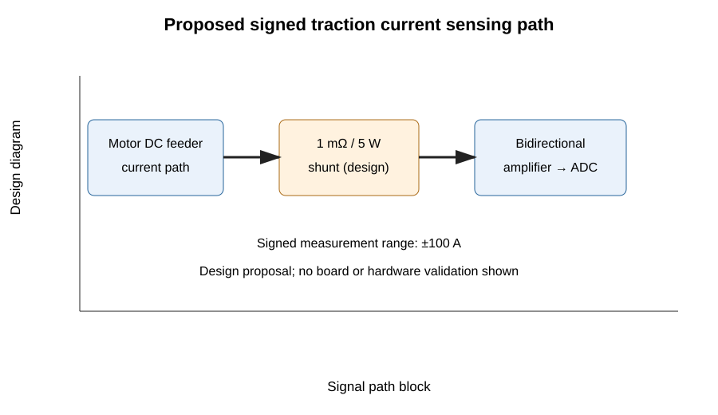

# Traction current sensing design

[GUESS] The proposed design uses a 1 mΩ, 5 W shunt with a bidirectional amplifier and a ±100 A design range on a separate power carrier. This is a design recommendation only; no hardware implementation or validation is claimed.

## Method and result

[COMPUTED] A replay and error-budget comparison examined shunt-amplifier, Hall-effect, and drive-feedback-only options. The selected 1 mΩ design provides a signed analog measurement independent of drive CAN feedback. A current sensor alone cannot detect DC-link overvoltage during regeneration; a separate voltage measurement and brake-chopper path are still required.

## What this teaches

[STANDARD PRACTICE] Shunt heating follows `P = I²R`: reducing resistance lowers loss but also reduces signal per ampere. A bidirectional measurement needs a midpoint reference. Current measurement location matters: a sensor on the control-board branch cannot report total traction current.

## What the real robot must confirm

[UNKNOWN] Verify the shunt’s pulse and continuous thermal ratings, Kelvin wiring, amplifier and ADC calibration, signed current accuracy, noise, sample timing, and protection coordination in a current-limited bench fixture. The ±100 A signal range does not establish a safe wiring or fuse rating.
