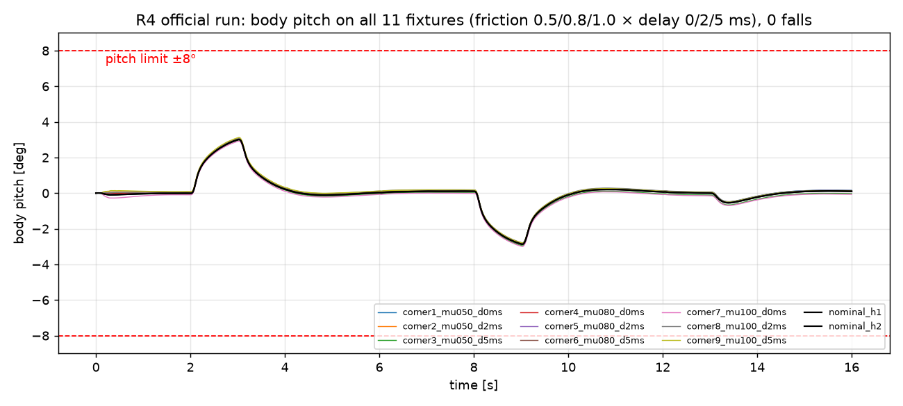
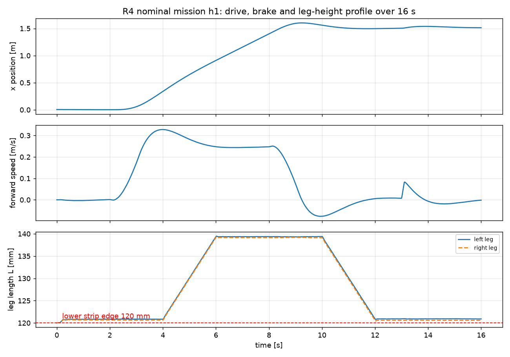
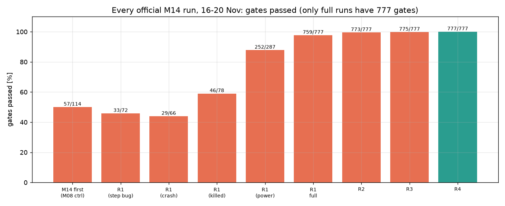
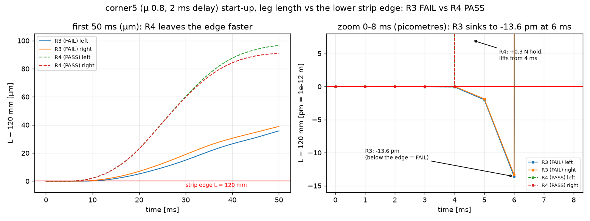

# MATLAB studio, milestone M14: mission under friction and actuator delay

All results are simulation results (MATLAB/Simscape Multibody, R2026b). No motors have been powered. Hardware applicability is unknown. The robot mass in this milestone is the CAD estimate of 3.62 kg; a 5.1 kg whole-robot check is the next step.

## What M14 tests

One 16 s mission (stand up, drive about 1.5 m, brake, raise and lower the legs, short disturbance near 13 s) on 11 fixtures: two nominal runs and a 3 × 3 grid of ground friction (0.5, 0.8, 1.0) × **added actuator delay (0, 2, 5 ms)**. The delay is a discrete delay block between the controller's torque request and the drives, on top of a 5 ms drive lag. Each fixture is scored against 70+ gates (fall, pitch ≤ 8°, leg angle and leg length inside their allowed ranges, slip, energy, warnings); a full run has 777 gates, and one failed gate fails the milestone. Gates were not relaxed between attempts.

## Result

**777 / 777 gates pass**: all 11 fixtures run the full 16 s with no fall, peak body pitch 2.98–3.13° ([per-fixture table](../../results/m14_summary.csv)). Friction and delay barely change the response.

## What changed to get there

The balance controller inherited from the earlier models was designed without input delay; its estimated extra-delay margin was 1.4 ms, and with 2–5 ms added delay the body pitched about 30° in early probes. The new controller and its fixes:

| Attempt | Gates | Problem found | Change |
| --- | --- | --- | --- |
| first | 57/114 | no delay margin | delay-aware LQR: gains solved on a model that includes the drive lag and a 3 ms lumped input delay |
| R1 | 759/777 | leg angle left its range by 0.67 mrad at the end of braking | leg-angle term added to the LQR cost, input weight ×4, predictor anti-windup |
| R2 | 773/777 | legs started exactly on the leg-length limit; encoder noise pushed them nanometres below it | smooth capped start-up target and an outward-only force floor |
| R3 | 775/777 | the floor had exactly zero margin; one fixture sank 13.6 picometres | floor raised to hold + 0.3 N |
| **R4** | **777/777** | — | — |

Extra-delay margin of the final controller on the reduced model: 12 ms (11 ms with the drive firmware's latch pattern), compared with 1.4 ms before. Several early runs also failed for computing reasons (a floating-point step-size bug, memory, power events); those were fixed in the run harness, not by changing the robot or the scoring.

## Limits

- Simulation only, CAD mass 3.62 kg, assumed friction and noise models.
- The MATLAB studio source is not in this repository yet; it will be released in later batches after review.
- The earlier MuJoCo delay study in the main README (falls at 2 ms and above) used a different model and controller and is unchanged.
