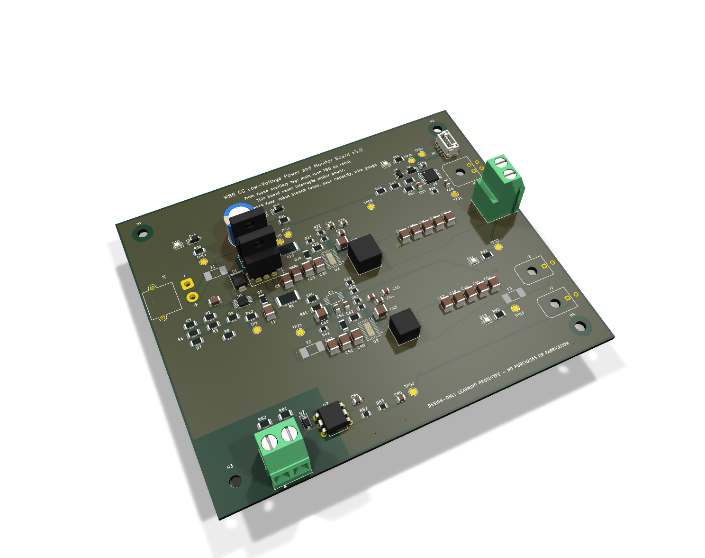
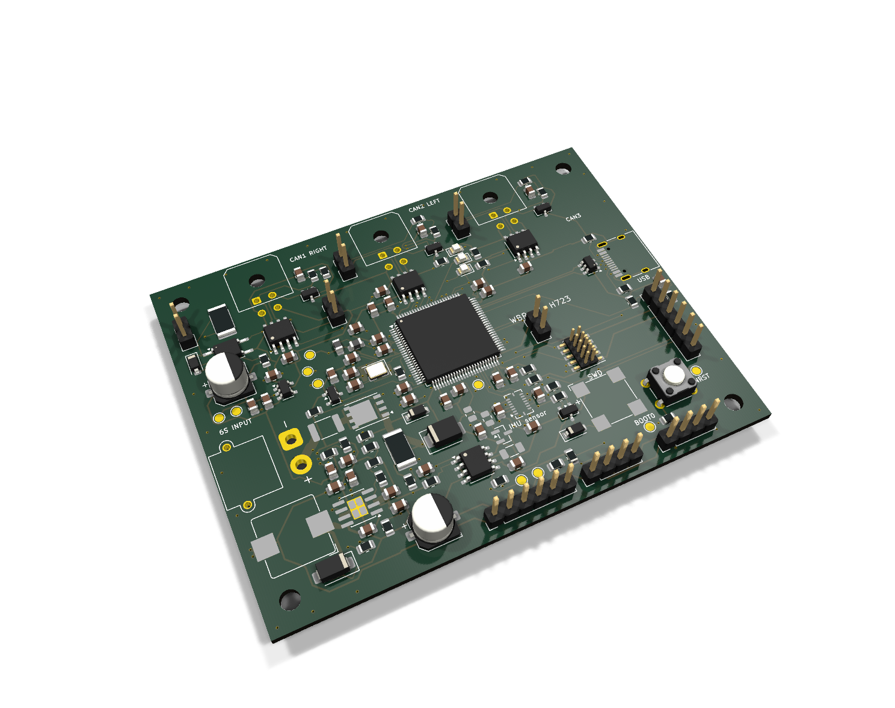
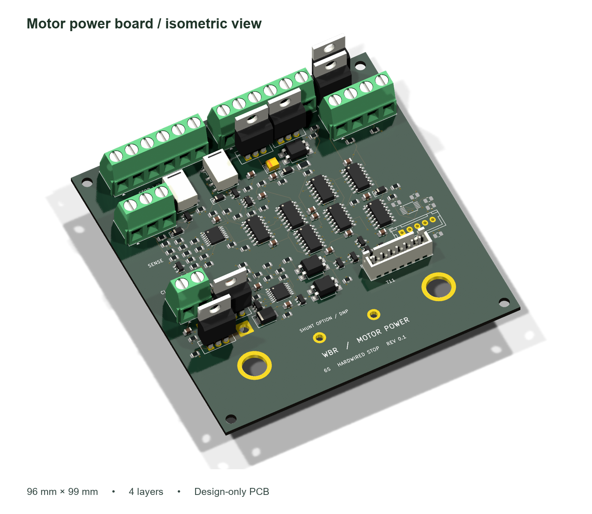
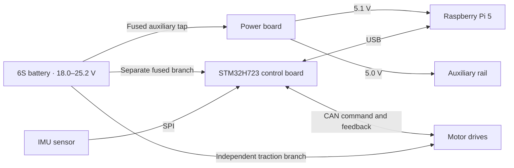

**Tóm tắt [FROM FILE / COMPUTED].** Bản mới nhất là AUX rev5 và CTRL rev4; hình bên dưới thuộc các bản lưu trước đó.

# Current public revisions

[FROM FILE / COMPUTED] [Revision evidence](../docs/evidence/hardware-control-board-revision.md).

| Revision | Editable source | Schematic | Checks |
| --- | --- | --- | --- |
| AUX rev5 | [Project](AUX/wbr_power.kicad_pro) | [PDF](AUX/schematic.pdf) | [ERC](AUX/checks/erc.json), [DRC](AUX/checks/drc.json) |
| CTRL rev4 | [Project](CTRL/CTRL.kicad_pro) | [PDF](CTRL/schematic.pdf) | [ERC](CTRL/checks/erc.json), [DRC](CTRL/checks/drc.json) |

[UNKNOWN] Both boards are design-only and require bench confirmation. The renders below show the earlier archived revisions.

# Wheel-biped electronics in KiCad 9

| 6S auxiliary power board | STM32H723 control board |
| --- | --- |
|  |  |
| [Top](../media/hardware/power-board-top.png) · [Bottom](../media/hardware/power-board-bottom.png) · [KiCad project](power-board/wbr_power.kicad_pro) · [Schematic PDF](power-board/schematic.pdf) | [Top](../media/hardware/control-board-top.png) · [Bottom](../media/hardware/control-board-bottom.png) · [KiCad project](control-board/control_board.kicad_pro) · [Schematic PDF](control-board/schematic.pdf) |

## Power board v3

**FROM FILE / COMPUTED** · The power board takes a fused auxiliary branch from a **6S, 18.0–25.2 V** pack. It combines input protection, independent 5.1 V Pi and 5.0 V auxiliary buck rails, power monitoring, and probe points. The stop-status circuit reports the status of an external loop. KiCad 9.0.9 found 0 ERC errors or warnings and 0 DRC errors, warnings, unconnected items or schematic-parity findings. [ERC summary](power-board/checks/erc.json) · [DRC summary](power-board/checks/drc.json)

## Control board v2

**FROM FILE / COMPUTED** · The STM32H723 board takes its own branch from the same **6S, 18.0–25.2 V** design supply and has onboard logic regulation. It connects to the motor drives over CAN, reads the onboard IMU sensor over SPI, and exchanges commands and telemetry with the Pi 5 over USB. KiCad 9.0.9 found 0 ERC errors or warnings and 0 DRC errors, warnings, unconnected items or schematic-parity findings. [ERC summary](control-board/checks/erc.json) · [DRC summary](control-board/checks/drc.json)

## Motor power board

[Top](../media/hardware/motor-power-board-top.png) · [KiCad project](motor-power-board/motor_power.kicad_pro) · [Schematic PDF](motor-power-board/schematic.pdf) · [ERC report](motor-power-board/checks/ERC.rpt) · [DRC report](motor-power-board/checks/DRC.rpt) · [BOM](motor-power-board/bom.csv)

**FROM FILE / COMPUTED** · The four-layer motor power board (96 × 99 mm, 70 µm outer copper, 35 µm inner copper, 1.60 mm stackup) manages the **6S, 18.0–25.2 V** traction feeder for all six motor drives. It controls two external series normally-open contactors with mirror-contact feedback, differential precharge through an external 3.0 Ω resistor (~0.85 V differential gate and hardware timer), a link-powered 1.5 Ω regenerative brake chopper (26.48 V rising / 25.99 V falling, ~27.95 V persistent overvoltage monitor), a 330 Ω passive bleeder, a dual-channel wired and supervised-radio safety relay latch with monitored reset, a logic permit and status connector to the STM32H723 control board, and an optional DNP feeder shunt and current monitor. KiCad 9.0.9 found 0 ERC errors, 0 ERC warnings, 0 PCB DRC violations, 0 unconnected pads, 0 footprint errors and 0 schematic parity issues across the six-page schematic.

**FROM FILE / UNKNOWN** · This board is **design-only, not fabricated**. No parts were purchased and the board has never been built or powered. Inrush current, precharge sequencing, contactor release and single-fault weld detection, clamp thermal margin and remote drive terminal overshoot, and wired/radio e-stop timing all require bench verification on a supported fixture.

## System connections

**FROM FILE** · The diagram shows the proposed system interfaces. The power board's auxiliary 5.0 V output is for a separate auxiliary load.

**FROM FILE / UNKNOWN** · These are **design-only learning boards**. No parts were purchased and the boards were never fabricated or powered. ERC and DRC check the configured schematic and layout rules. Thermal margin, load transients and e-stop behavior still require physical verification. Some component bodies are unavailable in the 3D library and appear as pads or outlines.

**FROM FILE** · The power board builds on the owner's earlier private **Edge AI Smart Power Module** project, carrying forward its input protection, buck rails, power monitoring and test-point organization. The control board follows the MCU pin and peripheral map in Trần Nguyên Bình's MIT-licensed **DM-jump CtrlBoard-H7** configuration. Library licensing and attribution are documented in [NOTICE.md](../NOTICE.md).
