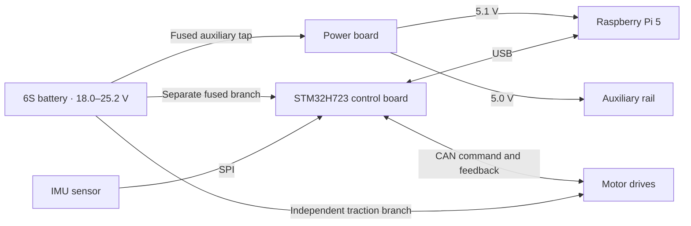

# Wheel-biped electronics in KiCad 9

| 6S auxiliary power board | STM32H723 control board |
| --- | --- |
|  |  |
| [Top](../media/hardware/power-board-top.png) · [Bottom](../media/hardware/power-board-bottom.png) · [KiCad project](power-board/wbr_power.kicad_pro) · [Schematic PDF](power-board/schematic.pdf) | [Top](../media/hardware/control-board-top.png) · [Bottom](../media/hardware/control-board-bottom.png) · [KiCad project](control-board/T11_custom_h723.kicad_pro) · [Schematic PDF](control-board/schematic.pdf) |

## Power board v3

**FROM FILE / COMPUTED** · The power board takes a fused auxiliary branch from a **6S, 18.0–25.2 V** pack. It combines input protection, independent 5.1 V Pi and 5.0 V auxiliary buck rails, power monitoring, and probe points. The stop-status circuit reports the status of an external loop. KiCad 9.0.9 found 0 ERC errors or warnings and 0 DRC errors, warnings, unconnected items or schematic-parity findings. [ERC summary](power-board/checks/erc.json) · [DRC summary](power-board/checks/drc.json)

## Control board v2

**FROM FILE / COMPUTED** · The STM32H723 board takes its own branch from the same **6S, 18.0–25.2 V** design supply and has onboard logic regulation. It connects to the motor drives over CAN, reads the onboard IMU sensor over SPI, and exchanges commands and telemetry with the Pi 5 over USB. KiCad 9.0.9 found 0 ERC errors or warnings and 0 DRC errors, warnings, unconnected items or schematic-parity findings. [ERC summary](control-board/checks/erc.json) · [DRC summary](control-board/checks/drc.json)

## System connections

**FROM FILE** · The diagram shows the proposed system interfaces. The power board's auxiliary 5.0 V output is for a separate auxiliary load.

**FROM FILE / UNKNOWN** · These are **design-only learning boards**. No parts were purchased and the boards were never fabricated or powered. ERC and DRC check the configured schematic and layout rules. Thermal margin, load transients and e-stop behavior still require physical verification. Some component bodies are unavailable in the 3D library and appear as pads or outlines.

**FROM FILE** · The power board builds on the owner's earlier private **Edge AI Smart Power Module** project, carrying forward its input protection, buck rails, power monitoring and test-point organization. The control board follows the MCU pin and peripheral map in Trần Nguyên Bình's MIT-licensed **DM-jump CtrlBoard-H7** configuration. Library licensing and attribution are documented in [NOTICE.md](../NOTICE.md).
