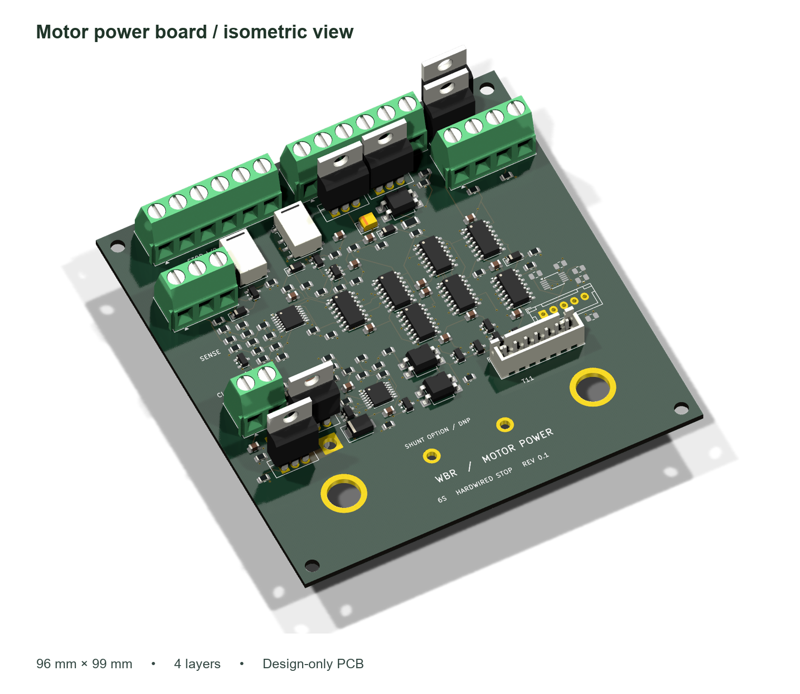
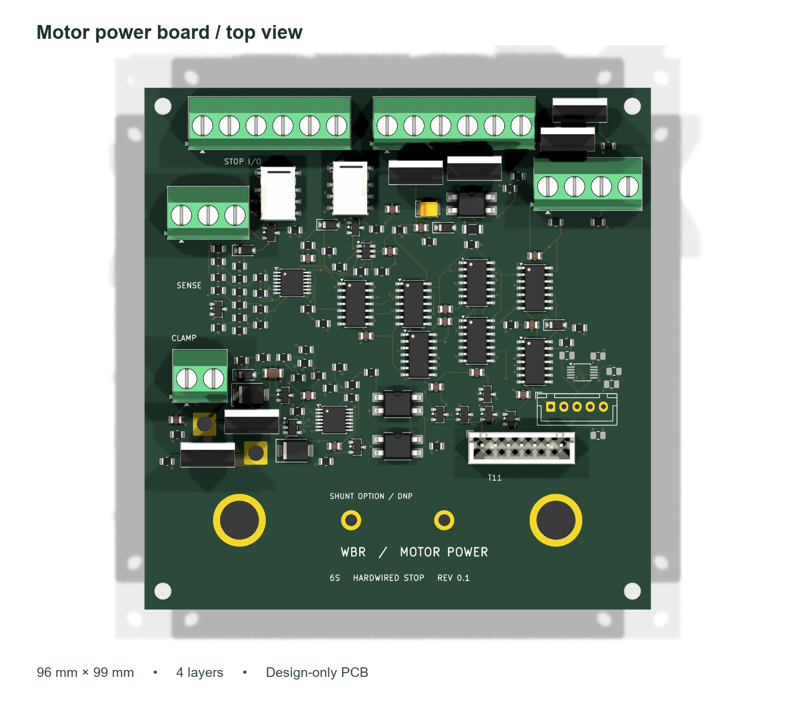
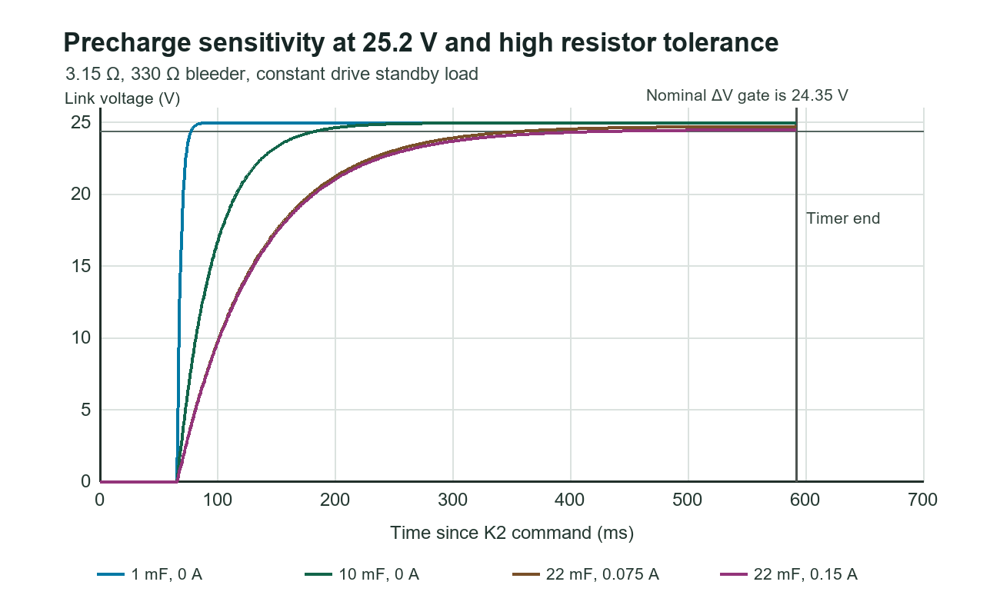

# Motor power board — rev 2 design study

**Tóm tắt [FROM FILE].** Đây là nghiên cứu thiết kế, chưa chế tạo. Sơ đồ rev 2 fix 4 có ERC 0 lỗi / 0 cảnh báo. Chưa được phát hành để sản xuất: cần đối chiếu footprint relay với bản vẽ khoan chính thức và xác nhận định mức Q1/D11 cho HW3.

[FROM FILE: supplied rev 2 fix 4 ERC] **Design study only; not fabricated.** The current [ERC report](checks/ERC.rpt) reports **0 errors and 0 warnings**. This is schematic consistency evidence, not a safety certification.

- [KiCad project](motor_power.kicad_pro), [root schematic](motor_power.kicad_sch), [PCB](motor_power.kicad_pcb) and [schematic PDF](schematic.pdf).
- [BOM](bom.csv), [symbols](motor_power_symbols.kicad_sym), [footprints](MotorPower.pretty/), and project-relative symbol/footprint tables.
- [Inherited ERC](checks/ERC-inherited.rpt), [inherited DRC](checks/DRC.rpt), [rating rows](S13_rating_rows.csv), [precharge sweep](precharge_sweep.csv) and [pinout comparison](pinout_diff.csv).

## Open pre-fabrication gates

[FROM FILE: supplied rev 2 review/fix notes] Verify the Elesta relay footprint pad positions and pin ordering against the official drilling drawing; the library still carries an unverified marker. Qualify Q1/D11 pulse, transient and thermal ratings against HW3 conditions. Synchronize the PCB, BOM, exported PDF and renders to the approved schematic, then rerun ERC/DRC before manufacturing. The supplied DRC is dated 22 November and the renders show `REV 0.1`; they are inherited layout illustrations, not rev 2 fabrication approval.

## Figures

[FROM FILE] Supplied illustrations, with white backgrounds; no mesh files are distributed:

## Design scripts

[FROM FILE] `design.py`, `circuit.py` and `board.py` are inherited generation scripts requiring KiCad 9 libraries/Python. They predate the manual rev 2 fixes: running them can overwrite those fixes. Keep an independent copy before regenerating. `design_checks.py` repeats the reduced precharge/rating analysis from external S13 input CSVs; point it at an explicit data directory with `--s13-dir`. Those full input sweeps are not included; the exported rating rows and precharge sweep are included. A missing input is an error, never a validation pass.

## What this teaches

[STANDARD PRACTICE] ERC checks electrical declarations; DRC checks layout constraints. Neither establishes component pulse capability or safe stopping. Capacitor charging follows C dV/dt = (Vpack − V)/R − Iload − V/Rbleed; standby load and resistance tolerance change whether the link reaches its gate before the timer ends.

## What the real robot must confirm

[UNKNOWN] Actual drive limits, regenerative pulses, clamp temperature, stop-chain timing, contactor feedback, standby load and relay mounting remain to be measured. The [sim-to-real checklist](../../docs/sim-to-real/sim-to-real-checklist.md) records the proposed measurements.
