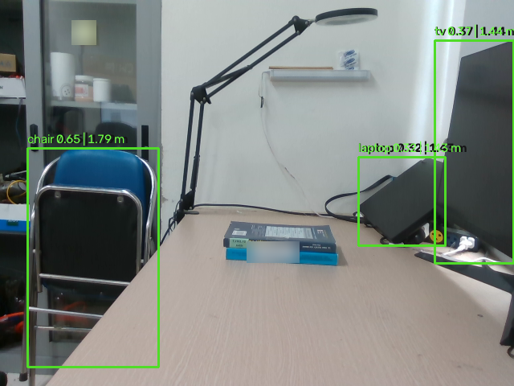
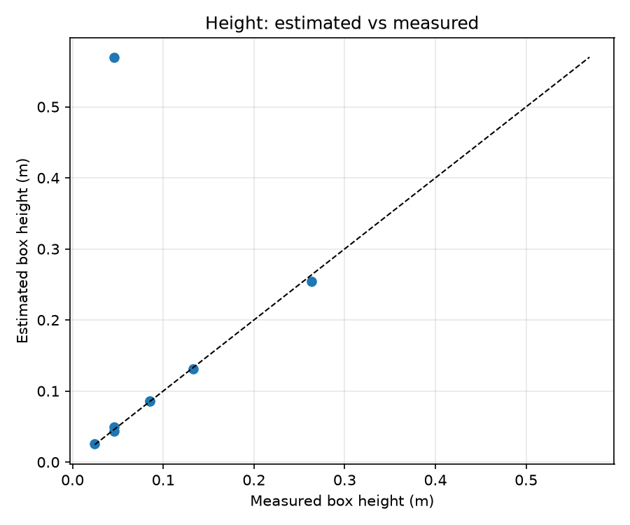
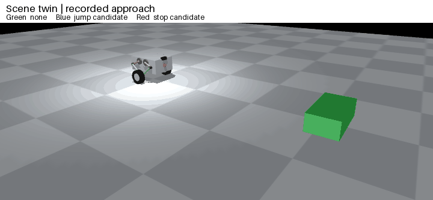
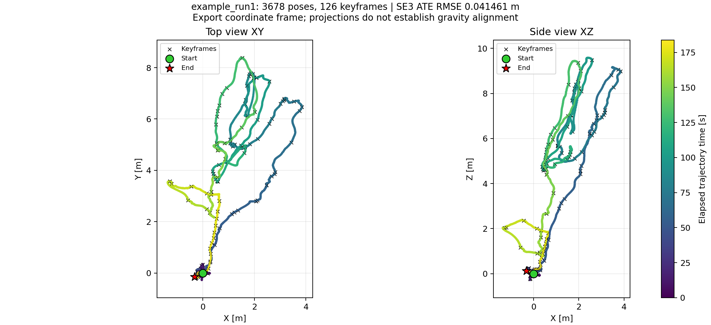
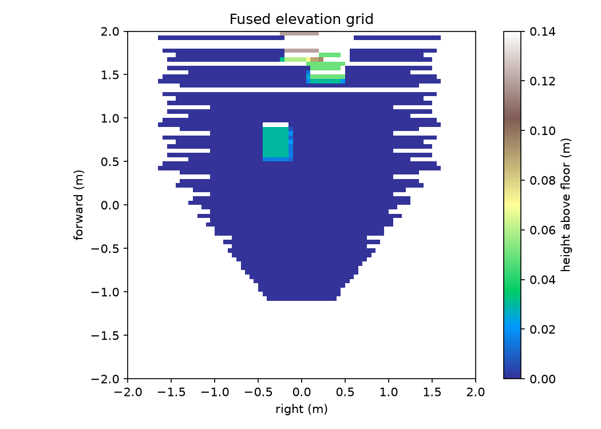

# WBR perception

**FROM FILE.** YOLO11n draws boxes on recorded lab colour images and reads distances from aligned RealSense depth. The model detected furniture in this frame and missed the books on the table. [Detector bench and limits](docs/evidence/yolo-overlay.md)

| Lab obstacle decision | Recorded approach replay |
| --- | --- |
|  |  |
| **FROM FILE.** All seven box runs at 0.5–1.0 m passed the saved height and range tolerances and matched their expected advisory. The 1.3 m run overestimated height and recommended stopping. [Lab results](tools/obstacle_decision/results/lab-20261024/evaluation.md) | **FROM FILE.** The digital twin replays recorded detector packets. Box colour follows the advisory and the robot's motion is inferred from range. [Replay method and receipt](docs/evidence/scene-twin.md) |

**FROM FILE.** The B-H13 lab fixture is shown in the [camera frame](media/obstacle-camera.jpg) and the [depth and corridor diagnostic](media/obstacle-points.png).

| Stereo-inertial SLAM | Ground plane and local map |
| --- | --- |
|  |  |
| **FROM FILE.** Native ORB-SLAM3 on the Pi 5 averaged 0.040 m SE(3)-aligned trajectory RMSE across three runs of EuRoC MH01. [Benchmark and power caveat](docs/evidence/euroc-mh01.md) | **FROM FILE.** The per-frame floor fit reached 0.995 precision and 0.984 recall on a 45-scene synthetic sweep. The local map fuses height above floor over 16 synthetic frames. [Plane report](tools/ground_plane/REPORT.md), [range plot](media/ground-plane-recall.png), [local map report](tools/local_map/REPORT.md) |

## Run it

- **FROM FILE.** [Pi 5 bring-up](docs/pi5-bring-up.md), [lab-day runbook](docs/lab-day.md), [architecture](docs/architecture.md), and [project state](docs/project-state.md).
- **FROM FILE.** [ROS 2 packages](ros2), [calibration tools](calibration), [analysis and bench tools](tools), and [host tests](docs/testing.md).
- **FROM FILE.** [Synthetic Blender/YOLO workflow](docs/synthetic-perception.md) and [experimental RTAB-Map launch](ros2/rtabmap) are companion workflows.
- **FROM FILE.** Dependency pins, project credits and upstream terms are in [THIRD_PARTY.md](THIRD_PARTY.md). Historical logs and inputs are at the [Phase 1 source revision](https://github.com/KaiserRichard/wbr-perception-phase1-runtime/tree/fde5721af0627eaf60c78d95296ab26924425e37).

## Limits

**FROM FILE.** The empty-floor run generated a false stop and the far wall failed the range criterion. The EuRoC benchmark covers one sequence and its speed figures were affected by Pi under-voltage. The STM32 owns balance, torque and safety. Perception publishes candidate advisories.

AI coding tools were used for the code, experiments and write-ups; the author reviewed and is responsible for all content.
