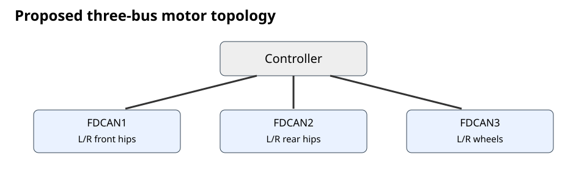

# Motor IDs and CAN commissioning

**Summary.** The proposed map assigns six unique command IDs and six separate reply IDs across three buses. Configure each drive while disarmed, confirm IDs and feedback on the expected bus, and reconcile wheel codec limits before control; the existing DBC and firmware use different wheel torque scales. [FROM FILE]

## Proposed map

| Axis | Bus | Command ID | Feedback ID |
|---|---|---:|---:|
| Left front hip | FDCAN1 | `0x001` | `0x011` |
| Left rear hip | FDCAN2 | `0x002` | `0x012` |
| Left wheel | FDCAN3 | `0x003` | `0x013` |
| Right front hip | FDCAN1 | `0x004` | `0x014` |
| Right rear hip | FDCAN2 | `0x005` | `0x015` |
| Right wheel | FDCAN3 | `0x006` | `0x016` |

[FROM FILE; source map provenance is listed in `NUMBERS.md`; cross-check `tools/can/wbr_dm.dbc`]

## Commissioning method

Keep the robot disarmed. Configure and read back one motor at a time; verify the command and feedback IDs, bus assignment, feedback payload motor ID, codec scaling, and lifecycle commands. Confirm duplicate IDs and wrong-bus frames are rejected before arming. The map is a proposed commissioning contract, not evidence that the borrowed hardware is configured this way. [FROM FILE / STANDARD PRACTICE]

## Results and limits

| Check | Result |
|---|---|
| Proposed command / feedback IDs | Globally unique `0x001`–`0x006` / `0x011`–`0x016` [FROM FILE] |
| Bus topology | Two axes per FDCAN bus [FROM FILE] |
| Wheel codec scale | DBC and firmware ranges disagree; resolve before using wheel torque values [FROM FILE] |
| Hardware commissioning | Not confirmed by this map [UNKNOWN] |

The existing DBC files are next to this page. This document does not update firmware, motor nonvolatile settings, or the DBC. [FROM FILE]

## What this teaches

CAN arbitration IDs route frames; the payload also identifies the motor and encodes scaled command values. Unique IDs prevent address collisions, while matching codec limits prevents a syntactically valid frame from commanding a different physical torque than intended. Bus assignment and hardware ID configuration must be checked together. [STANDARD PRACTICE]

## Reproduce

Cross-check each ID and bus against `tools/can/wbr_dm.dbc`. While disarmed, capture register reads and feedback frames; log the motor, bus, ID, payload, and decoded units. [FROM FILE / STANDARD PRACTICE]

## What the real robot must confirm

Verify all six driver IDs, actual bus wiring, wheel torque scaling registers, motor direction, feedback payload IDs, and safe lifecycle behavior before an armed run. [UNKNOWN]

## Figure

